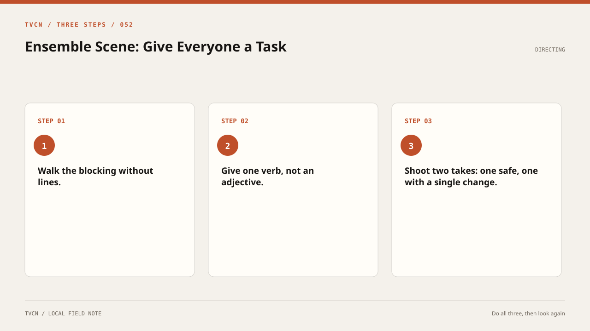

A group scene is chaotic not because there are many people but because power is unclear. Draw a gaze map: who wants to speak, who blocks, who watches. Every position and look answers those three questions.

<!-- DIAGRAM_START -->
<h2>Diagram</h2>
<figure>
  
  <figcaption>Watch “Give each person an action and a goal:” and “Fill one page before rolling so nobody stands”; judge whether the want can be said with one visible action.</figcaption>
</figure>
<!-- DIAGRAM_END -->
<section><h2 id="section-1">Ensemble scenes start with who watches whom</h2>
Give each person a continuous action—pour water, collect cups, flick a lighter. Actions layer the scene without everyone speaking.
<h2 id="section-2">Limits</h2>
Ensemble is not equal dialogue. Someone can be silent the whole scene, but their reaction must change the pressure.
</section><section><h2 id="section-3">On set</h2>
In an ensemble scene, give everyone an action and an objective: one looks for keys, one avoids a call, one waits for someone. Fill a page before rolling.
</section><section><h2 id="section-4">Do this</h2>
In an ensemble scene everyone has something to do; otherwise it is a row waiting for lines.
<ol><li>Give each person an action and a goal: find keys, avoid a call, wait for someone.</li><li>Fill one page before rolling so nobody stands empty in the background.</li><li>Let the actions interfere so relationships appear.</li></ol></section><section><h2 id="section-5">Avoid</h2>
Do not line up extras waiting for lines; an empty background makes the space fake.
</section><section><h2>Judge</h2>
This page passes on three observable checks, not slogans:
<ul><li><strong>1.</strong> Everyone in frame has an action and a goal; nobody stands empty.</li><li><strong>2.</strong> At least two actions interfere and a relationship becomes visible.</li><li><strong>3.</strong> Remove any one action and the space visibly empties.</li></ul></section><section><h2>Failures</h2>
Any one of these means stop and fix it before post:
<ul><li><strong>1.</strong> Check 1 is only staged (“Everyone in frame has an action and a goal; no…”); another camera position or location exposes it.</li><li><strong>2.</strong> Check 2 is left to post or a verbal explanation (“At least two actions interfere and a relations…”); nothing on set can be rechecked.</li><li><strong>3.</strong> Do not line up extras waiting for lines; an empty background makes the space fake.</li></ul></section><section><h2>Extend</h2>
<strong>10-minute exercise:</strong> Write one 30-second scene with only “Give each person an action and a goal:” and “Fill one page before rolling so nobody stands”. Cut every explanation and ask one person to retell what the character wants.
</section>
<h2>Check</h2><ul><li>Everyone in frame has an action and a goal; nobody stands empty.</li><li>At least two actions interfere and a relationship becomes visible.</li><li>Remove any one action and the space visibly empties.</li></ul>

<!-- SOURCES_START -->
## References and further reading

- [S42] [Pixar in a Box: Storytelling](https://www.khanacademy.org/partner-content/pixar) — Accessed 2026-11-26. Used to check the terminology/method/rule in the “Ensemble scenes start with who watches whom” section against Pixar storytelling course, not project pricing; it does not verify numbers, model choices or on-set conclusions derived from this page, and is not a substitute for a test.
- [S16] [BBC: Editorial Guidelines](https://www.bbc.co.uk/editorialguidelines/) — Accessed 2026-11-26. Used to check the terminology/method/rule in the “Limits” section against BBC editorial guidelines, not platform growth rules; it does not verify numbers, model choices or on-set conclusions derived from this page, and is not a substitute for a test.
<!-- SOURCES_END -->

