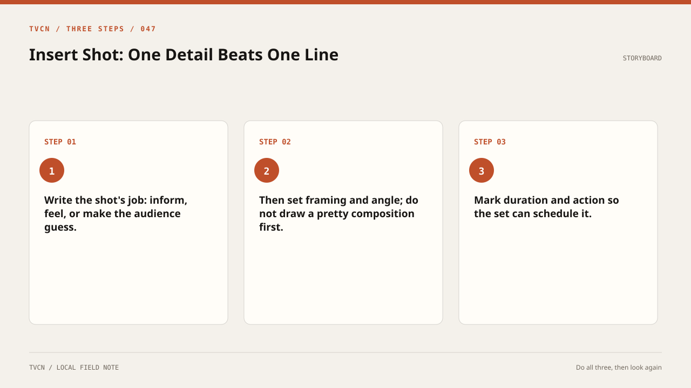

An insert can replace a line: a shaking hand, a cup rim, an open door.

<!-- DIAGRAM_START -->
<h2>Diagram</h2>
<figure>
  
  <figcaption>Do the three steps in order, then look again at the image or file.</figcaption>
</figure>
<!-- DIAGRAM_END -->
<h2>On set</h2>

List three shootable details per scene: fingers, a cup rim, a door gap. Cut to one for 1 to 2 seconds before the key line, with no explanation.

<h2>Do this</h2>

An insert can replace a line: a shaking hand, a cup rim, an unclosed door says more than explanation.
<ol><li>List three filmable details per scene: fingers, cup rim, door gap.</li><li>Cut one in one to two seconds before the key line.</li><li>Do not add explanation; let the detail speak.</li></ol>
<h2>Avoid</h2>

Do not use an insert as decoration; if it carries no information, cut it.

<h2>Check</h2>
<ul><li>The insert carries a specific piece of information, not just beauty.</li><li>It runs one to two seconds and cuts before the key line.</li><li>Remove it and information goes missing, proving it replaced a line.</li></ul>
