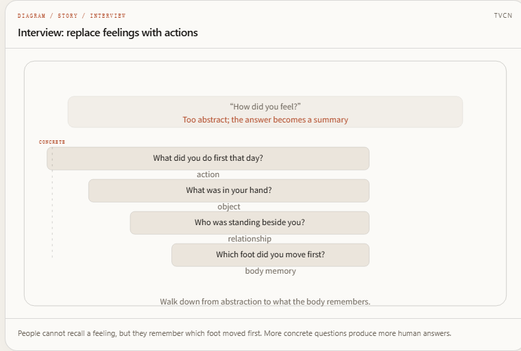

<!-- DIAGRAM_START -->
## Diagram

<figure>
  
  <figcaption>People cannot recall a feeling, but they remember which foot moved first. More concrete questions produce more human answers.</figcaption>
</figure>
<!-- DIAGRAM_END -->

## Ask what happened that day

Ask ten people “how did you feel” and eight will say “terrible” or “happy.” They are not stonewalling; the question is too big. Ask what time they left the house and where they went first, and they start looking for keys and bus cards. The words come with the actions.

I watched a reporter spend twenty minutes asking a market vendor whether the work was hard. He kept saying “it’s okay.” Then she asked what time he arrives and what he does first. He talked for half an hour about laying ice and keeping the scale from getting knocked. The audience remembers the ice, not the word “hard.”

## Leave three seconds of silence

When they stop talking, do not jump in. A lot of the truth arrives around second three. Nod, look at your notes, wait. They often add, “Actually, there is one more thing.”

That gap is not dead footage. In the edit, those three seconds are often where the audience enters the person. If the interviewer grabs the turn back, the subject returns to “being interviewed.”

## Check names and numbers before wrap

Read names, places, ages, and amounts back to them before you pack up. “Wang” and “Wong,” “fourteen” and “forty” sound alike on a recording and look wrong once subtitled.

Then ask what cannot be published. Someone may be willing to talk but not willing to be seen by their employer. Draw that line now; it is cheaper than taking the film down later.

## Three checks

- The first three questions can be answered in one sentence and contain an action.
- At least one silence longer than three seconds survived the edit.
- Names, places, and numbers were checked on site.

<!-- V11_DEEPEN -->

> Intent split: this page covers the practical details of “Stop Asking “How Did You Feel”: Ask for an Action”; start with <a href="https://formats.tvcn.org/article/interview-structure/">Interview Structure: The Question Matters More</a> for the cluster-level judgement, then return here.

<!-- INTENT_SCOPE -->

<!-- SOURCES_START -->
## Experience note

Experience note:This page draws on 3 table reads, rehearsals or on-set reviews with one lead and a two-to-three-person crew; it covers the decisions and actions for “Stop Asking “How Did You Feel”: Ask for an Action”, not an external laboratory test, multi-camera, union crews, stunts or high-risk sets.
<!-- SOURCES_END -->

