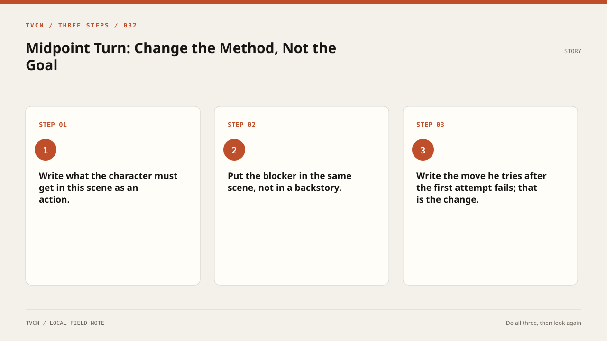

The midpoint is not a plot twist; it is the hero discovering that the old method fails and choosing a different approach. The goal remains, the cost rises, and the audience sees a choice rather than a writer pushing.

<!-- DIAGRAM_START -->
<h2>Diagram</h2>
<figure>
  
  <figcaption>Watch “Use one A4: old method on the left,” and “Write three concrete actions per column that look”; judge whether the want can be said with one visible action.</figcaption>
</figure>
<!-- DIAGRAM_END -->
<section><h2 id="section-1">Change the method, not the goal</h2>
Test it by writing “what he plans to do” before and after. If both lines say “try harder,” there is no turn. If the second line is a new action, the turn exists.
<h2 id="section-2">Limits</h2>
Do not let a new character or a new piece of information make the decision. The midpoint must turn on his own action, or the final choice has no weight.
</section><section><h2 id="section-3">On set</h2>
On one page, put the old method on the left and the new method on the right; the goal line stays the same. Three concrete actions in each column so the change is visible.
</section><section><h2 id="section-4">Do this</h2>
Midpoint is not a plot twist; the character changes method for the same goal.
<ol><li>Use one A4: old method on the left, new method on the right, goal unchanged above.</li><li>Write three concrete actions per column that look different on screen.</li><li>Shoot the difference so the audience sees the method change, not hears “I changed.”</li></ol></section><section><h2 id="section-5">Avoid</h2>
Do not make midpoint a twist; same goal, new method is the turn.
</section><section><h2>Judge</h2>
This page passes on three observable checks, not slogans:
<ul><li><strong>1.</strong> The goal line is identical before and after midpoint; it is not swapped.</li><li><strong>2.</strong> Each column has three filmable actions and the methods look different.</li><li><strong>3.</strong> Without dialogue, the audience can name what method changed.</li></ul></section><section><h2>Failures</h2>
Any one of these means stop and fix it before post:
<ul><li><strong>1.</strong> Check 1 is only staged (“The goal line is identical before and after mi…”); another camera position or location exposes it.</li><li><strong>2.</strong> Check 2 is left to post or a verbal explanation (“Each column has three filmable actions and the…”); nothing on set can be rechecked.</li><li><strong>3.</strong> Do not make midpoint a twist; same goal, new method is the turn.</li></ul></section><section><h2>Extend</h2>
<strong>10-minute exercise:</strong> Write one 30-second scene with only “Use one A4: old method on the left,” and “Write three concrete actions per column that look”. Cut every explanation and ask one person to retell what the character wants.
</section>
<h2>Check</h2><ul><li>The goal line is identical before and after midpoint; it is not swapped.</li><li>Each column has three filmable actions and the methods look different.</li><li>Without dialogue, the audience can name what method changed.</li></ul>

<!-- DEEP_DIVE_START -->
## Deep dive

<strong>About 5 minutes.</strong> The midpoint is not a twist. It is a change of method: the goal stays, the road is closed.

### At the midpoint, ask about method

The first half pursues the goal with method A; at the midpoint A fails and B becomes necessary. The second half exists because the method changed.

If the midpoint is only “another obstacle,” it is repetition, not a turn. The hero still uses the same method and the audience already knows the result.

The new method must cost something to learn: asking someone he avoids, learning a skill he lacks, giving up something he values.

### Do not change the goal

Change the goal and the audience’s earlier investment is cancelled. A swapped goal suits comedy or fable, not most narrative.

Change the method, ally, place, or timeline, not “what he really wanted was something else.” The latter makes the audience feel tricked.

If the goal must change, first prove the old goal impossible, then let the new goal grow out of it. The audience needs to see the cause.

### The midpoint must cost something

A change of method must lose something: money, an ally, time. Without a cost, the turn is only a reminder.

The cost must be filmable: selling the car, signing the debt, breaking with a friend. Do not cover it with “he is sad.”

After the midpoint, method A must be truly unavailable. If the second half can still solve the problem with A, the midpoint was fake.

### Shoot the midpoint as a scene

Let the hero fail with the old method in front of someone; the audience sees it without narration. The first try with the new method should be clumsy, not instantly skilled.

The failure needs a witness: opponent, ally, or client. A failure nobody sees feels reversible.

### Five-minute drill: four lines

Write four lines: the first-half method, why it fails, the new method, and the cost. If one line is missing, rewrite.

Remove the new method and see whether the second half still works. If it does, the midpoint did not change the story.

### Ten midpoint checks
<ul><li>Method changes, not goal</li><li>The old method worked first</li><li>The midpoint proves it fails</li><li>The new method has a learning cost</li><li>The cost is filmable</li><li>An ally or resource is lost</li><li>The old method cannot return</li><li>The new method grows from the old goal</li><li>Pace changes after the midpoint</li><li>No missing line in the four-line sheet</li></ul>
The midpoint is not there to complicate the story; it closes the road the character was using.

<!-- DEEP_DIVE_END -->

<!-- SOURCES_START -->
## References and further reading

- [S41] [WGA: Contract and Credit Resources](https://www.wga.org/) — Accessed 2026-11-26. Used to check the terminology/method/rule in the “Change the method, not the goal” section against WGA contract and credit resources, not Chinese employment law; it does not verify numbers, model choices or on-set conclusions derived from this page, and is not a substitute for a test.
- [S42] [Pixar in a Box: Storytelling](https://www.khanacademy.org/partner-content/pixar) — Accessed 2026-11-26. Used to check the terminology/method/rule in the “Limits” section against Pixar storytelling course, not project pricing; it does not verify numbers, model choices or on-set conclusions derived from this page, and is not a substitute for a test.
<!-- SOURCES_END -->

