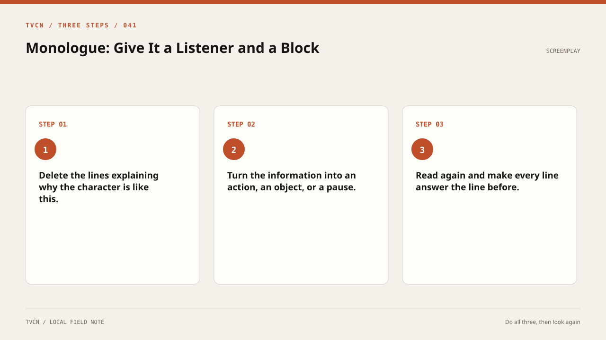

A monologue needs a listener who cannot easily leave and does not quite want to hear it.

<!-- DIAGRAM_START -->
<h2>Diagram</h2>
<figure>
  
  <figcaption>Do the three steps in order, then look again at the image or file.</figcaption>
</figure>
<!-- DIAGRAM_END -->
<h2>On set</h2>

Before the monologue, place a listener: someone packing, a child facing away. Give the speaker a task that keeps interrupting the speech.

<h2>Do this</h2>

A monologue is not a speech to air; it needs a listener who does not want to hear but cannot leave.
<ol><li>Place a listener: someone packing, a child with their back turned.</li><li>Give the speaker an action that interrupts the speech.</li><li>Keep the listener's reaction in frame; they are not background.</li></ol>
<h2>Avoid</h2>

Do not play the monologue to a mirror or empty air; without a listener it feels false.

<h2>Check</h2>
<ul><li>A listener is trapped in frame and their reaction is visible.</li><li>The speaker does an action that interrupts the speech.</li><li>Remove the listener and the monologue weakens, proving the relationship matters.</li></ul>
