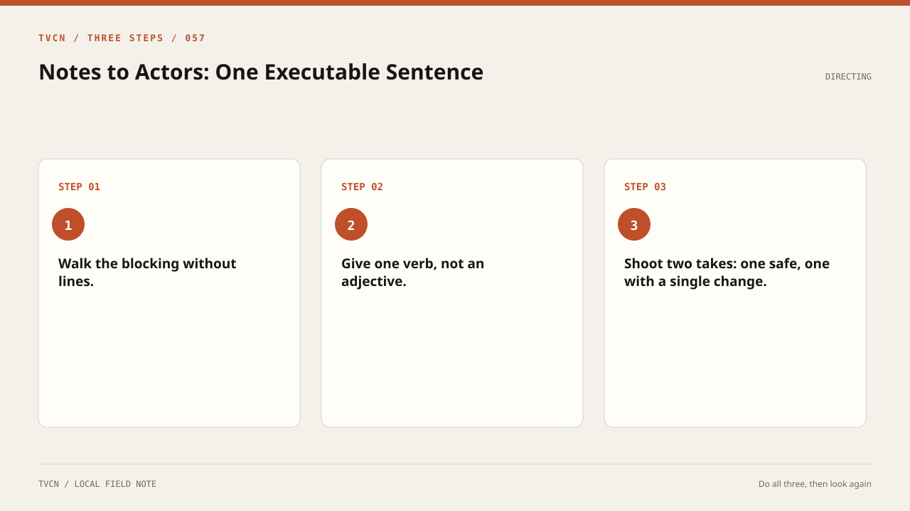

One executable sentence is enough for an actor; three suggestions add up to none.

<!-- DIAGRAM_START -->
<h2>Diagram</h2>
<figure>
  
  <figcaption>Do the three steps in order, then look again at the image or file.</figcaption>
</figure>
<!-- DIAGRAM_END -->
<h2>On set</h2>

Write the note as one change for the next take: walk half a beat slower, look at the cup before the person. Say it, let them do it, and stop talking.

<h2>Do this</h2>

One executable note is enough; three suggestions equal none.
<ol><li>Write the next take as one change: walk half a beat slower.</li><li>Or eyes go to the cup first, then the person.</li><li>Say it, let the actor do it, and stop adding explanation.</li></ol>
<h2>Avoid</h2>

Do not give three notes at once; the actor can execute one.

<h2>Check</h2>
<ul><li>Each note contains one executable action.</li><li>The actor can do it immediately without asking “how exactly.”</li><li>The next take changes only that one thing and holds the rest.</li></ul>
