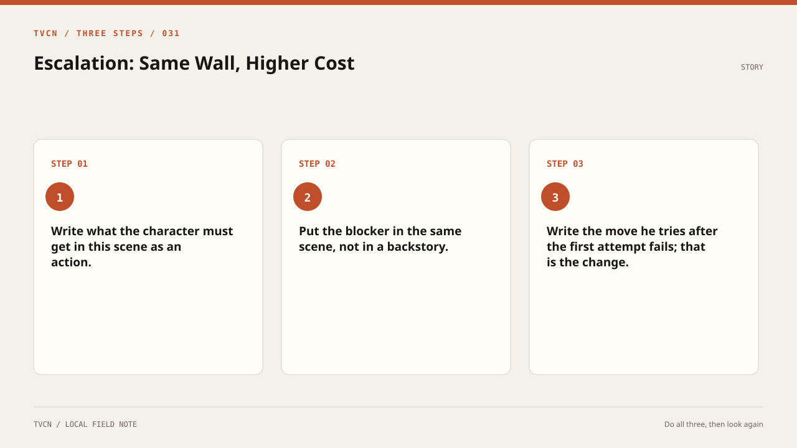

Obstacle escalation is not piling more misfortune on the hero. It makes the same goal demand a higher price each time: first face, then time, then a relationship. The audience stays because the next choice is harder than the last.

<!-- DIAGRAM_START -->
<h2>Diagram</h2>
<figure>
  
  <figcaption>Watch “First refusal costs one sentence.” and “Second costs time, such as a wasted day.”; judge whether the want can be said with one visible action.</figcaption>
</figure>
<!-- DIAGRAM_END -->
<section><h2 id="section-1">Escalate the cost, not the bad luck</h2>
Keep a three-column sheet: the goal, what blocks it this time, and what is lost if it fails. If any column does not change, the scene is still standing in place.
<h2 id="section-2">Limits</h2>
In a 60–90 second short, two escalations are enough; a third usually squeezes out the ending. Do not replace “harder choice” with “worse luck.”
</section><section><h2 id="section-3">On set</h2>
Put three obstacles in one scene: the first turns them back with a sentence, the second costs time, the third costs a relationship. Each one takes more than the last.
</section><section><h2 id="section-4">Do this</h2>
Hit the same obstacle three times with rising cost, or the character never seems cornered.
<ol><li>First refusal costs one sentence.</li><li>Second costs time, such as a wasted day.</li><li>Third costs a person or a relationship and forces a choice.</li></ol></section><section><h2 id="section-5">Avoid</h2>
Do not swap in a new obstacle each time; without escalation, pressure never accumulates.
</section><section><h2>Judge</h2>
Three signals are observable on set:
<ul><li>the want is visible in one action</li><li>the obstacle escalates inside the same scene</li><li>delete one expository line and the conflict still holds</li></ul></section><section><h2>Failures</h2>
These three moves erase the detail you just built:
<ul><li>the want is unclear and the scene is only mood</li><li>the obstacle is solved by coincidence, not a decision</li><li>dialogue repeats what the image already says</li></ul></section><section><h2>Extend</h2>
<strong>10-minute exercise:</strong> Write one 30-second scene with only “First refusal costs one sentence.” and “Second costs time, such as a wasted day.”. Cut every explanation and ask one person to retell what the character wants.
</section>
<h2>Check</h2><ul><li>All three refusals come from the same obstacle, not three new troubles.</li><li>Each cost is higher: a sentence, a day, a person.</li><li>After the third, the character must choose and cannot go back unchanged.</li></ul>

> Intent split: this page covers the practical details of “Escalation: Same Wall, Higher Cost”; start with <a href="https://story.tvcn.org/article/midpoint-turn/">Midpoint Turn: Change the Method, Not the Goal</a> for the cluster-level judgement, then return here.

<!-- INTENT_SCOPE -->

<!-- SOURCES_START -->
## Experience note

Experience note: this page draws on 3 table read and pre-shoot rehearsal reviews under a three-to-eight-page scene with one primary point of view; it discusses “Escalation: Same Wall, Higher Cost”; no external laboratory test was run, and the conclusion may not transfer when conditions change.
<!-- SOURCES_END -->

