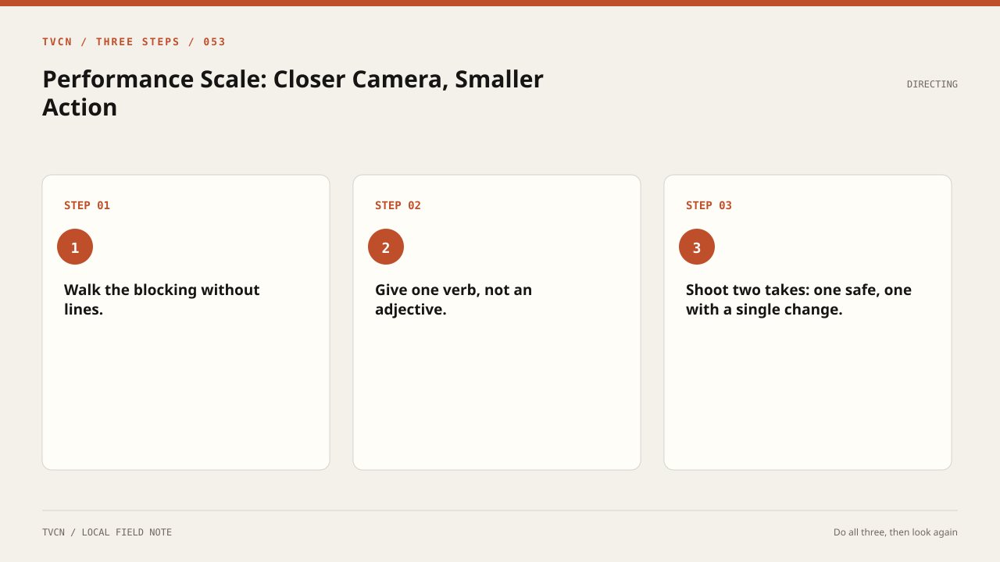

The closer the camera, the smaller the action; a gesture that works wide looks acted in a close-up.

<!-- DIAGRAM_START -->
<h2>Diagram</h2>
<figure>
  
  <figcaption>Do the three steps in order, then look again at the image or file.</figcaption>
</figure>
<!-- DIAGRAM_END -->
<h2>On set</h2>

Rehearse the wide with large gestures, then halve them for the close-up. Before the close-up, shoot a hand insert to check the action does not look performed.

<h2>Do this</h2>

The closer the shot, the smaller the action; a gesture that works wide looks theatrical close.
<ol><li>Rehearse the wide with larger actions so spatial relationships read.</li><li>Before the close-up, ask the actor to halve the action.</li><li>Shoot a hand close-up first and confirm it does not look performed.</li></ol>
<h2>Avoid</h2>

Do not use one performance scale for every size; the close-up magnifies acting.

<h2>Check</h2>
<ul><li>Wide and close actions differ visibly, with the close halved.</li><li>The hand close-up looks natural in joints and pressure.</li><li>Put the close action back into the wide and it feels too small, proving the scale.</li></ul>
