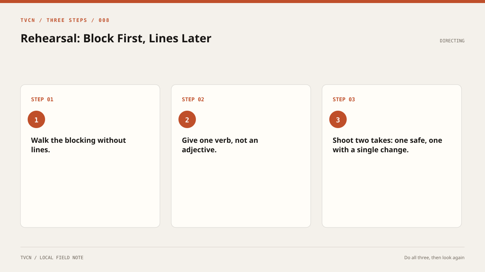

Block first, scripts in hand. Once the body is in the right place, the lines have somewhere to land.

<!-- DIAGRAM_START -->
<h2>Diagram</h2>
<figure>
  
  <figcaption>Do the three steps in order, then look again at the image or file.</figcaption>
</figure>
<!-- DIAGRAM_END -->
<h2>On set</h2>

Spend the first 20 minutes on blocking only: tape the door, the chair, and the camera. Walk it three times without lines; add lines on the third pass.

<h2>Do this</h2>

Rehearsal blocks first; lines can stay in hand. Once the body is in place, words have somewhere to land.
<ol><li>Spend the first twenty minutes on blocking only, taping door, chair, and camera.</li><li>Walk the actor through three times without lines, only action and pauses.</li><li>Add lines on the third pass and confirm they land on established positions.</li></ol>
<h2>Avoid</h2>

Do not shout “be natural” from behind the monitor; the actor cannot execute that.

<h2>Check</h2>
<ul><li>The first two passes have no lines, only positions and actions.</li><li>On the third pass, pauses still land on actions.</li><li>The actor can state what they want throughout the scene.</li></ul>

<!-- DEEP_DIVE_START -->
## Deep dive

<strong>About 5 minutes.</strong> Rehearsal is not line practice. It lets the body learn the space and the action first.

### Block first, lines later

Walk the scene without lines and mark the start, turn, sit, and prop touch. When the body knows where it goes, the line has somewhere to land.

Do not film the first pass. Let the actor find the rhythm; a recording is reference, not performance.

### Give verbs only

Do not say “be sadder.” Say “put the cup down and leave your hand on the table for two seconds.” An executable action gives the performance a base.

Change one action at a time. Change three and the actor will not know which one is right.

### Shoot a rehearsal wide

Shoot one wide and play it back to check blocking, exits, and repeated paths. The wide is not for the film; it is a checking tool.

Run the last pass from the final camera position without rolling. Let the actor see where the camera is, instead of discovering it on set.

### Rehearsal is not a performance for the director

Talk less in rehearsal. Let the actor walk it twice, then give one verb on the third pass. A body memory the actor finds is more reliable than a director’s instruction.

Put the phone away and do not record every pass; too much filming makes the actor play for the lens.

Run the last pass from the final camera position without makeup or rolling. Let the actor see where the camera is so they do not hide on the take. End with three notes: who is blocked, who exits frame, which action still feels unsafe.

If the actor asks what emotion to play, give an action, not an adjective.

### The last action of rehearsal

Ask the actor to repeat the opening action without lines, body only. Then ask where the hands want to be. Their answer is usually more accurate than your diagram.

Write it on the blocking sheet; do not keep it in your head. On a new location the next day, half the body memory is gone.

### Ten checks after rehearsal
<ul><li>Walked once without lines</li><li>Marked start, end, and turns</li><li>Tested sitting and standing</li><li>Touched every prop once</li><li>Gave verbs, not adjectives</li><li>Changed one action at a time</li><li>Checked blocking on the wide</li><li>Confirmed nobody exits frame</li><li>Ran the last pass from the final camera</li><li>Photographed the blocking diagram</li></ul>
Rehearsal keeps surprises in rehearsal and out of the first take.

<!-- DEEP_DIVE_END -->
