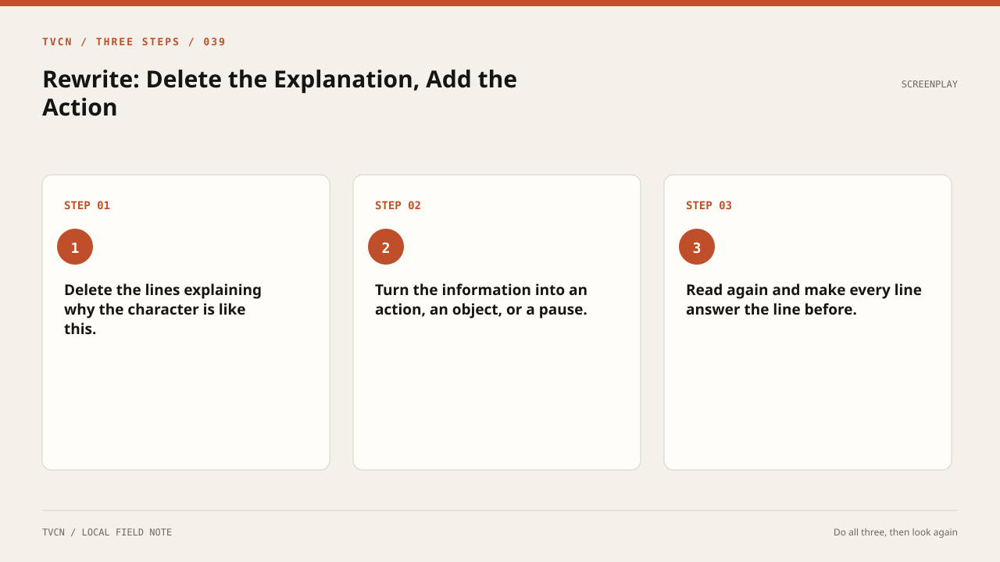

In a rewrite, delete the explanation and add a visible action; often they are the same fix.

<!-- DIAGRAM_START -->
<h2>Diagram</h2>
<figure>
  
  <figcaption>Do the three steps in order, then look again at the image or file.</figcaption>
</figure>
<!-- DIAGRAM_END -->
<h2>On set</h2>

Search the draft for because, so, and felt. Replace each with an action or an object; keep at most one explanatory sentence per page.

<h2>Do this</h2>

Rewrite by deleting explanation first, then adding one visible action; often they are the same fix.
<ol><li>Search for “because,” “so,” and “feels”; delete every hit.</li><li>Replace the deleted information with an action or object.</li><li>Keep at most one explanatory line per page and let the image carry the rest.</li></ol>
<h2>Avoid</h2>

Do not patch holes with explanation; more explanation means fewer actions.

<h2>Check</h2>
<ul><li>The page has no “because,” “so,” or “feels” explaining the action.</li><li>Deleted information now appears as a filmable action or object.</li><li>At most one explanatory line remains per page; the image carries the rest.</li></ul>
