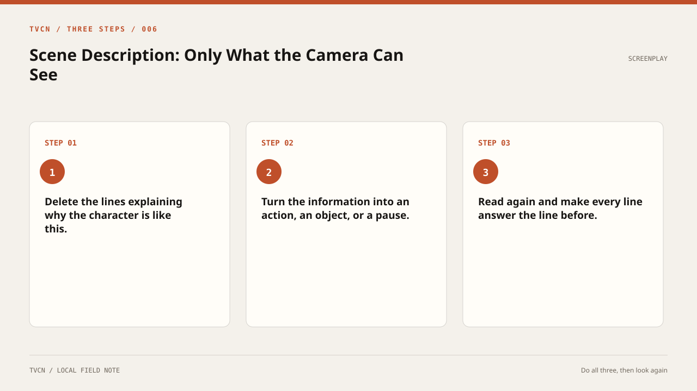

Scene description is not novelistic atmosphere. Write “one unwashed cup on the table, another soaking in the sink,” not “she feels her life out of control.” The first can be shot; the second can only be acted.

<!-- DIAGRAM_START -->
<h2>Diagram</h2>
<figure>
  
  <figcaption>Watch “Rewrite one page to visible and audible facts:” and “Delete “he is anxious” and replace it with”; judge whether the want can be said with one visible action.</figcaption>
</figure>
<!-- DIAGRAM_END -->
<section><h2 id="section-1">Write only what the camera can see and hear</h2>
Keep each paragraph to one or two actions and leave room for the director and art department; do not decide wallpaper or focal length for them.
<h2 id="section-2">Limits</h2>
Shootable is not a list. Every object must do something—advance action, show relationship or block it. Purely decorative props go.
</section><section><h2 id="section-3">On set</h2>
Rewrite one page as only what can be seen and heard: who sits where, what is in hand, what sound comes through the window. Delete he is anxious; let the actor show it by bouncing a knee or checking a watch.
</section><section><h2 id="section-4">Do this</h2>
Scene description writes only what the camera can see and the mic can hear: light, action, objects, sound. Psychology belongs to the actor.
<ol><li>Rewrite one page to visible and audible facts: who sits where, what is in hand, what sounds outside.</li><li>Delete “he is anxious” and replace it with an action: bouncing a leg, checking the door.</li><li>Read it once and confirm every line can be captured by camera or recorder.</li></ol></section><section><h2 id="section-5">Avoid</h2>
Do not let the character speak the theme; once spoken, the scene dies.
</section><section><h2>Judge</h2>
Three signals are observable on set:
<ul><li>the want is visible in one action</li><li>the obstacle escalates inside the same scene</li><li>delete one expository line and the conflict still holds</li></ul></section><section><h2>Failures</h2>
These three moves erase the detail you just built:
<ul><li>the want is unclear and the scene is only mood</li><li>the obstacle is solved by coincidence, not a decision</li><li>dialogue repeats what the image already says</li></ul></section><section><h2>Extend</h2>
<strong>10-minute exercise:</strong> Write one 30-second scene with only “Rewrite one page to visible and audible facts:” and “Delete “he is anxious” and replace it with”. Cut every explanation and ask one person to retell what the character wants.
</section>
<h2>Check</h2><ul><li>Every description can be shot or recorded; no interior monologue remains.</li><li>States like anxiety or hesitation are replaced with concrete actions.</li><li>A DP and a sound recordist can mark setups and sounds from one page.</li></ul>

<!-- DEEP_DIVE_START -->
## Deep dive

<strong>About 5 minutes.</strong> A scene description writes only what the camera can see. What the audience sees is what the script actually says.

### Cut the inner adjectives

Do not write “she is anxious.” Write “she opens the bottle, closes it again, and never drinks.” Action gives the actor something to play and the camera something to see.

Do not write “an oppressive mood.” Write “the window is shut; two cups on the table, one still steaming.”

### Write space and props

Two cups, a half-open box, a dent in the sofa: these do more than “the room is messy.” A prop must be visible to the camera and touchable by the actor.

A prop should do work the first time it appears. If it is only background, cut it; do not make art department build furniture for nothing.

### One action per paragraph

Opening the door, sitting, speaking: three paragraphs. Put three actions in one and the actor rushes while the edit finds no cut point.

Leave a blank line between actions so the director and actor can both see the breath.

### Make it readable for the actor

Read your own page and answer three questions: where are the hands, where do the feet go, who does the eyes look at? If you cannot answer, the actor will guess on set.

Replace abstractions with filmable nouns and verbs: cup, door gap, corridor, put down, hold for two seconds.

If a description runs past three lines, it usually holds two actions; split it so each paragraph has one. State where a prop is and what it is doing: on the table, in the hand, on the floor. The actor should not have to ask art department.

Rewrite light and sound at every new location; do not save words with “same as above.” When director and camera disagree, fix the description instead of arguing on set.

### The three-line check

Read three lines per paragraph: does the first have action, the second space, the third sound or light? If none, the paragraph is only explanation.

Cut “then” and “begins”; actions happen in order by themselves. Leave a blank line so the editor and actor can breathe.

### Ten scene-description checks
<ul><li>One action per paragraph</li><li>No inner adjectives</li><li>No empty mood words</li><li>Every action is filmable</li><li>Props do work on first appearance</li><li>Space relationships are clear</li><li>Light and sound are visible or audible</li><li>Blank lines between actions</li><li>Full name on first appearance</li><li>Read it once; the actor knows where the hands go</li></ul>
A scene description is not prose; it is a construction drawing for the camera and the actor.

<!-- DEEP_DIVE_END -->

<!-- SOURCES_START -->
## References and further reading

- [S41] [Writers Guild of America: WGA contract and credit resources](https://www.wga.org/) — Accessed 2026-11-26. Used to check the terminology and public context in the opening paragraph (“Describe only what the camera can see: light, action, object”) against WGA contract, credit and minimum-compensation terms; not a substitute for an on-set test.
- [S10] [Film history and moving-image research](https://www.bfi.org.uk/) — Accessed 2026-11-26. Used to check the terminology and public context in the opening paragraph (“Describe only what the camera can see: light, action, object”) against Entry point to BFI film history, archives and moving-image research; not a substitute for an on-set test.
<!-- SOURCES_END -->

