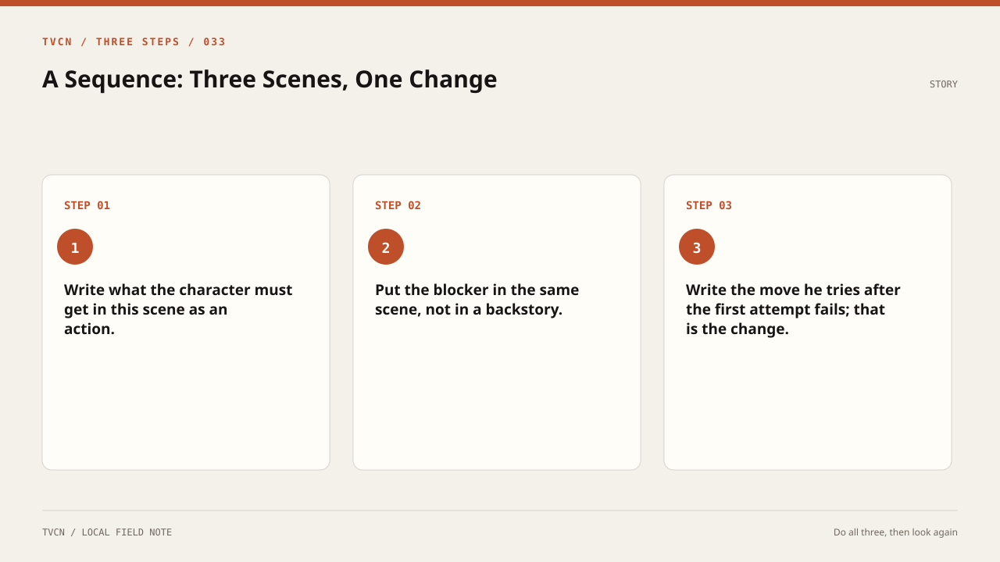

Three scenes are not three locations; they are three state changes. Each scene starts with what the character wants on entry and ends with what is different on exit. Between those two lines there must be a playable action.

<!-- DIAGRAM_START -->
<h2>Diagram</h2>
<figure>
  
  <figcaption>Watch “Scene one states the goal so the audience” and “Scene two blocks it and makes conditions worse.”; judge whether the want can be said with one visible action.</figcaption>
</figure>
<!-- DIAGRAM_END -->
<section><h2 id="section-1">One change per scene</h2>
Connect scenes with action, not captions: he closes a door and the next scene starts outside it; she sets down a cup and the next scene has someone else holding it.
<h2 id="section-2">Limits</h2>
If the story still works with a scene removed, that scene is atmosphere, not sequence. Cut it before discussing pacing.
</section><section><h2 id="section-3">On set</h2>
Split the sequence into three scenes: the first names the goal, the second blocks it, the third forces a choice. Each ending must change the conditions of the next scene.
</section><section><h2 id="section-4">Do this</h2>
One scene carries one change; three scenes move a sequence.
<ol><li>Scene one states the goal so the audience knows what is wanted.</li><li>Scene two blocks it and makes conditions worse.</li><li>Scene three forces a choice and changes what the next scene can be.</li></ol></section><section><h2 id="section-5">Avoid</h2>
Do not let three scenes repeat one piece of information; without changing conditions, the sequence stalls.
</section><section><h2>Judge</h2>
This page passes on three observable checks, not slogans:
<ul><li><strong>1.</strong> Each of the three scenes has one change stated as “from what to what.”</li><li><strong>2.</strong> Every scene ending changes the conditions of the next.</li><li><strong>3.</strong> Remove any scene and the sequence breaks, not just loses color.</li></ul></section><section><h2>Failures</h2>
Any one of these means stop and fix it before post:
<ul><li><strong>1.</strong> Check 1 is only staged (“Each of the three scenes has one change stated…”); another camera position or location exposes it.</li><li><strong>2.</strong> Check 2 is left to post or a verbal explanation (“Every scene ending changes the conditions of t…”); nothing on set can be rechecked.</li><li><strong>3.</strong> Do not let three scenes repeat one piece of information; without changing conditions, the sequence stalls.</li></ul></section><section><h2>Extend</h2>
<strong>10-minute exercise:</strong> Write one 30-second scene with only “Scene one states the goal so the audience” and “Scene two blocks it and makes conditions worse.”. Cut every explanation and ask one person to retell what the character wants.
</section>
<h2>Check</h2><ul><li>Each of the three scenes has one change stated as “from what to what.”</li><li>Every scene ending changes the conditions of the next.</li><li>Remove any scene and the sequence breaks, not just loses color.</li></ul>

<!-- DEEP_DIVE_START -->
## Deep dive

<strong>About 6 minutes.</strong> One scene pushes one change. Three scenes together make a sequence.

### One scene answers one question

Who wants what, what blocks them, what choice do they make? When those three are answered, the scene is over. Save the extra information for the next one.

If the character’s situation is the same at the end as at the start, the scene repeated itself. Cut it; the audience will not lose the story.

Keep one main question per scene. Subplots can appear, but they should not fight for the same answer in the same scene.

### Three scenes, one line of change

Scene one establishes the norm, scene two breaks it, scene three forces a choice. Every ending changes the conditions of the next scene.

At the end of one, the audience knows how he usually lives. At the end of two, why the old way fails. At the end of three, which new way he chose.

Do not jump time with a title card; link the change with a repeated prop, a repeated line, or the same action.

### A sequence is not three synonyms

If three scenes argue about the same thing, cut one. Escalation is not more volume; it is a change of method.

First he asks, then he threatens, then he gives up: three methods, one escalation. Three scenes of asking are one scene repeated.

Give the character a new constraint in each scene: time, money, a relationship, stamina. Change the constraint and the choice changes.

### Five-minute drill: read three lines

Write one line for each of three scenes: he wants, blocked by, chooses. Read the three together; if line two means the same as line one, rewrite scene two.

Then reverse the choice in scene three and see whether the story still stands. If it does, the pressure was not strong enough.

### Ten sequence checks
<ul><li>One main question per scene</li><li>Situation differs at the end</li><li>Scene one establishes the norm</li><li>Scene two breaks the old method</li><li>Scene three makes a new choice</li><li>Each ending changes the next conditions</li><li>Three different methods</li><li>One new constraint per scene</li><li>Link with a repeated prop or action</li><li>Three lines do not repeat</li></ul>
A sequence is not three scenes in a row; it is three scenes forcing each other forward.

<!-- DEEP_DIVE_END -->

<!-- SOURCES_START -->
## References and further reading

- [S41] [Writers Guild of America: WGA contract and credit resources](https://www.wga.org/) — Accessed 2026-11-26. Used to check the terminology and public context in the opening paragraph (“One scene delivers one change; three scenes together move a ”) against WGA contract, credit and minimum-compensation terms; not a substitute for an on-set test.
- [S10] [Film history and moving-image research](https://www.bfi.org.uk/) — Accessed 2026-11-26. Used to check the terminology and public context in the opening paragraph (“One scene delivers one change; three scenes together move a ”) against Entry point to BFI film history, archives and moving-image research; not a substitute for an on-set test.
<!-- SOURCES_END -->

