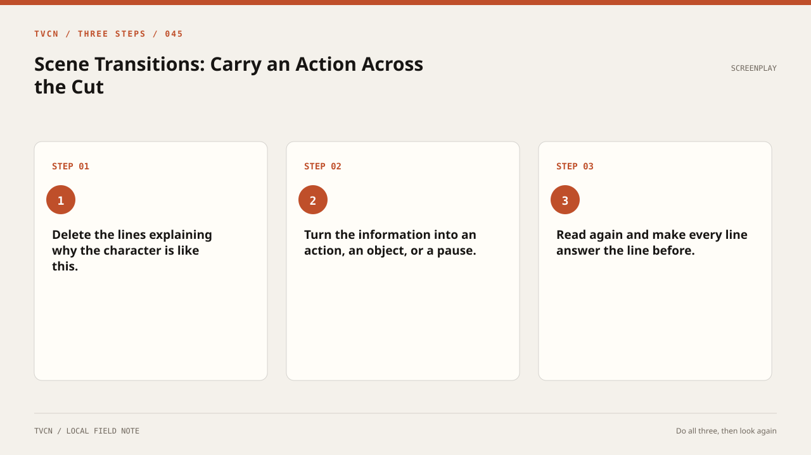

A scene change is not “then he went to the office.” Write what the last action left behind: he slams the door and it is still ringing; she sets down a cup and someone else holds it. Consequence connects the spaces.

<!-- DIAGRAM_START -->
<h2>Diagram</h2>
<figure>
  
  <figcaption>Watch “Find a shared action: door closes in one” and “Or a shared object: cup picked up, then”; judge whether the want can be said with one visible action.</figcaption>
</figure>
<!-- DIAGRAM_END -->
<section><h2 id="section-1">Write the consequence of an action, not “then”</h2>
End each scene on an unfinished action and catch it at the next opening; the audience fills in time.
<h2 id="section-2">Limits</h2>
A transition is not a title card. “Three days later” is weaker than stubble, light or wardrobe; titles are the last resort.
</section><section><h2 id="section-3">On set</h2>
Find a shared action between scenes: close a door, then open one; pick up a cup, then put it down. Let action carry the time jump.
</section><section><h2 id="section-4">Do this</h2>
Connect scenes with action, sound, or an object, not a title card saying “three days later.”
<ol><li>Find a shared action: door closes in one scene, opens in the next.</li><li>Or a shared object: cup picked up, then set down.</li><li>Use sound arriving early or late to bridge the spaces without a card.</li></ol></section><section><h2 id="section-5">Avoid</h2>
Do not use a title card for time; if an action can bridge it, do not write it.
</section><section><h2>Judge</h2>
This page passes on three observable checks, not slogans:
<ul><li><strong>1.</strong> Adjacent scenes share at least one action, object, or sound.</li><li><strong>2.</strong> The time jump reads without a title card.</li><li><strong>3.</strong> Remove the card and the audience can still say how much time passed or where they are.</li></ul></section><section><h2>Failures</h2>
Any one of these means stop and fix it before post:
<ul><li><strong>1.</strong> Check 1 is only staged (“Adjacent scenes share at least one action, obj…”); another camera position or location exposes it.</li><li><strong>2.</strong> Check 2 is left to post or a verbal explanation (“The time jump reads without a title card”); nothing on set can be rechecked.</li><li><strong>3.</strong> Do not use a title card for time; if an action can bridge it, do not write it.</li></ul></section><section><h2>Extend</h2>
<strong>10-minute exercise:</strong> Write one 30-second scene with only “Find a shared action: door closes in one” and “Or a shared object: cup picked up, then”. Cut every explanation and ask one person to retell what the character wants.
</section>
<h2>Check</h2><ul><li>Adjacent scenes share at least one action, object, or sound.</li><li>The time jump reads without a title card.</li><li>Remove the card and the audience can still say how much time passed or where they are.</li></ul>

<!-- SOURCES_START -->
## References and further reading

- [S41] [WGA: Contract and Credit Resources](https://www.wga.org/) — Accessed 2026-11-26. Used to check the terminology/method/rule in the “Write the consequence of an action, not “then”” section against WGA contract and credit resources, not Chinese employment law; it does not verify numbers, model choices or on-set conclusions derived from this page, and is not a substitute for a test.
- [S42] [Pixar in a Box: Storytelling](https://www.khanacademy.org/partner-content/pixar) — Accessed 2026-11-26. Used to check the terminology/method/rule in the “Limits” section against Pixar storytelling course, not project pricing; it does not verify numbers, model choices or on-set conclusions derived from this page, and is not a substitute for a test.
<!-- SOURCES_END -->

