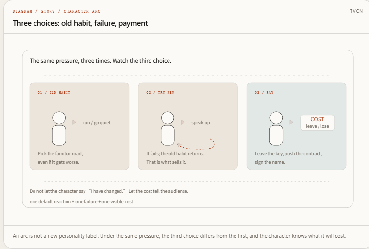

<!-- DIAGRAM_START -->
## Diagram

<figure>
  
  <figcaption>An arc is not a new personality label. Under the same pressure, the third choice differs from the first, and the character knows what it will cost.</figcaption>
</figure>
<!-- DIAGRAM_END -->

A character arc is not “she became braver.” It is the same pressure returning, and she makes a different choice, then pays for it.

## Give the character a default reaction

When pressure arrives, what do they do first: run, please, control, go silent, make a joke. That is the starting point. You do not need a biography; write three scenes with the same kind of pressure and show how they respond each time.

The first time, let them use the familiar move, even if it makes things worse. The audience has to know the old habit before the change can mean anything.

Do not move the arc with adjectives. Not “she gradually becomes steady,” but she stops in the doorway, pushes the suitcase back inside, apologizes for the first time or refuses to. When the action changes, the person changes.

## The middle has to fail once

Change is not one decision. At the midpoint, let them try the new choice, fail, and fall back into the old habit. That is what makes the audience believe it.

Example: she speaks up in a meeting for the first time and is shut down in front of everyone. In the next scene, she is quiet again. The retreat is not repetition; it shows how heavy the old habit is.

An arc is not a straight line. It steps back before it steps forward. Without the failure, the final choice feels like a prize from the writer, not something the character earned.

## The final choice has to cost

When they choose the new road, they must lose something old: safety, a relationship, face, a job. Do not give them a speech, and do not let others praise how much they have changed. Settle it with an action: leave the key, push the contract back, carry the suitcase inside, sign the name.

The audience reads the change from the cost, not the line. The more concrete the cost, the more believable the arc.

## Checks

- The character has a default reaction that can repeat.
- The change fails once at the midpoint, and the old habit returns.
- The final choice costs something visible, without a speech explaining it.
