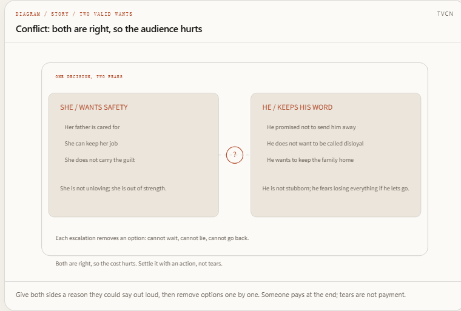

<!-- DIAGRAM_START -->
## Diagram

<figure>
  
  <figcaption>Give both sides a reason they could say out loud, then remove options one by one. Someone pays at the end; tears are not payment.</figcaption>
</figure>
<!-- DIAGRAM_END -->

An argument is not conflict. Real conflict is two valid wants that cannot both win.

## Give both sides a reason they could say out loud

A villain is easy to write and easy to forget. If both people are only out for themselves, the scene is a tug of war. If both are trying to protect someone else, the audience gets caught in the middle.

Example: she wants to move her father into care, because she cannot keep caring for him alone and is about to lose her job. He wants to bring his father home, because he promised not to send him away. Both reasons hold. Either way, someone loses something.

Give each person a sentence they could say to a friend without shame. A reason that cannot be said out loud is usually a reason the writer forced in.

## Conflict is not volume; it is fewer options

Louder is not escalation. Real escalation is the same decision getting harder to postpone: first it can be discussed, then it must be settled tonight, then the signature cannot be taken back.

Apply pressure with time, money, or a third person. Do not keep adding characters. Each turn removes an option: cannot wait, cannot lie, cannot go back. The fewer choices they have, the more the audience feels it.

If the two still have a third way out, the conflict has not arrived yet.

## Someone has to pay at the end

When the conflict ends, someone has to pay. Show what the winner lost and what the loser kept. A crying scene is not a cost. If nothing changes after the tears, the audience will not remember it.

One last action is enough: sign the form, close the door, put the key on the table, return the shoe to the cupboard. The audience reads who won from that action, and who did not.

## Checks

- Both reasons fit in one sentence and both hold.
- Each turn removes an option instead of raising the volume.
- Someone pays a visible cost at the end.

> Intent split: this page covers the practical details of “Conflict: Both Sides Need a Point”; start with <a href="https://story.tvcn.org/article/midpoint-turn/">Midpoint Turn: Change the Method, Not the Goal</a> for the cluster-level judgement, then return here.

<!-- INTENT_SCOPE -->

<section><h2>Boundary</h2>
This page only covers “Conflict: Both Sides Need a Point”; it does not replace Coverage board: shot sheet to animatic, Dialogue subtext: one person can play, Composition: Tell the Eye Where to Look. When the problem belongs to one of those pages, use that page instead of adding more parameters here.
</section>
<!-- SOURCES_START -->
## Experience note

Experience note:This page draws on 5 table reads, rehearsals or on-set reviews with one lead and a two-to-three-person crew; it covers the decisions and actions for “Conflict: Both Sides Need a Point”, not an external laboratory test, multi-camera, union crews, stunts or high-risk sets.
<!-- SOURCES_END -->

