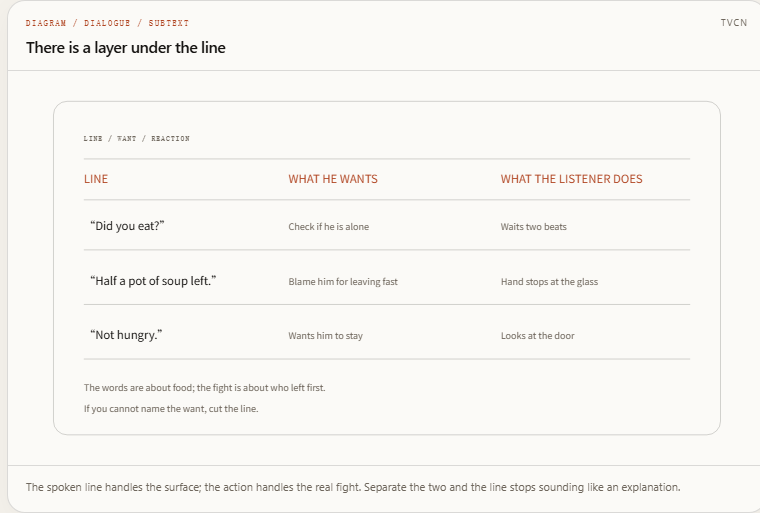

<!-- DIAGRAM_START -->
## Diagram

<figure>
  
  <figcaption>The spoken line handles the surface; the action handles the real fight. Separate the two and the line stops sounding like an explanation.</figcaption>
</figure>
<!-- DIAGRAM_END -->

## Every line is after something

Before writing a line, mark the action underneath it: he wants the other person to admit it, apologize, stay, shut up, pay, or just let the room go quiet. If you cannot name the action, the line is probably filler.

Two people want the same thing and the scene has tension. One asks, “Did you eat?” The other hears, “Why did you leave without me?” The words are about food. The fight is about who left first.

## Cut the manual

“You know, when I was a kid…” is an explanation for the audience, not something a person would say in that moment. People in an argument do not pause to brief each other. They go for the sore spot.

Put the backstory into objects and actions: a photo left behind, a suitcase still by the door, a cigarette pressed into an unwashed plate. Once the audience sees it, you do not have to say it.

If you must explain, let it slip out during the fight. A slip costs something. A summary costs nothing.

## The listener carries the scene

Dialogue is not a relay of lines. The reaction after a line is the temperature of the scene: how long the other person waits, whether they look away, what their hand does on the table.

Shoot a separate angle on the listener. Even with no line, the audience reads how much the last sentence landed.

Silence is dialogue too. If the expected answer does not come, the audience supplies it. Cutting away there is stronger than adding one more explanation.

## Checks

- You can name the action under every line.
- Explanatory lines are gone; objects or actions carry the backstory.
- The listener has a reaction shot, and the silence does something.

> Intent split: this page covers the practical details of “Dialogue: Let Them Fight with Words, Not Explain”; start with <a href="https://story.tvcn.org/article/want-stakes/">Want and Stakes: What Does Losing Cost?</a> for the cluster-level judgement, then return here.

<!-- INTENT_SCOPE -->

<section><h2>Boundary</h2>
This page only covers “Dialogue: Let Them Fight with Words, Not Explain”; it does not replace Directing Debut: Protect Performance Before Coverage, Directing Non-Actors: Give Them a Task, Not a Performance, Composition: Tell the Eye Where to Look. When the problem belongs to one of those pages, use that page instead of adding more parameters here.
</section>
<!-- SOURCES_START -->
## Experience note

Experience note:This page draws on 7 table reads, rehearsals or on-set reviews with one lead and a two-to-three-person crew; it covers the decisions and actions for “Dialogue: Let Them Fight with Words, Not Explain”, not an external laboratory test, multi-camera, union crews, stunts or high-risk sets.
<!-- SOURCES_END -->

