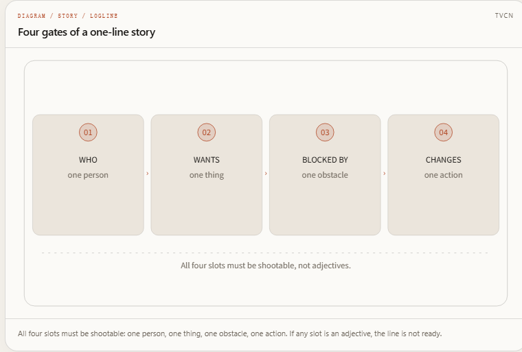

<!-- DIAGRAM_START -->
## Diagram

<figure>
  
  <figcaption>All four slots must be shootable: one person, one thing, one obstacle, one action. If any slot is an adjective, the line is not ready.</figcaption>
</figure>
<!-- DIAGRAM_END -->

## Why this sentence comes first

A logline is not marketing copy. It is a decision tool on set. Should you add a light? Keep this shot? Ask for another take? Every decision goes back to one sentence: who wants what, and what blocks them.

If that sentence is unclear, everyone on set fills in a different film. You end up with three cuts in one timeline.

## Three parts

### 1. A specific person

Do not write “a young person” or “a city dweller.” Write “a delivery rider who just moved into a subdivided apartment” or “a stand-up comedian about to perform for the first time.” The more specific the person, the easier the images arrive.

### 2. A specific want

The want must be visible or audible. Not “wants to be happy,” but “wants to deliver the last order before midnight and catch the last train.”

### 3. A specific obstacle

The obstacle can come from outside or inside the character. Outside: time, distance, rules. Inside: fear, pride, guilt. A short film needs one main obstacle, not five.

## A shootable formula

> A specific person + wants a specific thing + blocked by a specific obstacle + at a cost.

Example:

> A newly single man wants to rehome his ex’s cat before he moves out, but the cat only enters the ex’s old coat.

There is a person, a want, an obstacle, and a visible action: the cat and the coat.

## Three common failures

- **State without a want.** “A girl is lonely” is not a story, because there is no actionable want.
- **Concept without an obstacle.** “AI changes the world” is not a story, because no specific person has to do anything.
- **Too many obstacles.** A 60–90 second film needs one main obstacle; the rest is noise.

## A ten-minute exercise

1. Write five “who wants what” lines.
2. Give each one a specific obstacle.
3. Delete four. Keep the one you most want to shoot.
4. Read it aloud to someone who has not seen your material. Ask them to repeat it.

## Three checks

- The sentence has a specific person, a specific want, and a specific obstacle.
- A stranger can repeat it after hearing it once.
- The sentence suggests at least three concrete images.

## Deliverables

One logline under 40 Chinese characters or 25 English words, plus three images that grow from it.
<!-- SOURCES_START -->
<h2>Sources</h2>

Experience: TVCN field notes and project reviews; tested: the review setup and reproducible exercises noted on the page; references: public links below.

<ul><li>[S02] WIPO: Copyright FAQ</li><li>[S16] BBC Editorial Guidelines</li><li>[S17] Reuters Trust Principles</li></ul>

<a href="../../SOURCES.md">Full links and notes in SOURCES.md</a>

<!-- SOURCES_END -->
