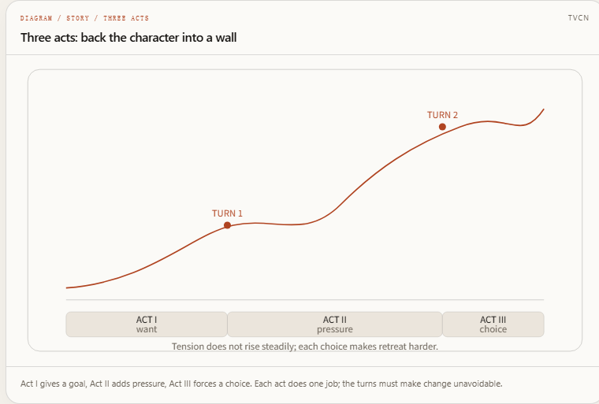

<!-- DIAGRAM_START -->
## Diagram

<figure>
  
  <figcaption>Act I gives a goal, Act II adds pressure, Act III forces a choice. Each act does one job; the turns must make change unavoidable.</figcaption>
</figure>
<!-- DIAGRAM_END -->

## Act one only gets the character moving

Act one does not need a world bible. It needs three things: what this person wants, what blocks them, and what they decide to do. End on an action, not an explanation.

A short film should finish this in its first quarter. If the audience still does not know the want halfway through, later beauty is just pictures.

## Act two applies pressure, not complication

Act two is where most short films break: new characters, new subplots, new twists. A short does not need more stuff; it needs the same obstacle to get harder to avoid.

The midpoint changes the method: ask for help, lie, compromise, fight back. When the method changes, the pressure actually rises.

## Act three answers one question

Act three answers one question: what is he willing to pay. Do not introduce new information, characters, or locations. The ending can be a win or a loss, but not a blur.

End after the choice, without a voice-over summary. The sentence the audience supplies is stronger than the one you write.

## Three checks

- You can state the want and the obstacle in one sentence.
- The method changes at the midpoint, not the goal.
- Act three introduces no new character or rule.
<!-- SOURCES_START -->
<h2>Sources</h2>

Experience: TVCN field notes and project reviews; tested: the review setup and reproducible exercises noted on the page; references: public links below.

<ul><li>[S02] WIPO: Copyright FAQ</li><li>[S16] BBC Editorial Guidelines</li><li>[S17] Reuters Trust Principles</li></ul>

<a href="../../SOURCES.md">Full links and notes in SOURCES.md</a>

<!-- SOURCES_END -->
