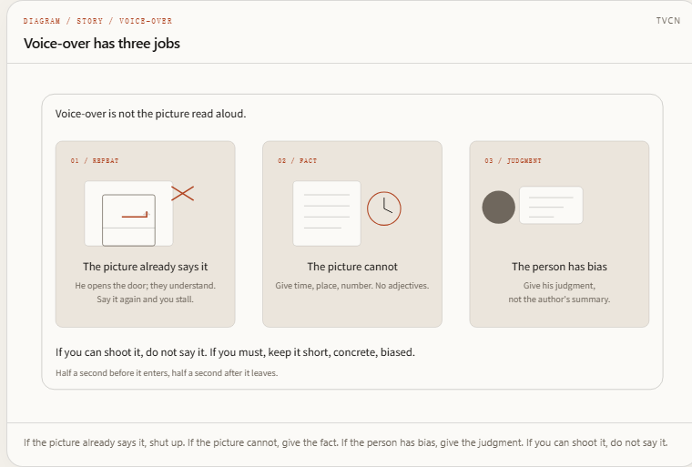

<!-- DIAGRAM_START -->
## Diagram

<figure>
  
  <figcaption>If the picture already says it, shut up. If the picture cannot, give the fact. If the person has bias, give the judgment. If you can shoot it, do not say it.</figcaption>
</figure>
<!-- DIAGRAM_END -->

## Three kinds of voice-over, three jobs

Expository VO gives context: the time, the place, how one event led to the next. First-person VO gives bias: how this person sees others, how they fool themselves. Inner VO gives the line the character cannot say out loud.

You can mix all three, but know who is speaking. If the last line was the author explaining the world and the next is the character's private complaint, the audience does not know which ear to trust.

## Write for the ear, not the eye

Short sentences. Concrete nouns. Few adjectives. Do not write “we can see” or “the next thing that happens”; the audience can see it. Each line does one job: a fact or a judgment.

Read it aloud and listen for where the tongue trips. The problem is the sentence, not the voice. Delete the first line and the last line; what remains is often the real text.

## When to shut up

If the picture already says it, do not repeat it. The character pushes the door open; the audience knows he is leaving. Do not say “he decides to leave.” Let the action happen. Leave half a second before the VO enters and half a second after it leaves.

Do not name the emotion. Do not say “he regrets it.” Let him pause at the door; let his hand slide off the handle. VO supplies facts and bias. The face and the action supply the feeling.

## Do not record it in a bedroom

Find a quiet room. Turn off the AC, the fridge, the window. Put the mic a fist away from the mouth, not against it. Record three passes: normal, lower, a little faster. Start with normal; do not begin with “voice-of-god.”

Keep the breath. Do not cut every pause flat. VO is not a commercial; it should sound like a person standing nearby.

## Checks

- Does this line add information the picture cannot, or repeat what is already there?
- Whose voice is it: the author, the character, or the character's inner voice?
- Read aloud, does it trip or sound like an essay?
- Does the VO cover the action at its entrance or exit?
