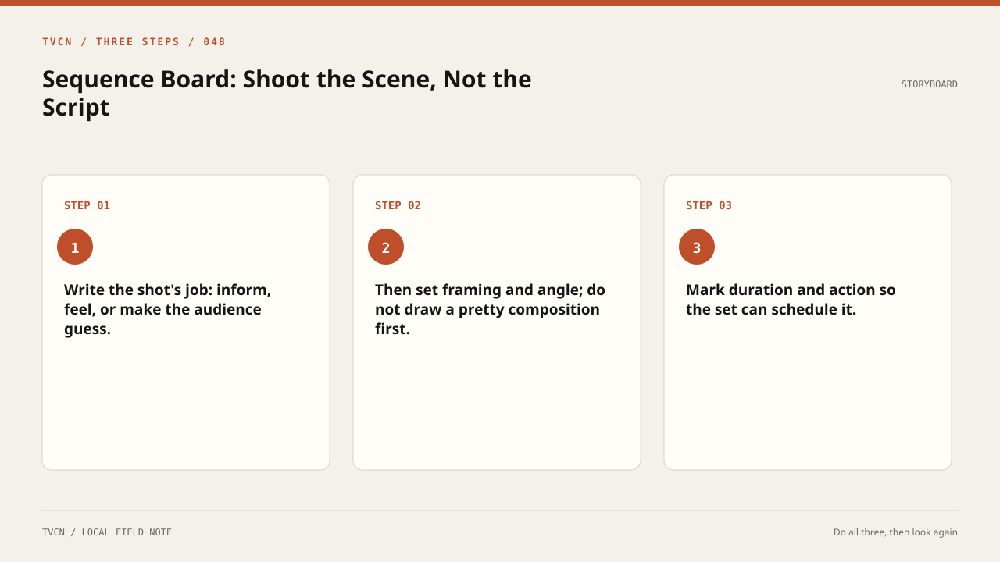

A sequence board does not illustrate every line; it decides what the audience sees first.

<!-- DIAGRAM_START -->
<h2>Diagram</h2>
<figure>
  
  <figcaption>Do the three steps in order, then look again at the image or file.</figcaption>
</figure>
<!-- DIAGRAM_END -->
<h2>On set</h2>

Draw three panels for one scene: what the audience sees first, what is hidden, what is revealed last. Then fill the middle; do not illustrate every line.

<h2>Do this</h2>

A sequence board does not illustrate every line; it decides what the audience sees first.
<ol><li>Draw three panels: what to show first, what to hide, what to reveal last.</li><li>Fill the middle shots so information releases in order.</li><li>Board information, not one panel per line.</li></ol>
<h2>Avoid</h2>

Do not draw one panel per line; a board is information order, not illustration.

<h2>Check</h2>
<ul><li>The first three panels show what is shown, hidden, and revealed last.</li><li>Middle shots fill by information order, not line count.</li><li>A third person can repeat the release order from the board.</li></ul>
