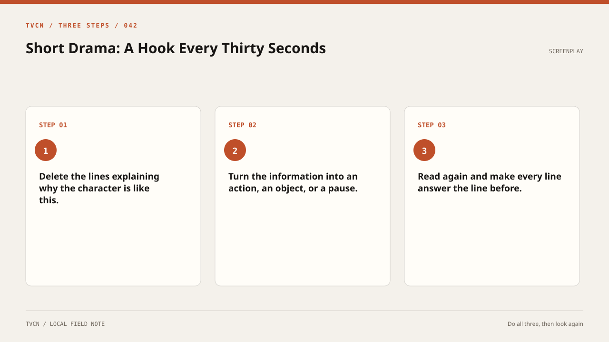

Short drama scripts run hook, reversal, cliffhanger, with a situation change every thirty seconds.

<!-- DIAGRAM_START -->
<h2>Diagram</h2>
<figure>
  
  <figcaption>Watch “List one situation change every thirty seconds: identity” and “Write the change as an image, not a”; judge whether the want can be said with one visible action.</figcaption>
</figure>
<!-- DIAGRAM_END -->
<section><h2 id="section-1">On set</h2>
List a turn every 30 seconds: an identity exposed, money taken, a door locked. Write the turn as an image, not as explanation.
</section><section><h2 id="section-2">Do this</h2><ol><li>List one situation change every thirty seconds: identity exposed, money taken, door locked.</li><li>Write the change as an image, not a character explaining it.</li><li>End on an unanswered question, not a summary, so the next episode can connect.</li></ol></section><section><h2 id="section-3">Avoid</h2>
Do not let a character explain the reversal; it must happen on screen.
</section><section><h2 id="section-4">Three causes</h2>
For “Short Drama: A Hook Every Thirty Seconds”, check three directions first. Change one variable, record a 30-second comparison, and see which link the change follows.

<table class="data-table"><thead><tr><th>Cause</th><th>Signal on set</th><th>Five-minute test</th></tr></thead><tbody><tr><td>No conflict in the first three seconds</td><td>The opening is scenery or narration and the viewer swipes away</td><td>Put goal and obstacle in the first line</td></tr><tr><td>Hook arrives late</td><td>The first turn lands after forty seconds; the first thirty have no change</td><td>Move the turn inside ten seconds</td></tr><tr><td>No question at the end</td><td>Each episode ends on an answer, so there is no reason to open the next</td><td>End on an unresolved problem</td></tr></tbody></table>
</section><section><h2 id="section-5">On-set diagnosis</h2><ol><li>Write what happens in 0–3, 3–10 and 10–30 seconds.</li><li>Count information changes in thirty seconds; fewer than two means rewrite.</li><li>Look at the last frame: does the viewer know what will happen next?</li></ol></section><section><h2 id="section-6">Fix</h2>
Short drama is not a long drama shortened; it delivers one promise and one new question every thirty seconds. Conflict first, turn second, hook last.
<ol><li>Put person, goal and obstacle in the first line; do not open on scenery.</li><li>Deliver the first turn within ten seconds and a second small change within thirty.</li><li>End each episode on a choice that creates a new problem.</li><li>Remove explanation; push with action and props.</li></ol></section><section><h2 id="section-7">Failure cases</h2>
With “Short Drama: A Hook Every Thirty Seconds”, these three moves make it worse. Pick one replacement action and do not change three variables at once.

<table class="data-table"><thead><tr><th>Failure</th><th>Why it gets worse</th><th>Replace with</th></tr></thead><tbody><tr><td>Hook with music</td><td>The music is loud but nothing happens</td><td>Write the event first</td></tr><tr><td>Turn every episode</td><td>The audience tires and turns lose weight</td><td>Alternate small changes and big turns</td></tr><tr><td>Summarise at the end</td><td>Narration explains the next episode</td><td>Stop on the question</td></tr></tbody></table>
</section><section><h2 id="section-8">Acceptance table</h2>
Acceptance is not “it feels better”; all four must be identifiable, playable and logged.

<table class="data-table"><thead><tr><th>Check</th><th>Pass line</th><th>Log</th></tr></thead><tbody><tr><td>First 3 seconds</td><td>A goal, obstacle or anomaly</td><td>Second-by-second marks</td></tr><tr><td>10 seconds</td><td>The first turn has happened</td><td>Time it</td></tr><tr><td>30 seconds</td><td>At least two information changes</td><td>Count them</td></tr><tr><td>Ending</td><td>One unresolved problem remains</td><td>Inspect the last frame</td></tr></tbody></table>
</section><section><h2>Judge</h2>
This page passes on three observable checks, not slogans:
<ul><li><strong>1.</strong> Every thirty seconds has a situation change that can be played as an image.</li><li><strong>2.</strong> The reversal is visible without a character explaining it.</li><li><strong>3.</strong> The ending stops on an unanswered question with no summary.</li></ul></section><section><h2>Failures</h2>
Any one of these means stop and fix it before post:
<ul><li><strong>1.</strong> Check 1 is only staged (“Every thirty seconds has a situation change th…”); another camera position or location exposes it.</li><li><strong>2.</strong> Check 2 is left to post or a verbal explanation (“The reversal is visible without a character ex…”); nothing on set can be rechecked.</li><li><strong>3.</strong> Do not let a character explain the reversal; it must happen on screen.</li></ul></section><section><h2>Extend</h2>
<strong>10-minute exercise:</strong> Write one 30-second scene with only “List one situation change every thirty seconds: identity” and “Write the change as an image, not a”. Cut every explanation and ask one person to retell what the character wants.
</section>
<h2>Check</h2><ul><li>Every thirty seconds has a situation change that can be played as an image.</li><li>The reversal is visible without a character explaining it.</li><li>The ending stops on an unanswered question with no summary.</li></ul>

> Intent split: this page covers the practical details of “Short Drama: A Hook Every Thirty Seconds”; start with <a href="https://formats.tvcn.org/article/vertical-drama/">Vertical Drama: A Want in the First Three Seconds</a> for the cluster-level judgement, then return here.

<!-- INTENT_SCOPE -->

<!-- SOURCES_START -->
## Experience note

Experience note: this page draws on 3 table read and pre-shoot rehearsal reviews under a three-to-eight-page scene with one primary point of view; it discusses “Short Drama: A Hook Every Thirty Seconds”; no external laboratory test was run, and the conclusion may not transfer when conditions change.
<!-- SOURCES_END -->

