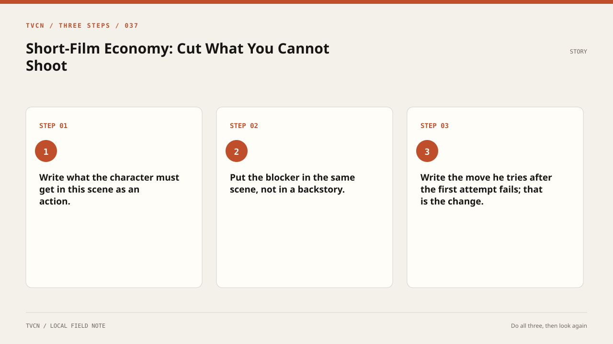

Every extra location, actor and VFX shot adds coordination, transport and a failure point. Compress to one main location, two actors, one time block; put the savings into sound and rehearsal.

<!-- DIAGRAM_START -->
<h2>Diagram</h2>
<figure>
  
  <figcaption>Watch “Strike the three most expensive scenes: crowd, night” and “Rewrite with one room, two people, one prop.”; judge whether the want can be said with one visible action.</figcaption>
</figure>
<!-- DIAGRAM_END -->
<section><h2 id="section-1">Short-film savings come from fewer variables</h2>
Use staging instead of coverage: play a scene in one space with blocking and framing changes. It is cheaper than ten locations and more coherent.
<h2 id="section-2">Limits</h2>
Savings are not a shorter film. The necessary change cannot be cut; remove the story and the saved budget cannot buy it back.
</section><section><h2 id="section-3">On set</h2>
Cross out the three most expensive scenes: crowds, night exteriors, vehicles. Rewrite with one room, two people, one prop, and keep the conflict working.
</section><section><h2 id="section-4">Do this</h2>
Short films cut what they cannot afford, then make what remains more specific.
<ol><li>Strike the three most expensive scenes: crowd, night exterior, vehicles.</li><li>Rewrite with one room, two people, one prop.</li><li>Confirm the conflict still holds, then add detail instead of scale.</li></ol></section><section><h2 id="section-5">Avoid</h2>
Do not hide an empty script behind scale; an unaffordable scene also hides the character.
</section><section><h2>Judge</h2>
This page passes on three observable checks, not slogans:
<ul><li><strong>1.</strong> The three costliest scenes are gone and the script stands without them.</li><li><strong>2.</strong> The rewrite uses one room, two people, and one prop.</li><li><strong>3.</strong> The conflict stays clear and the character becomes more specific, not smaller.</li></ul></section><section><h2>Failures</h2>
Any one of these means stop and fix it before post:
<ul><li><strong>1.</strong> Check 1 is only staged (“The three costliest scenes are gone and the sc…”); another camera position or location exposes it.</li><li><strong>2.</strong> Check 2 is left to post or a verbal explanation (“The rewrite uses one room, two people, and one…”); nothing on set can be rechecked.</li><li><strong>3.</strong> Do not hide an empty script behind scale; an unaffordable scene also hides the character.</li></ul></section><section><h2>Extend</h2>
<strong>10-minute exercise:</strong> Write one 30-second scene with only “Strike the three most expensive scenes: crowd, night” and “Rewrite with one room, two people, one prop.”. Cut every explanation and ask one person to retell what the character wants.
</section>
<h2>Check</h2><ul><li>The three costliest scenes are gone and the script stands without them.</li><li>The rewrite uses one room, two people, and one prop.</li><li>The conflict stays clear and the character becomes more specific, not smaller.</li></ul>

<!-- SOURCES_START -->
## References and further reading

- [S41] [Writers Guild of America: WGA contract and credit resources](https://www.wga.org/) — Accessed 2026-11-26. Used to check the terminology and public context in the opening paragraph (“Cut what you cannot shoot, then make what remains more speci”) against WGA contract, credit and minimum-compensation terms; not a substitute for an on-set test.
- [S10] [Film history and moving-image research](https://www.bfi.org.uk/) — Accessed 2026-11-26. Used to check the terminology and public context in the opening paragraph (“Cut what you cannot shoot, then make what remains more speci”) against Entry point to BFI film history, archives and moving-image research; not a substitute for an on-set test.
<!-- SOURCES_END -->

