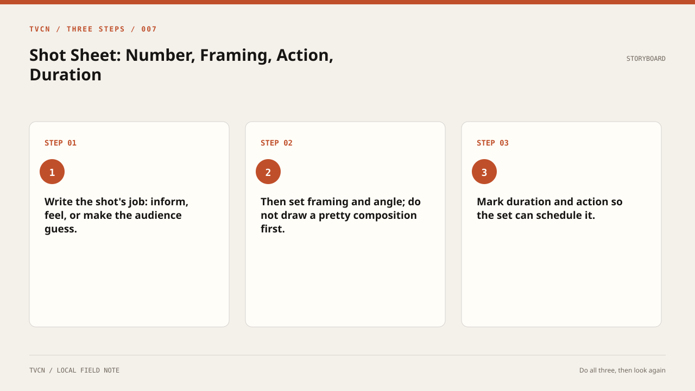

Each row: shot number, framing, camera position, action, line, duration, props, sound. Miss one and the set stops to ask. A shot sheet is not a substitute for the board; it is the board made executable.

<!-- DIAGRAM_START -->
<h2>Diagram</h2>
<figure>
  
  <figcaption>Watch “Fill shots 1, 3, and 5 first, each” and “Cut or split any shot over eight seconds”; judge whether the want can be said with one visible action.</figcaption>
</figure>
<!-- DIAGRAM_END -->
<section><h2 id="section-1">A shot sheet must be executable on set</h2>
Order by shoot sequence, not edit sequence, grouping the same camera and light to reduce moves.
<h2 id="section-2">Limits</h2>
The sheet can change, but every change goes to camera, sound and script supervisor. Three people with three versions is worse than no sheet.
</section><section><h2 id="section-3">On set</h2>
Fill shots 1, 3, and 5 first: one verb and one duration each. Read the sheet before rolling; if a shot runs past 8 seconds or has no action, cut it or split it.
</section><section><h2 id="section-4">Do this</h2>
A shot sheet needs four columns: number, size, action, duration. If these are unclear, the set will be chaos.
<ol><li>Fill shots 1, 3, and 5 first, each with one verb and one duration.</li><li>Cut or split any shot over eight seconds or without an action.</li><li>Read it aloud before rolling so camera and edit can repeat the order.</li></ol></section><section><h2 id="section-5">Avoid</h2>
Do not draw what the camera cannot shoot; a board is not an illustration.
</section><section><h2>Judge</h2>
Three signals are observable on set:
<ul><li>the want is visible in one action</li><li>the obstacle escalates inside the same scene</li><li>delete one expository line and the conflict still holds</li></ul></section><section><h2>Failures</h2>
These three moves erase the detail you just built:
<ul><li>the want is unclear and the scene is only mood</li><li>the obstacle is solved by coincidence, not a decision</li><li>dialogue repeats what the image already says</li></ul></section><section><h2>Extend</h2>
<strong>10-minute exercise:</strong> Write one 30-second scene with only “Fill shots 1, 3, and 5 first, each” and “Cut or split any shot over eight seconds”. Cut every explanation and ask one person to retell what the character wants.
</section>
<h2>Check</h2><ul><li>Every shot has number, size, action, and seconds; no column is missing.</li><li>No shot runs over eight seconds without an action.</li><li>A third person can repeat the shooting order from the sheet.</li></ul>

<!-- DEEP_DIVE_START -->
## Deep dive

<strong>About 5 minutes.</strong> A shot sheet is not a second storyboard. It decides what gets shot first, how many takes, and when the day can wrap.

### A shot sheet is not a storyboard

A storyboard shows what the frame looks like; a shot sheet shows how the day runs. Five columns are enough: number, size, action, camera position, duration. One main action per row; do not put opening a door, sitting, and talking in one box.

Schedule the safety shots first: a wide for space, a medium for performance, a close for emotion, an insert for the cut. Get at least two takes of each, or panic will leave you with no alternative.

### Three rules for changing the sheet on set

First, change the order, not the numbers. Second, pickups get letter suffixes instead of being inserted back into old numbers. Third, photograph the completed sheet before wrap and send copies to script supervisor and editor. Paper dies from rain, coffee, and hands; a photo does not.

If a scene runs past twelve shots, split it into morning and afternoon blocks. When people tire, the first things lost are inserts and reactions, not the main angle.

### Schedule by setup, not by story order

Shoot everything that fits one setup together; what you save is moving lights, track, and focus. Story order belongs to the edit; set order belongs to the camera.

Draw a line on the sheet at every setup change and write “move / est. 20 min.” That twenty minutes is the most underestimated part of the day.

### The last three minutes before wrap

Go back through the sheet and confirm every action has a wide, a close, and an insert. Pick up the missing one now; tomorrow it is gone. Letter the pickups, do not memorize them.

Photograph the completed sheet and one wide of the set. Send copies to script, edit, and director so nobody relies on memory tomorrow.

### Ten things your shot sheet needs before call time
<ul><li>One main action per row</li><li>Five columns: number, size, action, position, duration</li><li>Every group has wide, medium, close, and insert</li><li>Group by setup, not story order</li><li>Draw a line and estimate time at every setup change</li><li>Letter pickups instead of reusing old numbers</li><li>Note props needed for each shot</li><li>Mark blocking and eyeline</li><li>Leave a column for actual takes</li><li>Photograph it at wrap and send to script and edit</li></ul>
The sheet is not for other people; it is for tomorrow’s you, who will not remember why one shot was skipped.

<!-- DEEP_DIVE_END -->
