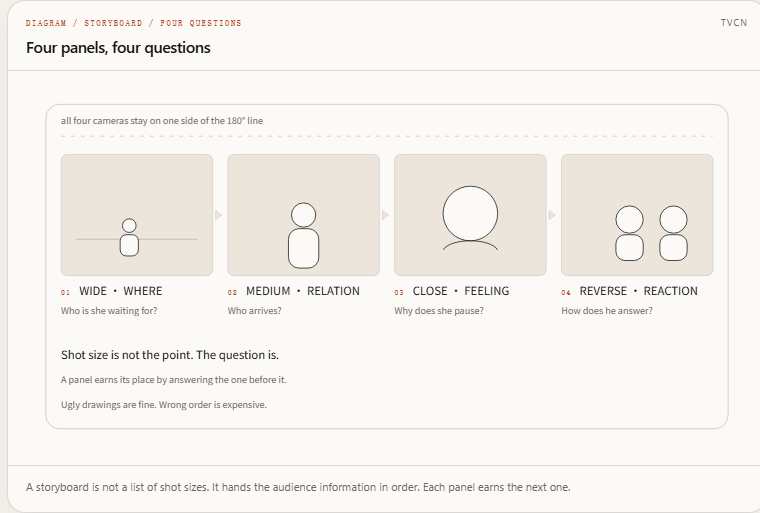

<!-- DIAGRAM_START -->
## Diagram

<figure>
  
  <figcaption>A storyboard is not a list of shot sizes. It hands the audience information in order. Each panel earns the next one.</figcaption>
</figure>
<!-- DIAGRAM_END -->

A shot sheet is not a pretty drawing. It tells the crew what to shoot next. Eight shots, built around action.

## Write action, not adjectives

“Lonely,” “premium,” “cinematic” are not shots. A shot answers: who, where, and what action. If you cannot write it, the action is not clear yet.

Give each shot one main action. If a shot contains opening a door, sitting down, talking, and crying, you will end up with four unfinished shots.

## The order of eight shots

Use a minimum structure: establish the space → establish the want → introduce the obstacle → reaction → decision → cost. Across eight shots, include at least two establishing shots, two reaction shots, and one close-up.

Do not shoot close-ups all the way through. The audience needs to know where people are, who they are with, and how big the space is. A wide shot is not “empty”; it is information.

## Five columns on the sheet

Shot number, framing, image, action, duration. Five columns are enough. Image is what you see; action is what happens; duration is roughly how long.

> 03 | Medium | Kitchen, kettle ringing | She turns off the stove and checks her phone | 4 sec

Write “push from chest to eyes, hold two seconds,” not “slow push.” An executable note tells camera and actor what to do; how long the move takes belongs in the duration column. The more concrete the sheet, the fewer arguments on set.

The camera operator, actor, and editor can all use this sheet. When the day changes, update the sheet, not the version in your head.

## Three checks

- Eight shots, each clear as “who + does what + where.”
- At least four framings, including two shots that establish space.
- Each shot has one main action.

<!-- V11_DEEPEN -->

<section><h2>Boundary</h2>
This page only covers “The Shot Sheet: Turn One Line into Eight Shootable Shots”; it does not replace Subplot: Only the One That Presses the Main Line, Subtext: The Thing Under the Line, Composition: Tell the Eye Where to Look. When the problem belongs to one of those pages, use that page instead of adding more parameters here.
</section>
<!-- SOURCES_START -->
## References and further reading

- [S42] [Pixar in a Box: Storytelling](https://www.khanacademy.org/partner-content/pixar) — Accessed 2026-11-26. Used to check the terminology/method/rule in the “Write action, not adjectives” section against Pixar storytelling course, not project pricing; it does not verify numbers, model choices or on-set conclusions derived from this page, and is not a substitute for a test.
- [S43] [BFI: National Archive](https://www.bfi.org.uk/bfi-national-archive) — Accessed 2026-11-26. Used to check the terminology/method/rule in the “The order of eight shots” section against BFI archive material, not distribution rules; it does not verify numbers, model choices or on-set conclusions derived from this page, and is not a substitute for a test.
<!-- SOURCES_END -->

