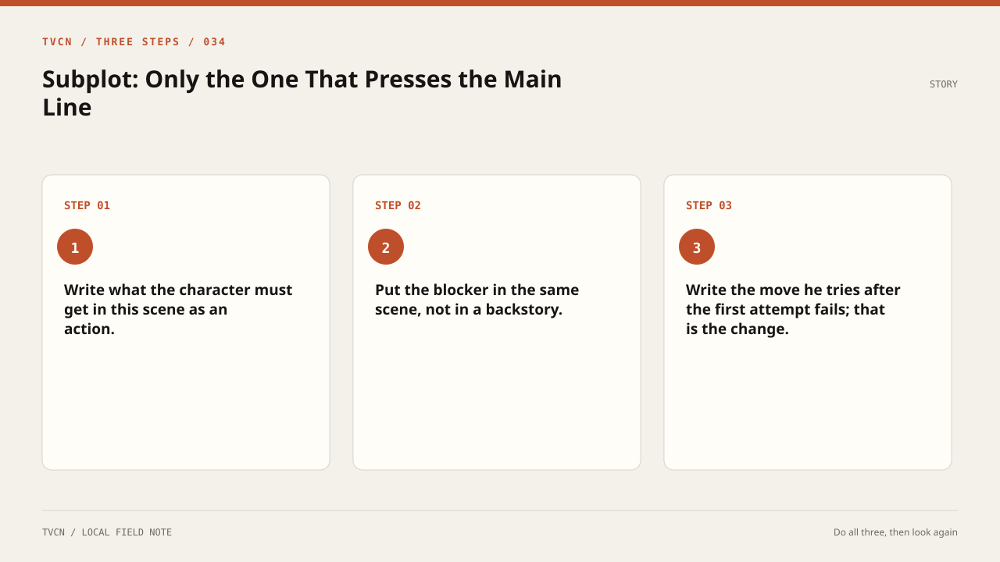

A subplot is not a second couple to make the film rich. At some point it forces the hero to choose differently: because of this person they are late; because of this event they lose an exit.

<!-- DIAGRAM_START -->
<h2>Diagram</h2>
<figure>
  
  <figcaption>Watch “On first appearance, state what it owes the” and “Every appearance adds pressure the main line cannot”; judge whether the want can be said with one visible action.</figcaption>
</figure>
<!-- DIAGRAM_END -->
<section><h2 id="section-1">A subplot must change one choice in the main line</h2>
Write two lines: what extra loss it creates, and whether it makes the ending harder or easier. If neither can be answered, cut it.
<h2 id="section-2">Limits</h2>
A short film has no time for two independent stories. A subplot is pressure on the main line, not a second center.
</section><section><h2 id="section-3">On set</h2>
When the subplot first appears, write what it owes the main line: a favor, a message, a lever. Every return adds pressure the main line cannot ignore.
</section><section><h2 id="section-4">Do this</h2>
A subplot is not extra heat; it must tighten the main line at a specific moment.
<ol><li>On first appearance, state what it owes the main line: a favor, a message, leverage.</li><li>Every appearance adds pressure the main line cannot ignore.</li><li>If removing it leaves the main line unchanged, cut it.</li></ol></section><section><h2 id="section-5">Avoid</h2>
Do not add a subplot for busyness; if it does not press the main line, it is delay.
</section><section><h2>Judge</h2>
This page passes on three observable checks, not slogans:
<ul><li><strong>1.</strong> The subplot states its debt to the main line on first appearance.</li><li><strong>2.</strong> Each subplot appearance makes the main choice harder.</li><li><strong>3.</strong> Remove it and the main line loses pressure; it does not stay unchanged.</li></ul></section><section><h2>Failures</h2>
Any one of these means stop and fix it before post:
<ul><li><strong>1.</strong> Check 1 is only staged (“The subplot states its debt to the main line o…”); another camera position or location exposes it.</li><li><strong>2.</strong> Check 2 is left to post or a verbal explanation (“Each subplot appearance makes the main choice…”); nothing on set can be rechecked.</li><li><strong>3.</strong> Do not add a subplot for busyness; if it does not press the main line, it is delay.</li></ul></section><section><h2>Extend</h2>
<strong>10-minute exercise:</strong> Write one 30-second scene with only “On first appearance, state what it owes the” and “Every appearance adds pressure the main line cannot”. Cut every explanation and ask one person to retell what the character wants.
</section>
<h2>Check</h2><ul><li>The subplot states its debt to the main line on first appearance.</li><li>Each subplot appearance makes the main choice harder.</li><li>Remove it and the main line loses pressure; it does not stay unchanged.</li></ul>

<!-- SOURCES_START -->
## References and further reading

- [S41] [WGA: Contract and Credit Resources](https://www.wga.org/) — Accessed 2026-11-26. Used to check the terminology/method/rule in the “A subplot must change one choice in the main line” section against WGA contract and credit resources, not Chinese employment law; it does not verify numbers, model choices or on-set conclusions derived from this page, and is not a substitute for a test.
- [S42] [Pixar in a Box: Storytelling](https://www.khanacademy.org/partner-content/pixar) — Accessed 2026-11-26. Used to check the terminology/method/rule in the “Limits” section against Pixar storytelling course, not project pricing; it does not verify numbers, model choices or on-set conclusions derived from this page, and is not a substitute for a test.
<!-- SOURCES_END -->

