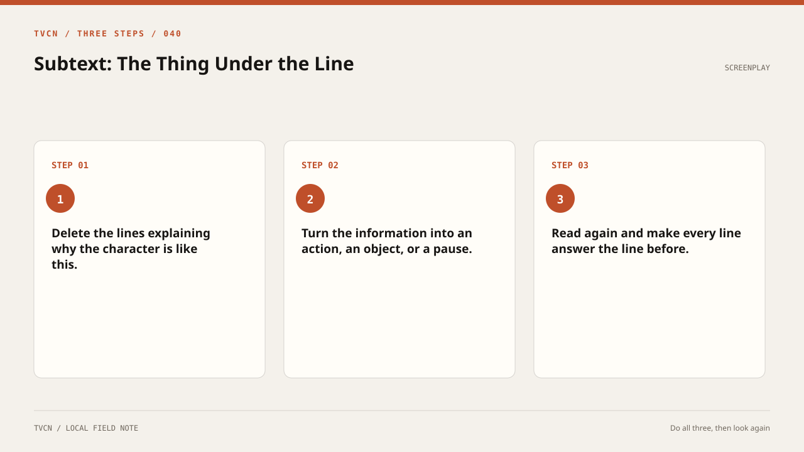

Subtext is saying A while wanting B; the director makes B visible.

<!-- DIAGRAM_START -->
<h2>Diagram</h2>
<figure>
  
  <figcaption>Watch “Give each line a hidden action: she says” and “Let the actor play the hand, not the”; judge whether the want can be said with one visible action.</figcaption>
</figure>
<!-- DIAGRAM_END -->
<section><h2 id="section-1">On set</h2>
Give every line a hidden action: she says whatever, but closes the menu. Direct the hand, not the line.
</section><section><h2 id="section-2">Do this</h2><ol><li>Give each line a hidden action: she says “whatever” and closes the menu.</li><li>Let the actor play the hand, not the line.</li><li>Review that line and action contradict each other and B reads.</li></ol></section><section><h2 id="section-3">Avoid</h2>
Do not let the line speak the subtext; once said, it is no longer subtext.
</section><section><h2 id="section-4">Three causes</h2>
For “Subtext: The Thing Under the Line”, check three directions first. Change one variable, record a 30-second comparison, and see which link the change follows.

<table class="data-table"><thead><tr><th>Cause</th><th>Signal on set</th><th>Five-minute test</th></tr></thead><tbody><tr><td>Lines state it</td><td>A character says “I want you to stay” and the scene is over</td><td>Hide the want in action and other words</td></tr><tr><td>No hidden goal</td><td>The character only completes the surface task and wants nothing from the other person</td><td>Give every character an unspeakable aim</td></tr><tr><td>No pressure</td><td>The other person agrees too easily, so subtext has nothing to push</td><td>Let them refuse or misunderstand</td></tr></tbody></table>
</section><section><h2 id="section-5">On-set diagnosis</h2><ol><li>Write one line of what each character really wants; keep it out of the script.</li><li>Ask the actor what they lose if this line fails.</li><li>Play the scene as action without lines and see whether the relationship still reads.</li></ol></section><section><h2 id="section-6">Fix</h2>
Subtext is not an explanation hidden under the line; it is the detour a character takes to get something. Give them a reason not to say it, then let them say something else.
<ol><li>Give each character an aim they cannot state: fear of rejection, loss of face, refusal to admit.</li><li>Make lines do actions: probe, deflect, threaten, appease; not state.</li><li>Let the scene partner resist so the subtext has pressure.</li><li>Hold a pause at the key moment so the audience feels the unsaid line.</li></ol></section><section><h2 id="section-7">Failure cases</h2>
With “Subtext: The Thing Under the Line”, these three moves make it worse. Pick one replacement action and do not change three variables at once.

<table class="data-table"><thead><tr><th>Failure</th><th>Why it gets worse</th><th>Replace with</th></tr></thead><tbody><tr><td>Let the character say the subtext</td><td>The moment the thought is spoken, subtext disappears</td><td>Keep the truth in action</td></tr><tr><td>Add music</td><td>The score feels for the audience and the lines get flatter</td><td>Change the line and resistance first</td></tr><tr><td>Hide everything</td><td>The scene becomes a puzzle</td><td>Keep the surface task clear</td></tr></tbody></table>
</section><section><h2 id="section-8">Acceptance table</h2>
Acceptance is not “it feels better”; all four must be identifiable, playable and logged.

<table class="data-table"><thead><tr><th>Check</th><th>Pass line</th><th>Log</th></tr></thead><tbody><tr><td>Surface task</td><td>Each scene has a clear surface goal</td><td>Write it per scene</td></tr><tr><td>Hidden aim</td><td>Each character has an unspeakable aim</td><td>Character notes</td></tr><tr><td>Resistance</td><td>The partner does not cooperate</td><td>Watch the exchange</td></tr><tr><td>Pause</td><td>A key unsaid pause exists</td><td>Playback</td></tr></tbody></table>
</section><section><h2>Judge</h2>
This page passes on three observable checks, not slogans:
<ul><li><strong>1.</strong> Every key line has a contradicting or offsetting action.</li><li><strong>2.</strong> The actor plays the hand and body, not the hidden line aloud.</li><li><strong>3.</strong> The audience can name what is said and what is actually wanted.</li></ul></section><section><h2>Failures</h2>
Any one of these means stop and fix it before post:
<ul><li><strong>1.</strong> Check 1 is only staged (“Every key line has a contradicting or offsetti…”); another camera position or location exposes it.</li><li><strong>2.</strong> Check 2 is left to post or a verbal explanation (“The actor plays the hand and body, not the hid…”); nothing on set can be rechecked.</li><li><strong>3.</strong> Do not let the line speak the subtext; once said, it is no longer subtext.</li></ul></section><section><h2>Extend</h2>
<strong>10-minute exercise:</strong> Write one 30-second scene with only “Give each line a hidden action: she says” and “Let the actor play the hand, not the”. Cut every explanation and ask one person to retell what the character wants.
</section>
<h2>Check</h2><ul><li>Every key line has a contradicting or offsetting action.</li><li>The actor plays the hand and body, not the hidden line aloud.</li><li>The audience can name what is said and what is actually wanted.</li></ul>

> Intent split: this page covers the practical details of “Subtext: The Thing Under the Line”; start with <a href="https://story.tvcn.org/article/want-stakes/">Want and Stakes: What Does Losing Cost?</a> for the cluster-level judgement, then return here.

<!-- INTENT_SCOPE -->

<section><h2>Boundary</h2>
This page only covers “Subtext: The Thing Under the Line”; it does not replace Table Read: Listen for Three Problems Only, Theme Through Action, Not Speeches, Composition: Tell the Eye Where to Look. When the problem belongs to one of those pages, use that page instead of adding more parameters here.
</section>
<!-- SOURCES_START -->
## References and further reading

- [S41] [WGA: Contract and Credit Resources](https://www.wga.org/) — Accessed 2026-11-26. Used to check the terminology/method/rule in the “On set” section against WGA contract and credit resources, not Chinese employment law; it does not verify numbers, model choices or on-set conclusions derived from this page, and is not a substitute for a test.
- [S42] [Pixar in a Box: Storytelling](https://www.khanacademy.org/partner-content/pixar) — Accessed 2026-11-26. Used to check the terminology/method/rule in the “Do this” section against Pixar storytelling course, not project pricing; it does not verify numbers, model choices or on-set conclusions derived from this page, and is not a substitute for a test.
<!-- SOURCES_END -->

