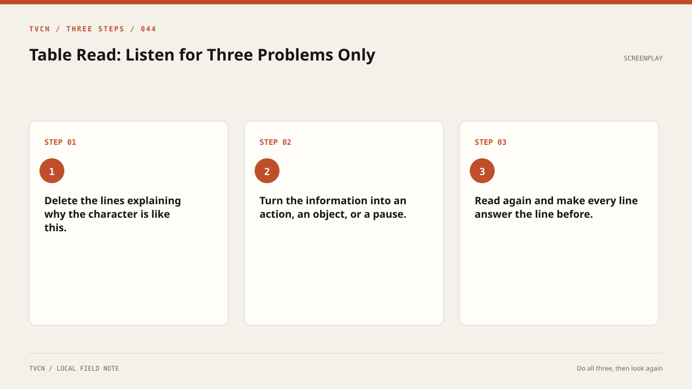

Bring two people who do not know the story, read it start to finish without interruption. Log three columns: unclear, boring, unbelievable. Do not log “add a shot here”; that is the next pass.

<!-- DIAGRAM_START -->
<h2>Diagram</h2>
<figure>
  
  <figcaption>Watch “Use three sticky notes: blue for confusing, red” and “Discuss at most three notes per act; do”; judge whether the want can be said with one visible action.</figcaption>
</figure>
<!-- DIAGRAM_END -->
<section><h2 id="section-1">A table read logs three kinds of problem</h2>
After the read ask what they think the character wants, then which line felt most false. Those answers beat praise.
<h2 id="section-2">Limits</h2>
A table read is not a performance review. Do not rewrite a line because someone read it flat; first decide whether the line or the reading is the problem.
</section><section><h2 id="section-3">On set</h2>
Hand out three colors: blue for confusing, red for boring, yellow for false character. Discuss at most three notes per act; do not rewrite line by line.
</section><section><h2 id="section-4">Do this</h2>
A table read logs three problems: confusing, boring, out of character. It is not a script seminar.
<ol><li>Use three sticky notes: blue for confusing, red for boring, yellow for out of character.</li><li>Discuss at most three notes per act; do not rewrite every line.</li><li>After the read, fix only the repeat note and log the rest for the next round.</li></ol></section><section><h2 id="section-5">Avoid</h2>
Do not turn the read into a line-by-line rewrite; ten pages changed overnight collapse the next day.
</section><section><h2>Judge</h2>
This page passes on three observable checks, not slogans:
<ul><li><strong>1.</strong> Three problem types are separated by color and not mixed in discussion.</li><li><strong>2.</strong> No act discusses more than three notes and no line-by-line rewrite happens.</li><li><strong>3.</strong> Only one repeated problem is changed after the read; the rest are logged.</li></ul></section><section><h2>Failures</h2>
Any one of these means stop and fix it before post:
<ul><li><strong>1.</strong> Check 1 is only staged (“Three problem types are separated by color and…”); another camera position or location exposes it.</li><li><strong>2.</strong> Check 2 is left to post or a verbal explanation (“No act discusses more than three notes and no…”); nothing on set can be rechecked.</li><li><strong>3.</strong> Do not turn the read into a line-by-line rewrite; ten pages changed overnight collapse the next day.</li></ul></section><section><h2>Extend</h2>
<strong>10-minute exercise:</strong> Write one 30-second scene with only “Use three sticky notes: blue for confusing, red” and “Discuss at most three notes per act; do”. Cut every explanation and ask one person to retell what the character wants.
</section>
<h2>Check</h2><ul><li>Three problem types are separated by color and not mixed in discussion.</li><li>No act discusses more than three notes and no line-by-line rewrite happens.</li><li>Only one repeated problem is changed after the read; the rest are logged.</li></ul>

<!-- DEEP_DIVE_START -->
## Deep dive

<strong>About 7 minutes.</strong> This section does not repeat the method above. It adds three things: two conditions, a counterexample and a reusable model, so you can decide when to change the method.

### Condition A: pre-casting read

A pre-casting read is not a performance; it is listening for structure. Let different actors read the same scene and hear who gives the lines a want; do not listen for who sounds like the character. Note only three questions: which line is unclear, which scene has no change, whose decision comes too late.

Do not direct and do not give emotion; let actors sit and read the words. Sitting exposes the writing; standing performance covers structure.

### Condition B: full-crew read before shooting

The full-crew read is not for memorising lines; it lets departments hear where money, time or space is needed. Camera hears blocking, sound hears unclear lines, art hears props, producing hears scene count. After the read each department names one thing that must be prepared in advance, not ten.

Read in shooting order, not script order, to catch too many company moves in one day, costume changes that cannot happen and repeated props. The read is not a creative meeting; it is a risk meeting.

### Counterexample: the read becomes a performance

At a read, actors stand and perform, the director gives emotion, everyone applauds. The room is lively, but nobody notices scene two and scene five say the same thing. After two shoot days, the edit reveals the repetition.

Split the read: first sitting, structure only; then standing, action only. Structure before performance, not performance first. Keep music off during the sitting read; do not let mood cover the problem.

### Reusable model

<strong>Three questions → one risk sheet → one advance action.</strong> The read records three questions; each department writes one risk sheet; each department takes one advance action. The value is not applause; it is one less stop on set.

Send the three questions to the writer and the risk sheets to the producer the same day. Do not wait for the shoot. Problems are cheaper early.

<!-- DEEP_DIVE_END -->

<!-- SOURCES_START -->
## References and further reading

- [S41] [WGA: Contract and Credit Resources](https://www.wga.org/) — Accessed 2026-11-26. Used to check the terminology/method/rule in the “A table read logs three kinds of problem” section against WGA contract and credit resources, not Chinese employment law; it does not verify numbers, model choices or on-set conclusions derived from this page, and is not a substitute for a test.
- [S42] [Pixar in a Box: Storytelling](https://www.khanacademy.org/partner-content/pixar) — Accessed 2026-11-26. Used to check the terminology/method/rule in the “Limits” section against Pixar storytelling course, not project pricing; it does not verify numbers, model choices or on-set conclusions derived from this page, and is not a substitute for a test.
<!-- SOURCES_END -->

