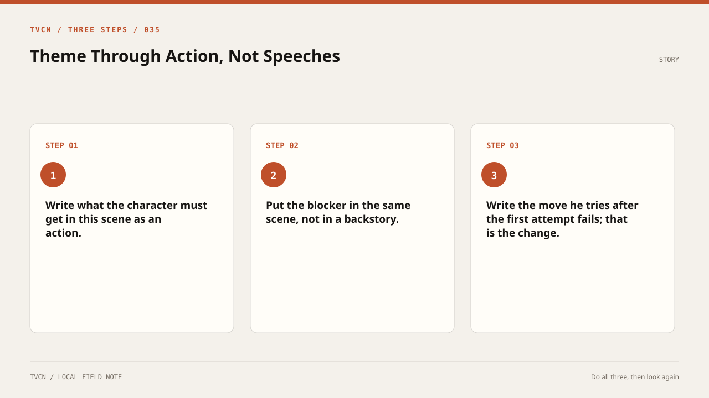

Theme is not a voiceover line; it is an action that recurs with a different meaning each time. Someone wipes the table when nervous: first a habit, then a cover, then a goodbye. The audience reads the theme from the change.

<!-- DIAGRAM_START -->
<h2>Diagram</h2>
<figure>
  
  <figcaption>Watch “Write one theme sentence the character will never” and “Design a choice: they give up B for”; judge whether the want can be said with one visible action.</figcaption>
</figure>
<!-- DIAGRAM_END -->
<section><h2 id="section-1">Theme lands on a repeated action</h2>
After writing the theme sentence, ask which action proves it. If no action exists, it is still a concept.
<h2 id="section-2">Limits</h2>
Do not let a character announce the theme. They can be wrong, contradict it, or fail to say it; the structure proves the theme, not a line.
</section><section><h2 id="section-3">On set</h2>
Write one theme sentence no character will say, then design a choice: they give up B for A. The camera only shows the hand reaching and stopping.
</section><section><h2 id="section-4">Do this</h2>
Do not let the character state the theme; make them choose under pressure and expose their values.
<ol><li>Write one theme sentence the character will never say.</li><li>Design a choice: they give up B for A.</li><li>Shoot the reach and the stop; let the audience read the theme.</li></ol></section><section><h2 id="section-5">Avoid</h2>
Do not summarize the theme in dialogue; let the choice expose the stance.
</section><section><h2>Judge</h2>
Three signals are observable on set:
<ul><li>the want is visible in one action</li><li>the obstacle escalates inside the same scene</li><li>delete one expository line and the conflict still holds</li></ul></section><section><h2>Failures</h2>
These three moves erase the detail you just built:
<ul><li>the want is unclear and the scene is only mood</li><li>the obstacle is solved by coincidence, not a decision</li><li>dialogue repeats what the image already says</li></ul></section><section><h2>Extend</h2>
<strong>10-minute exercise:</strong> Write one 30-second scene with only “Write one theme sentence the character will never” and “Design a choice: they give up B for”. Cut every explanation and ask one person to retell what the character wants.
</section>
<h2>Check</h2><ul><li>Nobody speaks the theme sentence; the choice carries it.</li><li>The choice has a clear A and B so the audience knows what was given up.</li><li>The last action is a reach or a stop, not an explanatory line.</li></ul>

<!-- DEEP_DIVE_START -->
## Deep dive

<strong>About 6 minutes.</strong> Theme is not a lesson a character says. It is the choice he keeps making under pressure.

### Theme is a verb

Do not write “family matters.” Write “he makes it home before dinner every time.” A repeated action lets the theme appear.

The theme must be filmable: catching a train, cooking, giving up a seat, closing a door. Not “he understands now.”

If the theme needs narration, the audience remembers the sentence, not the person.

### Give the counter-theme a case

The opponent should represent another way to live, not just a villain. Both choices must be understandable or the audience stops thinking.

Give the counter-theme its own cost and reward: he chose career and lost what; he chose freedom and paid what.

Do not let dialogue judge for the audience. Put both choices in the same scene and let them collide.

### Answer with an action at the end

Do not end with a speech. Put him in the same situation and let him choose differently; the theme lands by itself.

At the start he races home; at the end he chooses to stay late. Same dinner hour, different action, and the audience sees the change.

Do not explain “this is growth.” Let the next action carry the conclusion.

### Let the counter-theme win sometimes

Give the counter-theme one real win; do not make it only do wrong things. When it wins, the protagonist’s choice has pressure.

The counter-theme pays for that win, but the cost should not cancel it immediately. The audience must see the benefit before they understand the temptation.

Do not use score to tell the audience what to feel. Let action and silence speak. Push the music and the theme becomes a commercial.

### Five-minute drill: three proofs and one counter

Write one theme sentence, three actions that prove it, and one counterexample. If the counterexample is weak, the theme is a slogan.

Place the three actions across three scenes, not one; repetition across time is what makes the audience believe it.

### Ten theme checks
<ul><li>Theme fits in one verb</li><li>Theme is filmable</li><li>Three actions across three scenes</li><li>The counter-theme has a case</li><li>The counter-theme also pays</li><li>Dialogue does not judge</li><li>Same situation at start and end</li><li>The ending answers with action</li><li>No explanation of growth</li><li>The counterexample holds</li></ul>
Theme is not what the audience hears; it is what they watch a person keep doing.

<!-- DEEP_DIVE_END -->
