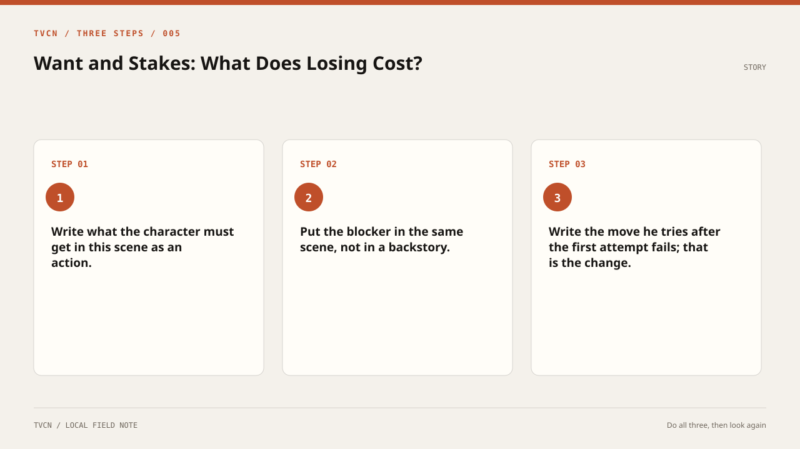

“Wants recognition” is abstract; “needs that signature by Friday” is playable. Loss must also be concrete: the job, the apartment, someone&#x27;s trust. Abstract desire cannot drive action; specific loss can.

<!-- DIAGRAM_START -->
<h2>Diagram</h2>
<figure>
  
  <figcaption>Watch “Write the specific thing they want in this” and “Write the specific cost of losing it: no”; judge whether the want can be said with one visible action.</figcaption>
</figure>
<!-- DIAGRAM_END -->
<section><h2 id="section-1">Make the want concrete and the loss visible</h2>
“Wants recognition” is abstract; “needs that signature by Friday” is playable. Loss must also be concrete: the job, the apartment, someone's trust. Abstract desire cannot drive action; specific loss can.

Write three columns: what they want, what they lose if they fail, what they will pay. All three must be playable in the same scene.
<h2 id="section-2">Limits</h2>
Bigger stakes are not better. An ordinary person losing a job holds the audience more than a superhero losing Earth; scale must match the character.
</section><section><h2 id="section-3">On set</h2>
Before writing a scene, fill two boxes: the concrete thing they want, a key or a signature, and the concrete cost of losing it, no bed tonight or a lost job. Both must be nouns and actions, not dignity or security.
</section><section><h2 id="section-4">Do this</h2>
What the character wants matters less than what losing it costs. Write a concrete object, then a concrete cost.
<ol><li>Write the specific thing they want in this scene: a key, a signature, one sentence.</li><li>Write the specific cost of losing it: no bed tonight, a lost job, a missed person.</li><li>Keep both boxes to nouns and actions, not dignity or security.</li></ol></section><section><h2 id="section-5">Avoid</h2>
Do not replace the scene with a character biography; the audience sees only now.
</section><section><h2>Judge</h2>
This page passes on three observable checks, not slogans:
<ul><li><strong>1.</strong> Both boxes hold filmable nouns and actions, not abstractions like dignity or security.</li><li><strong>2.</strong> The want and the cost happen in the same scene without voice-over.</li><li><strong>3.</strong> Another reader can name exactly what the character fears losing.</li></ul></section><section><h2>Failures</h2>
Any one of these means stop and fix it before post:
<ul><li><strong>1.</strong> Check 1 is only staged (“Both boxes hold filmable nouns and actions, no…”); another camera position or location exposes it.</li><li><strong>2.</strong> Check 2 is left to post or a verbal explanation (“The want and the cost happen in the same scene…”); nothing on set can be rechecked.</li><li><strong>3.</strong> Do not replace the scene with a character biography; the audience sees only now.</li></ul></section><section><h2>Extend</h2>
<strong>10-minute exercise:</strong> Write one 30-second scene with only “Write the specific thing they want in this” and “Write the specific cost of losing it: no”. Cut every explanation and ask one person to retell what the character wants.
</section>
<h2>Check</h2><ul><li>Both boxes hold filmable nouns and actions, not abstractions like dignity or security.</li><li>The want and the cost happen in the same scene without voice-over.</li><li>Another reader can name exactly what the character fears losing.</li></ul>

<!-- DEEP_DIVE_START -->
## Deep dive

<strong>About 6 minutes.</strong> Want and stakes are not a character bio. The audience needs to know what it costs to fail.

### Make the want concrete

Do not write “wants to succeed.” Write “wants his daughter in a room with a window before school starts.” A concrete goal becomes action.

The want must be filmable: moving boxes, signing, handing over keys, not “becoming better.”

### Make the stake visible

Name what is lost: money, a relationship, status, time. Show the cost in the first scene, not in the last line.

A stake does not have to be life or death. A mother missing a parent-teacher meeting can be the heaviest thing in her year.

### Escalate the pressure

The same wall closes in: late once, then fired, then a custody hearing. Each turn must change the character’s choice.

Escalation is not repeating the same bad luck; each beat forces a new method at a higher price.

### Put the stake into an action

Do not let the character say “I cannot lose you.” Let them transfer the last money or hand over the keys; an action makes the stake visible.

At the end of every scene ask: what did he just lose, or nearly lose? If there is no answer, the scene may be information only.

The stake must be seen by another character; knowing it only as the audience is not enough pressure. When the opponent knows the cost, the conflict becomes real; when they do not, it goes soft.

Do not explain the stake at the end; let the choice speak. If the audience cannot name what he fears losing, cut the premise and add an action.

### The one-sentence check

Ask a friend who has not read the story to repeat one sentence: “He wants ____, and if he fails, he loses ____.” If both blanks are concrete, the story stands.

If the friend asks why he cannot simply choose another goal, the stake is not painful enough. Raise the cost until he cannot walk away.

### Ten checks before the story works
<ul><li>The want is filmable</li><li>The goal has a deadline</li><li>The cost appears in the first scene</li><li>The stake is money, a relationship, or status</li><li>The opposition wants the opposite</li><li>Every escalation changes the choice</li><li>The hero cannot win by luck</li><li>Each failure costs more</li><li>The ending stops after a choice</li><li>The audience can name what he fears losing</li></ul>
The audience is not tense about a premise; it is tense about what a person is about to lose.

<!-- DEEP_DIVE_END -->

<!-- SOURCES_START -->
## References and further reading

- [S41] [WGA: Contract and Credit Resources](https://www.wga.org/) — Accessed 2026-11-26. Used to check the terminology/method/rule in the “Make the want concrete and the loss visible” section against WGA contract and credit resources, not Chinese employment law; it does not verify numbers, model choices or on-set conclusions derived from this page, and is not a substitute for a test.
- [S42] [Pixar in a Box: Storytelling](https://www.khanacademy.org/partner-content/pixar) — Accessed 2026-11-26. Used to check the terminology/method/rule in the “Limits” section against Pixar storytelling course, not project pricing; it does not verify numbers, model choices or on-set conclusions derived from this page, and is not a substitute for a test.
<!-- SOURCES_END -->

