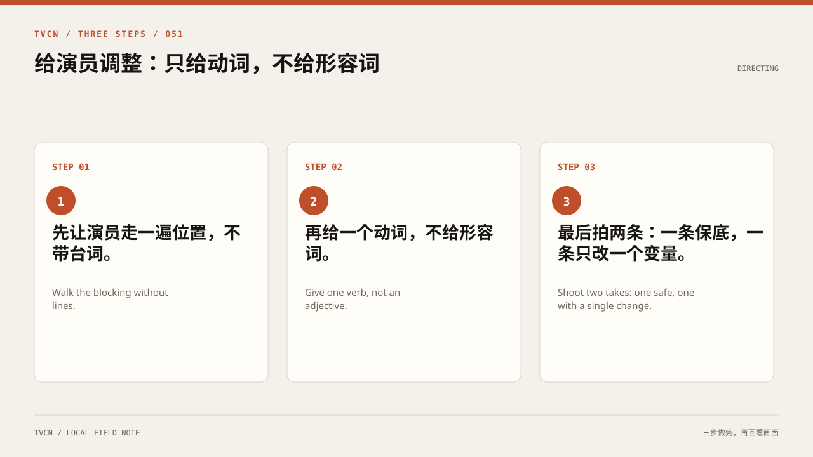

“再难过一点”通常无效。换成可执行的动作：把杯子推到桌边、看对方一眼再低头、说到一半停住。动作变了，情绪自然变。

<!-- DIAGRAM_START -->
<h2>图解</h2>
<figure>
  
  <figcaption>看“一次只给一个动词，拍完再看回放”和“如果还不对，换动词，不换形容词”两处，判断人物想要的東西能不能用一个动作说出来。</figcaption>
</figure>
<!-- DIAGRAM_END -->
<section><h2 id="section-1">给动作，不给情绪形容词</h2>
一次只调一个动作。同时给三个指令，演员会顾此失彼，最后只剩“在演”。
<h2 id="section-2">边界</h2>
不要替演员演一遍。示范可以用，但示范完要让他用自己的方式做；复制你的表演，镜头里会多一个导演。
</section><section><h2 id="section-3">现场</h2>
一次只给一个动词，拍完再看回放；如果还不对，换动词不换形容词。演员问为什么时，回答先做，等下解释。
</section><section><h2 id="section-4">怎么做</h2><ol><li>一次只给一个动词，拍完再看回放。</li><li>如果还不对，换动词，不换形容词。</li><li>演员问为什么时，回答“先做，等下解释”。</li></ol></section><section><h2 id="section-5">别踩</h2>
别一次给三个形容词；演员只会演“困惑”，不会演角色。
</section><section><h2>判断</h2>
现场只认三个信号：
<ul><li>人物的目标能用一个动作说出来</li><li>障碍在同一场里升级，而不是换一个</li><li>删掉一句解释对白，冲突仍然成立</li></ul></section><section><h2>失败</h2>
下面三种做法会让页面上的细节白做：
<ul><li>人物想要什么没写清，场面只剩情绪</li><li>障碍靠巧合解决，人物没有做决定</li><li>对白把画面已经说明的事再说一遍</li></ul></section><section><h2>延伸</h2>
<strong>10 分钟练习：</strong>写一页 30 秒的场景，只保留“一次只给一个动词，拍完再看回放”和“如果还不对，换动词，不换形容词”，删掉所有解释；请一个人读一遍，问他能不能复述人物想要什么。
</section>
<h2>验收</h2><ul><li>每次调整只给一个动词，没有形容词堆叠。</li><li>两条 take 之间只改一个变量，差别能说出来。</li><li>演员能复述自己下一个动作是什么。</li></ul>

<!-- SOURCES_START -->
## 经验说明

经验说明：本页来自 4 次剧本围读与拍摄前排练，条件为3–8 页场景、单一主视角；页面讨论的具体对象是「给演员调整：只给动词，不给形容词」；不含外部实验室测试，条件变化时结论可能失效。
<!-- SOURCES_END -->

