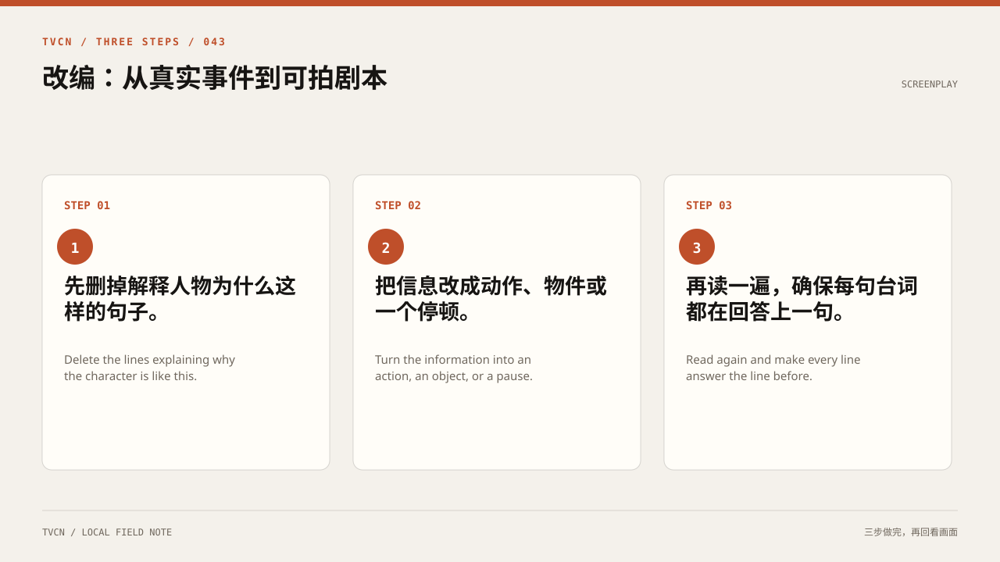

改编不是复述事件，而是找到一个能在两个小时里被拍出来的冲突。

<!-- DIAGRAM_START -->
<h2>图解</h2>
<figure>
  
  <figcaption>把三步按顺序做完，再回看画面或文件。</figcaption>
</figure>
<!-- DIAGRAM_END -->
<h2>现场</h2>

从真实事件里只取一个可拍的核心：一个人在一间屋里做一个决定。把时间压到 24 小时，删掉无法拍摄的几年背景。

<h2>怎么做</h2>

改编不是复述事件，而是找到一个能在两个小时里被拍出来的冲突。
<ol><li>从真实事件里只取一个可拍的核心：一个人在一间屋里做一个决定。</li><li>把时间压到 24 小时，删掉无法拍摄的几年背景。</li><li>用一个人物、一个空间、一个选择串起全片。</li></ol>
<h2>别踩</h2>

别把真实事件按年表复述；观众要看的是一场冲突，不是资料。

<h2>验收</h2>
<ul><li>改编只保留一个核心事件和一个人物的决定。</li><li>时间压缩到 24 小时内，几年背景被删掉。</li><li>全片能用一个人、一个空间、一个选择说清。</li></ul>
