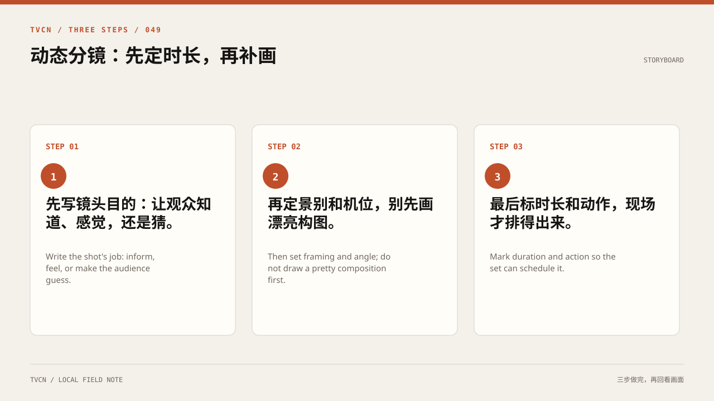

动态分镜先定镜头时长和剪辑点，画得糙没关系，节奏错了才是大问题。

<!-- DIAGRAM_START -->
<h2>图解</h2>
<figure>
  
  <figcaption>把三步按顺序做完，再回看画面或文件。</figcaption>
</figure>
<!-- DIAGRAM_END -->
<h2>现场</h2>

先用手机录一遍台词，按真实语速定时长；把每镜秒数写进分镜，再补画。总时长先控制在目标长度的 110%。

<h2>怎么做</h2>

动态分镜先定镜头时长和剪辑点，画得糙没关系，节奏错了才是大问题。
<ol><li>先用手机录一遍台词，按真实语速定时长。</li><li>把每镜秒数写进分镜，再补画。</li><li>总时长先控制在目标长度的 110%。</li></ol>
<h2>别踩</h2>

别先画漂亮图再定时长；节奏一错，画得再好也要重做。

<h2>验收</h2>
<ul><li>每镜秒数来自真实语速的台词录音，不是估的。</li><li>分镜上每格都有时长，总长不超过目标的 110%。</li><li>按秒数播放一遍，剪辑点能对上。</li></ul>
