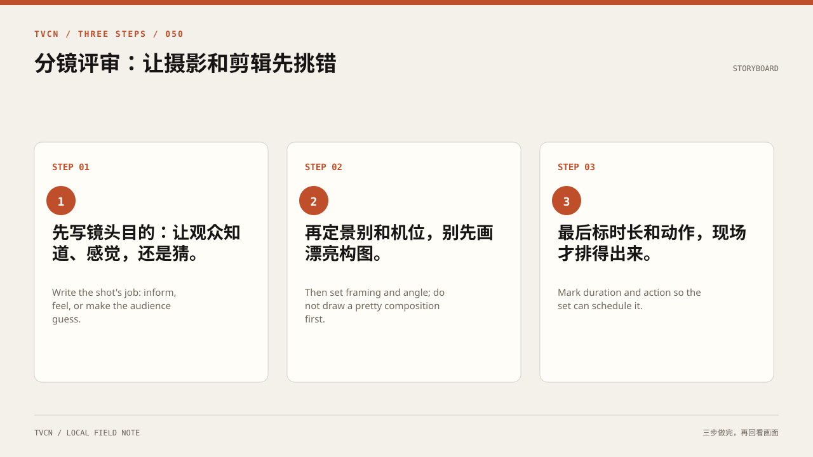

分镜评审按四列走：这一格谁在做什么、摄影机在哪、需要什么、多久。画得再漂亮，如果摄影机位置说不清，现场仍然拍不出来。

<!-- DIAGRAM_START -->
<h2>图解</h2>
<figure>
  
  <figcaption>看“给摄影一张机位问题清单，给剪辑一张缺…”和“会上只改三格，其余记下来下一轮”两处，判断人物想要的東西能不能用一个动作说出来。</figcaption>
</figure>
<!-- DIAGRAM_END -->
<section><h2 id="section-1">看板子先看“能不能拍”，不看“画得好不好”</h2>
让摄影和剪辑各提一个“我会怎么拍/怎么接”的问题；问题越具体，越能提前暴露缺口。
<h2 id="section-2">边界</h2>
评审不是投票。不要用“感觉不对”否决一格；指出是动作不清、空间不清还是时间不清。
</section><section><h2 id="section-3">现场</h2>
评审前给摄影一张机位问题清单、给剪辑一张缺口清单；会上只改三格，其余记下来下一轮。
</section><section><h2 id="section-4">怎么做</h2><ol><li>给摄影一张机位问题清单，给剪辑一张缺口清单。</li><li>会上只改三格，其余记下来下一轮。</li><li>导演最后拍板，不让所有人同时重画。</li></ol></section><section><h2 id="section-5">别踩</h2>
别在评审会上全盘重画；一次改三格，才改得完。
</section><section><h2>判断</h2>
这一页的判断只看三条可观察的验收，不靠口号：
<ul><li><strong>1.</strong> 摄影和剪辑各带一张问题清单进场。</li><li><strong>2.</strong> 会议只改了三个格子，其他有记录。</li><li><strong>3.</strong> 改完三格后，机位和剪辑缺口有具体改善。</li></ul></section><section><h2>失败</h2>
下面任一条出现，先停，不要靠后期补：
<ul><li><strong>1.</strong> 只做到“摄影和剪辑各带一张问题清单进场”的形式，换一个机位或场景就重现不了。</li><li><strong>2.</strong> 把“会议只改了三个格子，其他有记录”留到后期或口头解释，现场没有留下能复查的记录。</li><li><strong>3.</strong> 别在评审会上全盘重画；一次改三格，才改得完。</li></ul></section><section><h2>延伸</h2>
<strong>10 分钟练习：</strong>写一页 30 秒的场景，只保留“给摄影一张机位问题清单，给剪辑一张缺…”和“会上只改三格，其余记下来下一轮”，删掉所有解释；请一个人读一遍，问他能不能复述人物想要什么。
</section>
<h2>验收</h2><ul><li>摄影和剪辑各带一张问题清单进场。</li><li>会议只改了三个格子，其他有记录。</li><li>改完三格后，机位和剪辑缺口有具体改善。</li></ul>

<!-- SOURCES_START -->
## 参考与延伸阅读

- [S42] [Pixar in a Box：叙事课程](https://www.khanacademy.org/partner-content/pixar) — 2026-11-26 访问。用于核对「看板子先看“能不能拍”，不看“画得好不好”」一节的术语/方法/规则（Pixar 叙事课程，不是项目报价）；不核对其中由本页经验得出的数字、型号与现场结论，也不替代测试。
- [S43] [BFI：国家档案馆](https://www.bfi.org.uk/bfi-national-archive) — 2026-11-26 访问。用于核对「现场」一节的术语/方法/规则（BFI 档案资料，不是发行规则）；不核对其中由本页经验得出的数字、型号与现场结论，也不替代测试。
<!-- SOURCES_END -->

