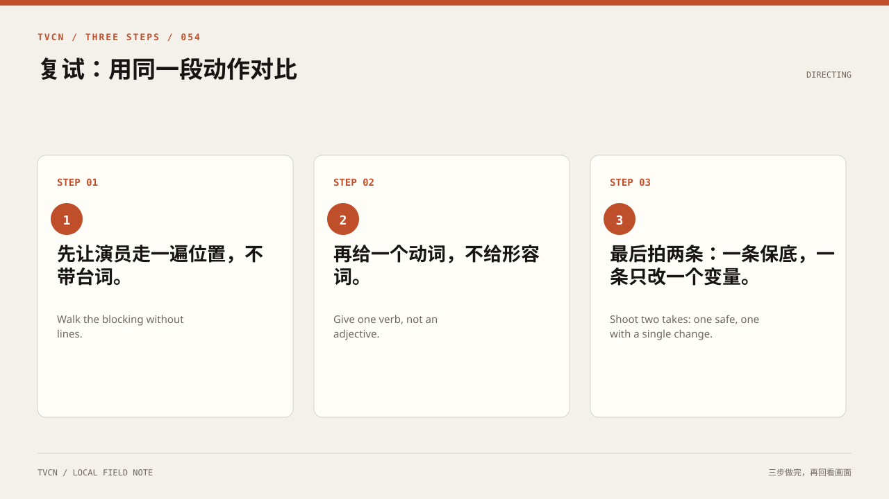

复试别让演员重新演一段，让两个人做同一个动作，才看得出差别。

<!-- DIAGRAM_START -->
<h2>图解</h2>
<figure>
  
  <figcaption>把三步按顺序做完，再回看画面或文件。</figcaption>
</figure>
<!-- DIAGRAM_END -->
<h2>现场</h2>

复试给同一段 30 秒动作：进门、找东西、发现不对。两个人用同一机位、同一台词，回放对比反应。

<h2>怎么做</h2>

复试别让演员重新演一段，让两个人做同一个动作，才看得出差别。
<ol><li>给同一段 30 秒动作：进门、找东西、发现不对。</li><li>两个人用同一机位、同一台词。</li><li>回放对比反应，不看谁更讨喜。</li></ol>
<h2>别踩</h2>

别让每个人演不同片段；片段不同，比较就不成立。

<h2>验收</h2>
<ul><li>两位演员做的是同一段 30 秒动作，台词相同。</li><li>机位、焦段和光线一致，可以直接并排看。</li><li>比较落在反应和动作上，不是“谁更讨喜”。</li></ul>
