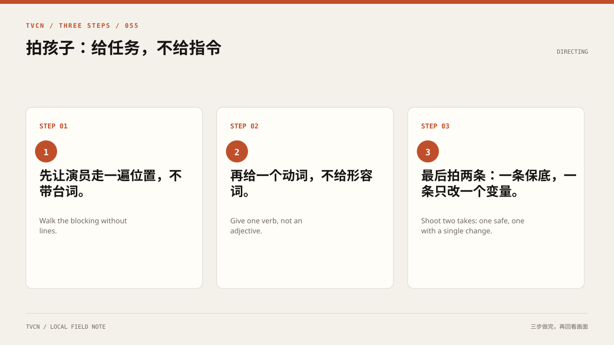

儿童演员的现场规则要写进通告：每天最长工作时间、休息与吃饭时间、监护人始终在场、不得单独进入封闭空间、不得拍摄危险动作。

<!-- DIAGRAM_START -->
<h2>图解</h2>
<figure>
  
  <figcaption>看“给孩子一个具体任务和一个时限：30 …”和“不要喊“表现自然”，只说明任务和边界”两处，判断人物想要的東西能不能用一个动作说出来。</figcaption>
</figure>
<!-- DIAGRAM_END -->
<section><h2 id="section-1">先保作息和监护，再谈表演</h2>
把剧本里孩子不该看到的内容提前说明；现场用游戏和具体动作引导，不要用“你想象一下你妈妈死了”这种情绪诱导。
<h2 id="section-2">边界</h2>
孩子点头不等于同意。监护人可以在任何时刻喊停；已经拍到的素材，如果孩子后来不安，应删掉。
</section><section><h2 id="section-3">现场</h2>
给孩子一个具体任务和一个时限：把桌上的三样东西装进袋子，30 秒内完成。不要喊表现自然。
</section><section><h2 id="section-4">怎么做</h2><ol><li>给孩子一个具体任务和一个时限：30 秒内把三样东西装进袋子。</li><li>不要喊“表现自然”，只说明任务和边界。</li><li>拍完立刻给结果反馈，不让孩子长时间等待。</li></ol></section><section><h2 id="section-5">别踩</h2>
别让孩子演情绪；任务清楚，反应才会自己出现。
</section><section><h2>判断</h2>
这一页的判断只看三条可观察的验收，不靠口号：
<ul><li><strong>1.</strong> 孩子接到的是具体任务和时限，不是情绪指令。</li><li><strong>2.</strong> 拍摄中没有人喊“自然一点”或“难过一点”。</li><li><strong>3.</strong> 任务完成后孩子能马上得到反馈，没有长时间干等。</li></ul></section><section><h2>失败</h2>
下面任一条出现，先停，不要靠后期补：
<ul><li><strong>1.</strong> 只做到“孩子接到的是具体任务和时限，不是情绪指令”的形式，换一个机位或场景就重现不了。</li><li><strong>2.</strong> 把“拍摄中没有人喊“自然一点”或“难过一点””留到后期或口头解释，现场没有留下能复查的记录。</li><li><strong>3.</strong> 别让孩子演情绪；任务清楚，反应才会自己出现。</li></ul></section><section><h2>延伸</h2>
<strong>10 分钟练习：</strong>写一页 30 秒的场景，只保留“给孩子一个具体任务和一个时限：30 …”和“不要喊“表现自然”，只说明任务和边界”，删掉所有解释；请一个人读一遍，问他能不能复述人物想要什么。
</section>
<h2>验收</h2><ul><li>孩子接到的是具体任务和时限，不是情绪指令。</li><li>拍摄中没有人喊“自然一点”或“难过一点”。</li><li>任务完成后孩子能马上得到反馈，没有长时间干等。</li></ul>

<!-- SOURCES_START -->
## 参考与延伸阅读

- [S42] [Pixar in a Box：叙事课程](https://www.khanacademy.org/partner-content/pixar) — 2026-11-26 访问。用于核对「先保作息和监护，再谈表演」一节的术语/方法/规则（Pixar 叙事课程，不是项目报价）；不核对其中由本页经验得出的数字、型号与现场结论，也不替代测试。
- [S16] [BBC：编辑准则](https://www.bbc.co.uk/editorialguidelines/) — 2026-11-26 访问。用于核对「现场」一节的术语/方法/规则（BBC 编辑准则，不是平台流量规则）；不核对其中由本页经验得出的数字、型号与现场结论，也不替代测试。
<!-- SOURCES_END -->

