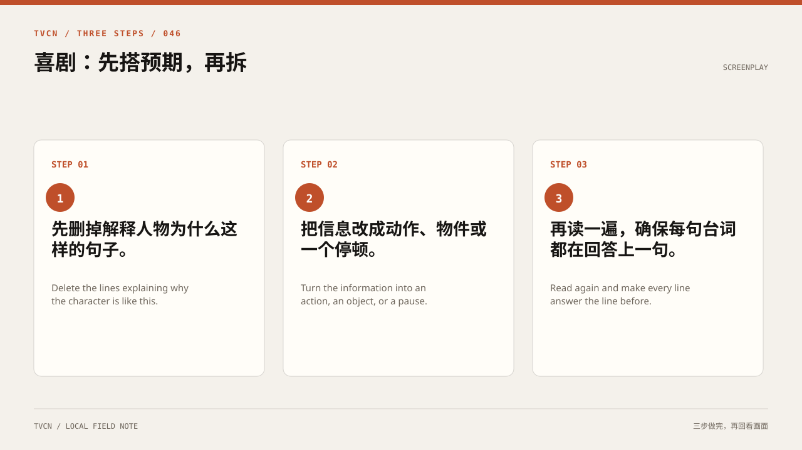

别解释笑点；角色一笑，观众就不笑了。

<!-- DIAGRAM_START -->
<h2>图解</h2>
<figure>
  
  <figcaption>看“先写观众预期的三个步骤”和“把第二步换成一个合理但错的东西”两处，判断人物想要的東西能不能用一个动作说出来。</figcaption>
</figure>
<!-- DIAGRAM_END -->
<section><h2 id="section-1">现场</h2>
先写观众预期的三个步骤，再把第二步换成一个合理但错的东西；不要解释笑点，让角色继续认真做事。
</section><section><h2 id="section-2">怎么做</h2><ol><li>先写观众预期的三个步骤。</li><li>把第二步换成一个合理但错的东西。</li><li>不要解释笑点，让角色继续认真做事。</li></ol></section><section></section><section><h2 id="section-4">三种原因</h2>
针对“喜剧：先搭预期，再拆”，先按三个方向排查；每次只改一个变量，改完录 30 秒对比，看变化跟着哪个环节走。

<table class="data-table"><thead><tr><th>原因</th><th>现场信号</th><th>5 分钟验证</th></tr></thead><tbody><tr><td>没有建立预期</td><td>观众不知道角色相信什么，笑点没有落点</td><td>先写一个角色坚信的错误认知</td></tr><tr><td>角色太聪明</td><td>人物自己知道好笑，观众就不笑</td><td>让人物认真对待一件小事</td></tr><tr><td>节奏太慢</td><td>铺垫太久，笑点到达前观众已经走神</td><td>把铺垫压到三拍以内</td></tr></tbody></table>
</section><section><h2 id="section-5">现场诊断</h2><ol><li>标出 setup 和 payoff 的位置；如果 payoff 前没有重复，预期没建立。</li><li>问一个没看过的人“你猜到会这样吗”；如果猜不到，铺垫不够。</li><li>把笑点前的台词删一半，看是否还成立。</li></ol></section><section><h2 id="section-6">修法</h2>
喜剧不是讲笑话，是让一个人认真做一件不该成功的事。先搭预期，再让预期以具体方式失败。
<ol><li>用三拍：建立规则、重复规则、打破规则。</li><li>让角色用错误方法解决一个具体问题：拿错钥匙、穿错衣服。</li><li>把笑点落在动作或道具上，不要让人物解释。</li><li>第二笑点放在反应，不在台词。</li></ol></section><section><h2 id="section-7">失败案例</h2>
处理“喜剧：先搭预期，再拆”时，下面三种做法会更糟；先选一个替换动作，别同时改三个变量。

<table class="data-table"><thead><tr><th>失败做法</th><th>为什么会更糟</th><th>替换动作</th></tr></thead><tbody><tr><td>解释笑话</td><td>观众被告诉“这很好笑”，反而不笑</td><td>删掉解释，留动作</td></tr><tr><td>角色自己搞笑</td><td>人物在演滑稽，观众在看表演</td><td>让人物认真</td></tr><tr><td>铺垫太长</td><td>笑点到达时注意力已经没了</td><td>三拍内给第一次变化</td></tr></tbody></table>
</section><section><h2 id="section-8">验收表</h2>
验收不是“感觉好了”，是这四项都能指认、能回放、能记录。

<table class="data-table"><thead><tr><th>验收项</th><th>通过线</th><th>记录</th></tr></thead><tbody><tr><td>预期</td><td>setup 和 payoff 能指认</td><td>逐段标记</td></tr><tr><td>认真</td><td>人物不知道自己好笑</td><td>演员回看</td></tr><tr><td>节奏</td><td>第一次变化在三拍内</td><td>计时</td></tr><tr><td>反应</td><td>笑点后有反应镜头</td><td>回放</td></tr></tbody></table>
</section><section><h2>判断</h2>
这一页的判断只看三条可观察的验收，不靠口号：
<ul><li><strong>1.</strong> 前两步建立了明确预期，观众能猜到第三步。</li><li><strong>2.</strong> 只拆掉一个条件，其他逻辑仍然成立。</li><li><strong>3.</strong> 角色没有解释或笑场，仍在认真处理错误。</li></ul></section><section><h2>失败</h2>
下面任一条出现，先停，不要靠后期补：
<ul><li><strong>1.</strong> 只做到“前两步建立了明确预期，观众能猜到第三步”的形式，换一个机位或场景就重现不了。</li><li><strong>2.</strong> 把“只拆掉一个条件，其他逻辑仍然成立”留到后期或口头解释，现场没有留下能复查的记录。</li><li><strong>3.</strong> 第 3 条验收“角色没有解释或笑场，仍在认真处理错误”没人复核，交片时才发现。</li></ul></section><section><h2>延伸</h2>
<strong>10 分钟练习：</strong>写一页 30 秒的场景，只保留“先写观众预期的三个步骤”和“把第二步换成一个合理但错的东西”，删掉所有解释；请一个人读一遍，问他能不能复述人物想要什么。
</section>
<h2>验收</h2><ul><li>前两步建立了明确预期，观众能猜到第三步。</li><li>只拆掉一个条件，其他逻辑仍然成立。</li><li>角色没有解释或笑场，仍在认真处理错误。</li></ul>

<section><h2>边界</h2>
本页只解决「喜剧：先搭预期，再拆」这一个问题；不替代 冲突：两个人都得有道理、覆盖与分镜：从 Shot Sheet 到 Animatic、构图：先让观众知道看哪里。如果现场问题属于后者，先读对应页，不要在本页继续加参数。
</section>
<!-- SOURCES_START -->
## 参考与延伸阅读

- [S41] [美国编剧工会：合同与署名资源](https://www.wga.org/) — 2026-11-26 访问。用于核对「现场」一节的术语/方法/规则（WGA 合同与署名资源，不是中国劳动法）；不核对其中由本页经验得出的数字、型号与现场结论，也不替代测试。
- [S42] [Pixar in a Box：叙事课程](https://www.khanacademy.org/partner-content/pixar) — 2026-11-26 访问。用于核对「怎么做」一节的术语/方法/规则（Pixar 叙事课程，不是项目报价）；不核对其中由本页经验得出的数字、型号与现场结论，也不替代测试。
<!-- SOURCES_END -->

