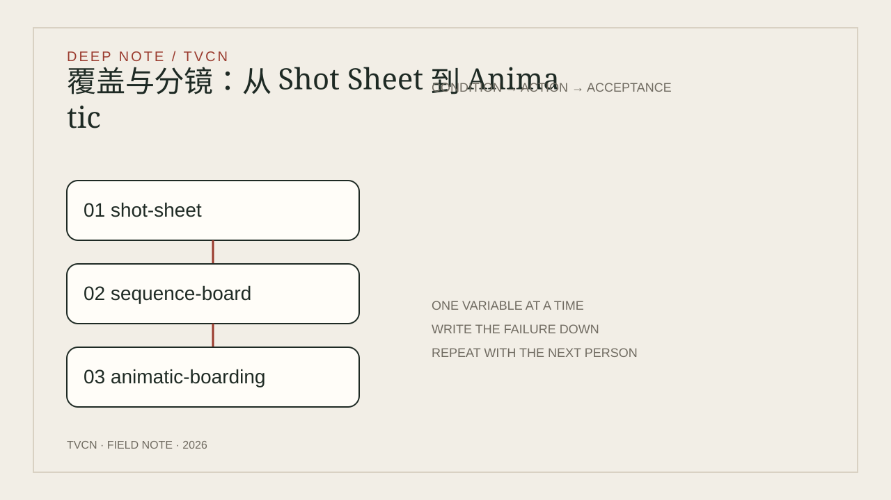

分镜不是画得漂亮，而是 shot sheet、coverage 和 animatic 能在剪辑台上兑现。 单看《镜头表：镜号、景别、动作、时长》只能解决一个局部；把《镜头表：镜号、景别、动作、时长》《段落分镜：一场戏怎么排镜头》《动态分镜：先定时长，再补画》接成一条链，才会暴露“条件没写、变量太多、结果无法复现”的真问题。

<!-- DEEP_DIVE_START -->
<!-- DIAGRAM_START -->
<h2>图解</h2>
<figure>
  
  <figcaption>看“镜头表：镜号、景别、动作、时长”和“段落分镜：一场戏怎么排镜头”两处，先定条件，再看失败能不能被记录下来。</figcaption>
</figure>
<!-- DIAGRAM_END -->

<section><h2 id="section-1">问题</h2>
这一页的问题不是“方法不够多”，而是三个环节各自成立、合起来却不成立：条件没写、变量太多、结果不能复现。

本页按“先定条件—再做判断—只改一个变量—留下证据”的顺序；每一步都能被下一个人复述，才算完成。
</section>
<section><h2 id="section-2">判断</h2><ul><li>《镜头表：镜号、景别、动作、时长》的第一道门槛：每镜都有镜号、景别、动作和秒数，四列不缺</li><li>《段落分镜：一场戏怎么排镜头》的第二道门槛：没有超过 8 秒还没有动作的镜头</li><li>《动态分镜：先定时长，再补画》的第三道门槛：第三个人按表能复述先拍什么、后拍什么</li></ul>
三条里有一条不成立，就先回到对应单页；不要用整条链掩盖一个没解决的单点。
</section>
<section><h2 id="section-3">做法</h2><ol><li>先写条件：把《镜头表：镜号、景别、动作、时长》里“先填第 1、3、5 镜，每镜写一个动词和一个秒数”落到一张三行表：素材、环境、验收。</li><li>再做一次最小动作：只按《镜头表：镜号、景别、动作、时长》的步骤做 30 秒，不加入第二页的方法。</li><li>把《段落分镜：一场戏怎么排镜头》的步骤接上：某镜超过 8 秒或没有动作，就删掉或拆成两镜。</li><li>用《动态分镜：先定时长，再补画》做对照：开机前读一遍，让摄影和剪辑都能按顺序复述。</li><li>每改一次只动一个变量；其他条件写进记录，不靠记忆。</li><li>把失败也拍下来：失败版本和成功版本并排，才知道哪一步不能省。</li><li>让下一个人按记录复现一次；他做不出来，说明记录还不够。</li></ol></section>
<section><h2 id="section-4">现场案例</h2>
可复现实验（不是客户案例）：拿 30 秒素材，先按《镜头表：镜号、景别、动作、时长》的“每镜都有镜号、景别、动作和秒数，四列不缺”做 A 版；再按《段落分镜：一场戏怎么排镜头》的“没有超过 8 秒还没有动作的镜头”做 B 版；两版只允许一个变量不同。把两版并排看，记录《动态分镜：先定时长，再补画》里最先崩的是哪一项：条件、动作还是验收。如果一次就成功，说明变量还不够多，再加一个现实限制重做。
</section>
<section><h2 id="section-5">失败表</h2>
<table class="data-table"><thead><tr><th>现象</th><th>原因</th><th>替换动作</th></tr></thead><tbody><tr><td>别画摄影机拍不到的东西；分镜不是插画</td><td>条件没写清</td><td>回到第一页重写三行表</td></tr><tr><td>别按台词一句一句画；分镜是信息顺序，不是插画</td><td>条件没写清</td><td>回到第一页重写三行表</td></tr><tr><td>别先画漂亮图再定时长；节奏一错，画得再好也要重做</td><td>条件没写清</td><td>回到第一页重写三行表</td></tr></tbody></table>
</section>
<section><h2 id="section-6">验收</h2><ul><li>每镜都有镜号、景别、动作和秒数，四列不缺。</li><li>没有超过 8 秒还没有动作的镜头。</li><li>第三个人按表能复述先拍什么、后拍什么。</li><li>每行只有一个主要动作</li><li>镜号、景别、动作、机位、时长五列齐全</li><li>每组都有全景、中景、近景、插入</li><li>按机位分组，不按剧情顺序</li><li>换机位处画横线并写预计耗时</li><li>前三格能看出先给什么、藏什么、最后揭示什么。</li><li>中间镜头按信息顺序补，不是按台词数量补。</li></ul></section>
<section><h2 id="section-7">替代方案</h2><ul><li>只处理《镜头表：镜号、景别、动作、时长》里的单点问题：回到<a href="https://story.tvcn.org/article/shot-sheet/">《镜头表：镜号、景别、动作、时长》</a>，不要用整条链。</li><li>只比较两个动作：看<a href="https://story.tvcn.org/article/sequence-board/">《段落分镜：一场戏怎么排镜头》</a>，先不改第三页。</li><li>只做验收：看<a href="https://story.tvcn.org/article/animatic-boarding/">《动态分镜：先定时长，再补画》</a>，把判断表拿去做自测。</li></ul></section>

<!-- SOURCES_START -->
## 参考与延伸阅读

- [S12] [Britannica](https://www.britannica.com/art/animation) — 2026-11-26 访问。用于核对首段“分镜不是画得漂亮，而是 shot sheet、coverage 和 animatic 能在剪辑台上兑现。”中的术语与公开背景（动画原理、技术与产业史的百科条目）；不替代现场测试。
- [S41] [美国编剧工会：WGA 合同与署名资源](https://www.wga.org/) — 2026-11-26 访问。用于核对首段“分镜不是画得漂亮，而是 shot sheet、coverage 和 animatic 能在剪辑台上兑现。”中的术语与公开背景（编剧合同、署名与最低报酬条款）；不替代现场测试。
- [S10] [BFI](https://www.bfi.org.uk/) — 2026-11-26 访问。用于核对首段“分镜不是画得漂亮，而是 shot sheet、coverage 和 animatic 能在剪辑台上兑现。”中的术语与公开背景（英国电影协会的电影史、档案与观影研究入口）；不替代现场测试。
- [S42] [Khan Academy：Pixar in a Box](https://www.khanacademy.org/partner-content/pixar) — 2026-11-26 访问。用于核对首段“分镜不是画得漂亮，而是 shot sheet、coverage 和 animatic 能在剪辑台上兑现。”中的术语与公开背景（故事结构、角色与视觉叙事教学）；不替代现场测试。
- [S16] [BBC 编辑准则](https://www.bbc.co.uk/editorialguidelines/) — 2026-11-26 访问。用于核对首段“分镜不是画得漂亮，而是 shot sheet、coverage 和 animatic 能在剪辑台上兑现。”中的术语与公开背景（准确性、公正、隐私与隐蔽拍摄的编辑标准）；不替代现场测试。
<!-- SOURCES_END -->

