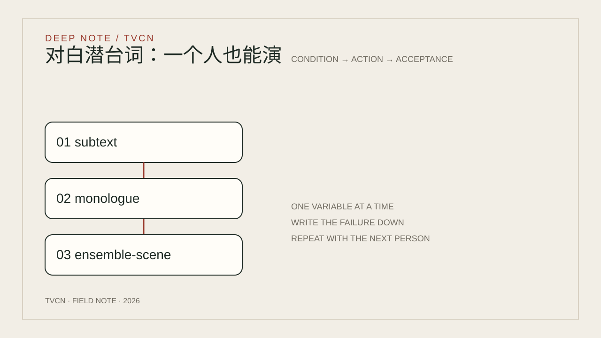

好对白不是把心里话说出来，而是让角色说一件事、做另一件事。 单看《潜台词：台词下面那件事》只能解决一个局部；把《潜台词：台词下面那件事》《独白：别让人物对着空气演讲》《群戏：让每个人都有事做》接成一条链，才会暴露“条件没写、变量太多、结果无法复现”的真问题。

<!-- DEEP_DIVE_START -->
<!-- DIAGRAM_START -->
<h2>图解</h2>
<figure>
  
  <figcaption>看“潜台词：台词下面那件事”和“独白：别让人物对着空气演讲”两处，先定条件，再看失败能不能被记录下来。</figcaption>
</figure>
<!-- DIAGRAM_END -->

<section><h2 id="section-1">问题</h2>
这一页的问题不是“方法不够多”，而是三个环节各自成立、合起来却不成立：条件没写、变量太多、结果不能复现。

本页按“先定条件—再做判断—只改一个变量—留下证据”的顺序；每一步都能被下一个人复述，才算完成。
</section>
<section><h2 id="section-2">判断</h2><ul><li>《潜台词：台词下面那件事》的第一道门槛：画面里有一个走不开的听众，反应可见</li><li>《独白：别让人物对着空气演讲》的第二道门槛：人物说话时在做一件打断自己的事</li><li>《群戏：让每个人都有事做》的第三道门槛：删掉听众后独白明显变弱，说明关系真的在起作用</li></ul>
三条里有一条不成立，就先回到对应单页；不要用整条链掩盖一个没解决的单点。
</section>
<section><h2 id="section-3">做法</h2><ol><li>先写条件：把《潜台词：台词下面那件事》里“给每句台词加一个隐藏动作：她嘴上说随便，手却把菜单合上”落到一张三行表：素材、环境、验收。</li><li>再做一次最小动作：只按《潜台词：台词下面那件事》的步骤做 30 秒，不加入第二页的方法。</li><li>把《独白：别让人物对着空气演讲》的步骤接上：让演员演手，不演台词。</li><li>用《群戏：让每个人都有事做》做对照：回放确认台词和动作互相矛盾，观众能读出 B。</li><li>每改一次只动一个变量；其他条件写进记录，不靠记忆。</li><li>把失败也拍下来：失败版本和成功版本并排，才知道哪一步不能省。</li><li>让下一个人按记录复现一次；他做不出来，说明记录还不够。</li></ol></section>
<section><h2 id="section-4">现场案例</h2>
可复现实验（不是客户案例）：拿 30 秒素材，先按《潜台词：台词下面那件事》的“画面里有一个走不开的听众，反应可见”做 A 版；再按《独白：别让人物对着空气演讲》的“人物说话时在做一件打断自己的事”做 B 版；两版只允许一个变量不同。把两版并排看，记录《群戏：让每个人都有事做》里最先崩的是哪一项：条件、动作还是验收。如果一次就成功，说明变量还不够多，再加一个现实限制重做。
</section>
<section><h2 id="section-5">失败表</h2>
<table class="data-table"><thead><tr><th>现象</th><th>原因</th><th>替换动作</th></tr></thead><tbody><tr><td>别让人物对着镜子或空气演讲；没有听众，独白就假</td><td>条件没写清</td><td>回到第一页重写三行表</td></tr><tr><td>别让群演站成一排等台词；背景一空，空间就假</td><td>条件没写清</td><td>回到第一页重写三行表</td></tr><tr><td>只看结果，不记条件</td><td>条件没写清</td><td>回到第一页重写三行表</td></tr></tbody></table>
</section>
<section><h2 id="section-6">验收</h2><ul><li>画面里有一个走不开的听众，反应可见。</li><li>人物说话时在做一件打断自己的事。</li><li>删掉听众后独白明显变弱，说明关系真的在起作用。</li><li>画面里每个人都有动作和目标，没有空站的人。</li><li>至少两组动作互相干扰，关系在画面里出现。</li><li>删掉任意一个人的动作，空间会明显变空。</li><li>把 潜台词：台词下面那件事 的条件写成一行，能复述给下一个人。</li><li>只改一个变量，另一页的结果还能复现。</li><li>失败现象能被记录成“条件—动作—结果”，不是一句感觉。</li><li>下一位同事不问你，也能按记录做出同一版。</li></ul></section>
<section><h2 id="section-7">替代方案</h2><ul><li>只处理《潜台词：台词下面那件事》里的单点问题：回到<a href="https://story.tvcn.org/article/subtext/">《潜台词：台词下面那件事》</a>，不要用整条链。</li><li>只比较两个动作：看<a href="https://story.tvcn.org/article/monologue/">《独白：别让人物对着空气演讲》</a>，先不改第三页。</li><li>只做验收：看<a href="https://story.tvcn.org/article/ensemble-scene/">《群戏：让每个人都有事做》</a>，把判断表拿去做自测。</li></ul></section>

<!-- SOURCES_START -->
## 参考与延伸阅读

- [S12] [Britannica](https://www.britannica.com/art/animation) — 2026-11-26 访问。用于核对首段“好对白不是把心里话说出来，而是让角色说一件事、做另一件事。”中的术语与公开背景（动画原理、技术与产业史的百科条目）；不替代现场测试。
- [S41] [美国编剧工会：WGA 合同与署名资源](https://www.wga.org/) — 2026-11-26 访问。用于核对首段“好对白不是把心里话说出来，而是让角色说一件事、做另一件事。”中的术语与公开背景（编剧合同、署名与最低报酬条款）；不替代现场测试。
- [S10] [BFI](https://www.bfi.org.uk/) — 2026-11-26 访问。用于核对首段“好对白不是把心里话说出来，而是让角色说一件事、做另一件事。”中的术语与公开背景（英国电影协会的电影史、档案与观影研究入口）；不替代现场测试。
- [S42] [Khan Academy：Pixar in a Box](https://www.khanacademy.org/partner-content/pixar) — 2026-11-26 访问。用于核对首段“好对白不是把心里话说出来，而是让角色说一件事、做另一件事。”中的术语与公开背景（故事结构、角色与视觉叙事教学）；不替代现场测试。
- [S16] [BBC 编辑准则](https://www.bbc.co.uk/editorialguidelines/) — 2026-11-26 访问。用于核对首段“好对白不是把心里话说出来，而是让角色说一件事、做另一件事。”中的术语与公开背景（准确性、公正、隐私与隐蔽拍摄的编辑标准）；不替代现场测试。
<!-- SOURCES_END -->

