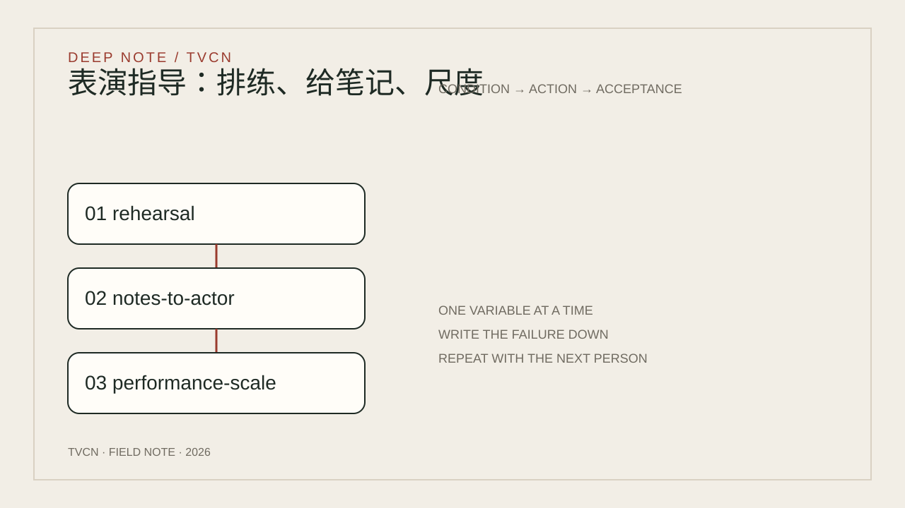

表演指导不是喊“再来一条”，而是把动作、意图和尺度变成演员能执行的话。 单看《排练：先走位，再给台词》只能解决一个局部；把《排练：先走位，再给台词》《给演员的笔记：一句能执行的话》《表演尺度：镜头越近，动作越小》接成一条链，才会暴露“条件没写、变量太多、结果无法复现”的真问题。

<!-- DEEP_DIVE_START -->
<!-- DIAGRAM_START -->
<h2>图解</h2>
<figure>
  
  <figcaption>看“排练：先走位，再给台词”和“给演员的笔记：一句能执行的话”两处，先定条件，再看失败能不能被记录下来。</figcaption>
</figure>
<!-- DIAGRAM_END -->

<section><h2 id="section-1">问题</h2>
这一页的问题不是“方法不够多”，而是三个环节各自成立、合起来却不成立：条件没写、变量太多、结果不能复现。

本页按“先定条件—再做判断—只改一个变量—留下证据”的顺序；每一步都能被下一个人复述，才算完成。
</section>
<section><h2 id="section-2">判断</h2><ul><li>《排练：先走位，再给台词》的第一道门槛：前两遍没有台词，演员只走位置和动作</li><li>《给演员的笔记：一句能执行的话》的第二道门槛：第三遍加台词后，停顿仍落在动作上</li><li>《表演尺度：镜头越近，动作越小》的第三道门槛：演员能说出自己在这一场一直想做什么</li></ul>
三条里有一条不成立，就先回到对应单页；不要用整条链掩盖一个没解决的单点。
</section>
<section><h2 id="section-3">做法</h2><ol><li>先写条件：把《排练：先走位，再给台词》里“前 20 分钟只走位，用胶带标门口、椅子和摄影机”落到一张三行表：素材、环境、验收。</li><li>再做一次最小动作：只按《排练：先走位，再给台词》的步骤做 30 秒，不加入第二页的方法。</li><li>把《给演员的笔记：一句能执行的话》的步骤接上：演员不带台词走三遍，只走动作和停顿。</li><li>用《表演尺度：镜头越近，动作越小》做对照：第三遍才加台词，确认话落在已经成立的位置上。</li><li>每改一次只动一个变量；其他条件写进记录，不靠记忆。</li><li>把失败也拍下来：失败版本和成功版本并排，才知道哪一步不能省。</li><li>让下一个人按记录复现一次；他做不出来，说明记录还不够。</li></ol></section>
<section><h2 id="section-4">现场案例</h2>
可复现实验（不是客户案例）：拿 30 秒素材，先按《排练：先走位，再给台词》的“前两遍没有台词，演员只走位置和动作”做 A 版；再按《给演员的笔记：一句能执行的话》的“第三遍加台词后，停顿仍落在动作上”做 B 版；两版只允许一个变量不同。把两版并排看，记录《表演尺度：镜头越近，动作越小》里最先崩的是哪一项：条件、动作还是验收。如果一次就成功，说明变量还不够多，再加一个现实限制重做。
</section>
<section><h2 id="section-5">失败表</h2>
<table class="data-table"><thead><tr><th>现象</th><th>原因</th><th>替换动作</th></tr></thead><tbody><tr><td>别在监视器后面喊“自然一点”；演员不知道那是什么意思</td><td>条件没写清</td><td>回到第一页重写三行表</td></tr><tr><td>别用同一个动作尺度拍所有景别；近景会把表演放大</td><td>条件没写清</td><td>回到第一页重写三行表</td></tr><tr><td>只看结果，不记条件</td><td>条件没写清</td><td>回到第一页重写三行表</td></tr></tbody></table>
</section>
<section><h2 id="section-6">验收</h2><ul><li>前两遍没有台词，演员只走位置和动作。</li><li>第三遍加台词后，停顿仍落在动作上。</li><li>演员能说出自己在这一场一直想做什么。</li><li>演员不拿台词走了一遍</li><li>起点、终点、转身点标好</li><li>坐下和起身都试过</li><li>每个道具都碰过一次</li><li>只给动词不给形容词</li><li>远景和近景的动作幅度明显不同，近景减半。</li><li>手部特写没有表演感，关节和力度自然。</li></ul></section>
<section><h2 id="section-7">替代方案</h2><ul><li>只处理《排练：先走位，再给台词》里的单点问题：回到<a href="https://story.tvcn.org/article/rehearsal/">《排练：先走位，再给台词》</a>，不要用整条链。</li><li>只比较两个动作：看<a href="https://story.tvcn.org/article/notes-to-actor/">《给演员的笔记：一句能执行的话》</a>，先不改第三页。</li><li>只做验收：看<a href="https://story.tvcn.org/article/performance-scale/">《表演尺度：镜头越近，动作越小》</a>，把判断表拿去做自测。</li></ul></section>

<!-- SOURCES_START -->
## 参考与延伸阅读

- [S12] [Britannica](https://www.britannica.com/art/animation) — 2026-11-26 访问。用于核对首段“表演指导不是喊“再来一条”，而是把动作、意图和尺度变成演员能执行的话。”中的术语与公开背景（动画原理、技术与产业史的百科条目）；不替代现场测试。
- [S41] [美国编剧工会：WGA 合同与署名资源](https://www.wga.org/) — 2026-11-26 访问。用于核对首段“表演指导不是喊“再来一条”，而是把动作、意图和尺度变成演员能执行的话。”中的术语与公开背景（编剧合同、署名与最低报酬条款）；不替代现场测试。
- [S10] [BFI](https://www.bfi.org.uk/) — 2026-11-26 访问。用于核对首段“表演指导不是喊“再来一条”，而是把动作、意图和尺度变成演员能执行的话。”中的术语与公开背景（英国电影协会的电影史、档案与观影研究入口）；不替代现场测试。
- [S42] [Khan Academy：Pixar in a Box](https://www.khanacademy.org/partner-content/pixar) — 2026-11-26 访问。用于核对首段“表演指导不是喊“再来一条”，而是把动作、意图和尺度变成演员能执行的话。”中的术语与公开背景（故事结构、角色与视觉叙事教学）；不替代现场测试。
- [S16] [BBC 编辑准则](https://www.bbc.co.uk/editorialguidelines/) — 2026-11-26 访问。用于核对首段“表演指导不是喊“再来一条”，而是把动作、意图和尺度变成演员能执行的话。”中的术语与公开背景（准确性、公正、隐私与隐蔽拍摄的编辑标准）；不替代现场测试。
<!-- SOURCES_END -->

