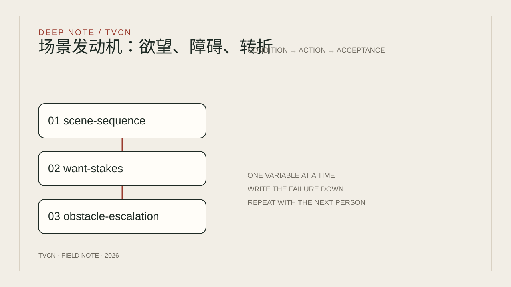

场景不是信息交换，而是一个人想要东西、被挡住、被迫改变。 单看《场景序列：三场戏推一个变化》只能解决一个局部；把《场景序列：三场戏推一个变化》《欲望与赌注：输了会失去什么》《障碍升级：同一堵墙越收越紧》接成一条链，才会暴露“条件没写、变量太多、结果无法复现”的真问题。

<!-- DEEP_DIVE_START -->
<!-- DIAGRAM_START -->
<h2>图解</h2>
<figure>
  
  <figcaption>看“场景序列：三场戏推一个变化”和“欲望与赌注：输了会失去什么”两处，先定条件，再看失败能不能被记录下来。</figcaption>
</figure>
<!-- DIAGRAM_END -->

<section><h2 id="section-1">问题</h2>
这一页的问题不是“方法不够多”，而是三个环节各自成立、合起来却不成立：条件没写、变量太多、结果不能复现。

本页按“先定条件—再做判断—只改一个变量—留下证据”的顺序；每一步都能被下一个人复述，才算完成。
</section>
<section><h2 id="section-2">判断</h2><ul><li>《场景序列：三场戏推一个变化》的第一道门槛：三场各有一个变化，能用“从什么变成什么”说清</li><li>《欲望与赌注：输了会失去什么》的第二道门槛：每场结尾都改变了下一场的条件</li><li>《障碍升级：同一堵墙越收越紧》的第三道门槛：删掉任意一场，段落会断，而不是只少一点热闹</li></ul>
三条里有一条不成立，就先回到对应单页；不要用整条链掩盖一个没解决的单点。
</section>
<section><h2 id="section-3">做法</h2><ol><li>先写条件：把《场景序列：三场戏推一个变化》里“第一场提出目标，让观众知道人物要什么”落到一张三行表：素材、环境、验收。</li><li>再做一次最小动作：只按《场景序列：三场戏推一个变化》的步骤做 30 秒，不加入第二页的方法。</li><li>把《欲望与赌注：输了会失去什么》的步骤接上：第二场让目标受阻，条件变坏。</li><li>用《障碍升级：同一堵墙越收越紧》做对照：第三场逼出一个选择，并改变下一场的条件。</li><li>每改一次只动一个变量；其他条件写进记录，不靠记忆。</li><li>把失败也拍下来：失败版本和成功版本并排，才知道哪一步不能省。</li><li>让下一个人按记录复现一次；他做不出来，说明记录还不够。</li></ol></section>
<section><h2 id="section-4">现场案例</h2>
可复现实验（不是客户案例）：拿 30 秒素材，先按《场景序列：三场戏推一个变化》的“三场各有一个变化，能用“从什么变成什么”说清”做 A 版；再按《欲望与赌注：输了会失去什么》的“每场结尾都改变了下一场的条件”做 B 版；两版只允许一个变量不同。把两版并排看，记录《障碍升级：同一堵墙越收越紧》里最先崩的是哪一项：条件、动作还是验收。如果一次就成功，说明变量还不够多，再加一个现实限制重做。
</section>
<section><h2 id="section-5">失败表</h2>
<table class="data-table"><thead><tr><th>现象</th><th>原因</th><th>替换动作</th></tr></thead><tbody><tr><td>别让三场戏都在重复同一个信息；没有条件变化，段落推不动</td><td>条件没写清</td><td>回到第一页重写三行表</td></tr><tr><td>别用人物小传代替一场戏；观众看不到过去，只能看到现在</td><td>条件没写清</td><td>回到第一页重写三行表</td></tr><tr><td>别每次都换新障碍；不升级，压力就不会累积</td><td>条件没写清</td><td>回到第一页重写三行表</td></tr></tbody></table>
</section>
<section><h2 id="section-6">验收</h2><ul><li>三场各有一个变化，能用“从什么变成什么”说清。</li><li>每场结尾都改变了下一场的条件。</li><li>删掉任意一场，段落会断，而不是只少一点热闹。</li><li>每场只回答一个主问题</li><li>结尾处境和开头不同</li><li>第一场建立常态</li><li>第二场打破旧办法</li><li>第三场做出新选择</li><li>两格里都是可拍的名词和动作，没有“尊严”“安全感”这类抽象词。</li><li>想要的东西和失去的代价在同一场里发生，不靠旁白补充。</li></ul></section>
<section><h2 id="section-7">替代方案</h2><ul><li>只处理《场景序列：三场戏推一个变化》里的单点问题：回到<a href="https://story.tvcn.org/article/scene-sequence/">《场景序列：三场戏推一个变化》</a>，不要用整条链。</li><li>只比较两个动作：看<a href="https://story.tvcn.org/article/want-stakes/">《欲望与赌注：输了会失去什么》</a>，先不改第三页。</li><li>只做验收：看<a href="https://story.tvcn.org/article/obstacle-escalation/">《障碍升级：同一堵墙越收越紧》</a>，把判断表拿去做自测。</li></ul></section>

<!-- SOURCES_START -->
## 参考与延伸阅读

- [S42] [Pixar in a Box：叙事课程](https://www.khanacademy.org/partner-content/pixar) — 2026-11-26 访问。用于核对「问题」一节的术语/方法/规则（Pixar 叙事课程，不是项目报价）；不核对其中由本页经验得出的数字、型号与现场结论，也不替代测试。
- [S43] [BFI：国家档案馆](https://www.bfi.org.uk/bfi-national-archive) — 2026-11-26 访问。用于核对「判断」一节的术语/方法/规则（BFI 档案资料，不是发行规则）；不核对其中由本页经验得出的数字、型号与现场结论，也不替代测试。
<!-- SOURCES_END -->

