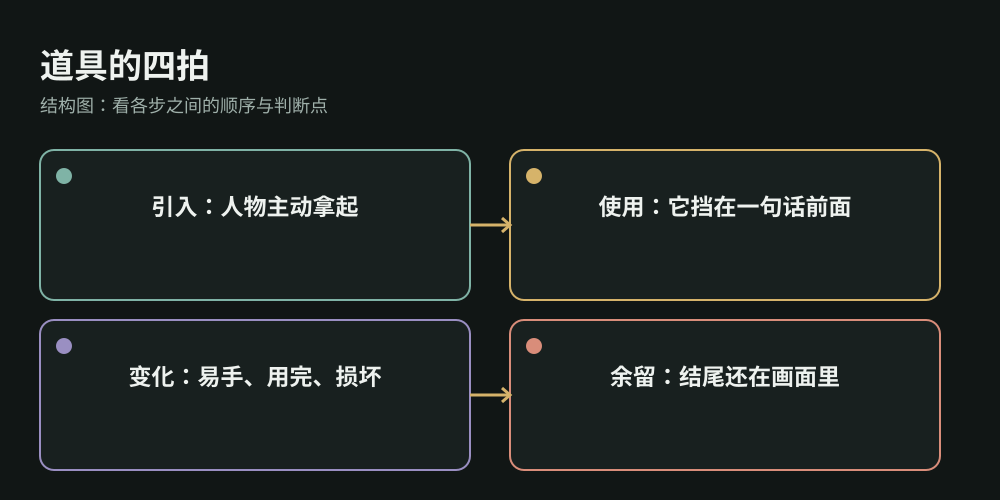

很多场景写不下去，是因为人物一直在说“我现在是什么感受”。把这句话拿走，给他一个能拿、能放、能递、能弄坏的东西，场景就有了身体。观众看不见心理，但看得见杯子从满到空。

<!-- DIAGRAM_START -->
<h2 id="diagram">图解</h2>
<figure class="diagram">
  
  <figcaption>看道具是否被主动使用、是否发生变化、结尾是否还在；只有被使用的道具才承担叙事，摆着的不算。</figcaption>
</figure>
<!-- DIAGRAM_END -->

<section><h2 id="section-1">现场</h2>
一场分手戏，两个人在厨房，台词写了三页：你为什么不再看我、我为你做了什么、我们能不能再试一次。导演排了两遍，演员越说越像辩论。第三遍，导演把一只还没洗的杯子放在两人中间，只给一个动作：一个人擦杯子，另一个人把杯子拿走。
</section>
<section><h2 id="section-2">判断</h2><ul><li><strong>人物主动使用：</strong>不是道具摆在那里，而是有人拿起、放下、递给对方，动作改变了对话的方向。</li><li><strong>道具发生变化：</strong>水洒了、杯子裂了、钥匙换了手；变化让观众看见关系已经不一样。</li><li><strong>结尾还在画面里：</strong>道具不需要被解释，但它留在桌上、口袋里或门口，观众自己会接。</li></ul></section>
<section><h2 id="section-3">怎么做</h2><ol><li>删掉一句解释，选一个和这句解释有关的日常物件：杯子、钥匙、药盒、快递单。</li><li>给道具一个起点：谁把它带进来，放在哪里，观众第一次看见它时它是什么状态。</li><li>让另一个人挡住一次使用：抢走、按住、不接；道具第一次被拒绝，关系就有了阻力。</li><li>让道具在场景中变化一次：倒空、弄坏、贴错标签、转手；变化要能被镜头看见，不靠台词。</li><li>结尾不解释，只留一个位置：道具最后在谁手边，谁没有伸手。</li></ol></section>
<section><h2 id="section-4">失败</h2><ul><li><strong>装饰道具：</strong>桌上摆了十个东西，没有一个被人使用；观众只看见美术，不看见人物。</li><li><strong>道具太多：</strong>杯子、手机、照片同时承担意义，观众不知道该看哪一个。</li><li><strong>让道具替演员演情绪：</strong>人物摔杯子，但摔完没有任何后续；动作变成情绪标点，不是叙事。</li></ul></section>
<section><h2 id="section-5">边界</h2>
不是每个场景都需要道具。两人对峙、纯语言交锋、动作片追逐，可能不需要一个中心物件。道具也不能替代对白的所有功能；它负责让观众看见关系变化，不负责交代背景信息。背景信息仍然要靠场景、服装、台词或前一场戏。
</section>
<section><h2 id="section-6">验收</h2><ul><li>道具被至少一个人主动使用，且使用改变了对话方向。</li><li>道具在场景中发生一次可见变化。</li><li>结尾道具仍在画面里，但没有被台词解释。</li><li>删掉的那句解释，观众能从动作复述出来。</li></ul></section>
<!-- DEEP_DIVE_START -->
## 深读

<strong>约 8 分钟。</strong> 下面把同一套判断放进两个不同条件，再看一个反例和一个可复用模型；不是重复前文，而是决定什么时候该换做法。

### 条件 A：亲密关系场景

亲密场景里，道具的作用是让两个人不必一直对视。一个人洗碗，另一个人靠在门边；说话的人背对，听的人看着手。道具给了他们不直视的理由，也给了观众一个可以观察的第三点。此时道具越日常越好：毛巾、碗、孩子的鞋。

不要给亲密场景一个“象征性”太强的道具，比如婚纱照或戒指；观众会先读符号，不读人物。日常物件的变化更小，但更可信：毛巾从干到湿，碗从干净到堆满。

### 条件 B：公共或职场场景

公共场景里，道具还要承担“空间权力”。谁坐在桌子的哪一头、谁拿到唯一的笔、谁的文件被推到地上，都是关系的可见地图。道具不需要被人物珍惜，反而要被使用、传递、占用；被占用得越自然，权力越清楚。

职场场景要小心“道具说明身份”：工牌、名牌、咖啡杯只能告诉观众职位，不能告诉观众关系。让道具进入一次冲突：签字笔被拿走、门禁卡刷不开、文件被错发，身份才会变成压力。

### 反例：杯子从头到尾没有变化

一个短片在桌上放了一只杯子，开场是满的，结尾还是满的；人物吵了五分钟，杯子没有被碰过。导演说“杯子代表家庭”，观众只看到一个道具没被使用。问题不是杯子选错，是它没有进入动作。

修法不是换一个更奇怪的杯子，而是给杯子一个最小的变化：有人喝一口、有人把冷茶倒掉、有人把杯子推到桌角。变化不需要大，只需要让观众知道这只杯子在这一场里“发生过”。

### 可复用模型

<strong>引入 → 使用 → 变化 → 余留。</strong> 引入要主动，使用要有阻力，变化要可见，余留不解释。四拍里少一拍，道具就退回背景。写场景时先问：如果把这个物件拿走，这场戏会失去什么？如果答案是“什么都没有”，它就不该在画面里。

道具的最高级用法不是象征，是交易：一个人用杯子换一句真话，另一个人用钥匙换一次离开。观众记住的不是“杯子代表什么”，而是“他用杯子做了什么”。

<!-- DEEP_DIVE_END -->
<!-- SOURCES_START -->
## 参考与延伸阅读

- [S42] [Khan Academy：Pixar in a Box](https://www.khanacademy.org/partner-content/pixar) — 2026-11-26 访问。用于核对“判断”一节的术语、方法或规则；不核对本页由经验得出的数字、型号与现场结论，也不替代测试或合同。
- [S41] [美国编剧工会：WGA 合同与署名资源](https://www.wga.org/) — 2026-11-26 访问。用于核对“边界”一节的术语、方法或规则；不核对本页由经验得出的数字、型号与现场结论，也不替代测试或合同。
<!-- SOURCES_END -->
