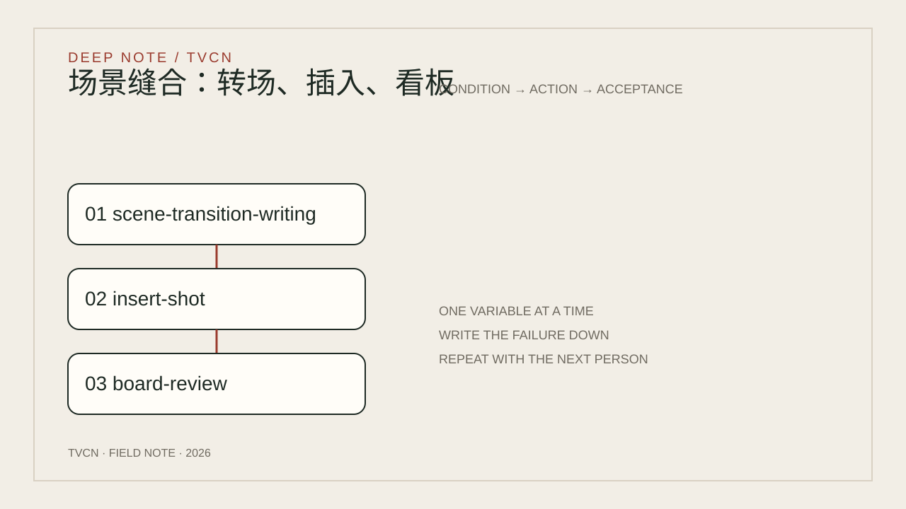

场景之间不是靠转场特效接上，而是靠一个未完成的动作和下一场的第一个信息。 单看《场与场之间：用动作接，不用字幕》只能解决一个局部；把《场与场之间：用动作接，不用字幕》《插入镜头：一个细节顶一句台词》《分镜评审：让摄影和剪辑先挑错》接成一条链，才会暴露“条件没写、变量太多、结果无法复现”的真问题。

<!-- DEEP_DIVE_START -->
<!-- DIAGRAM_START -->
<h2>图解</h2>
<figure>
  
  <figcaption>看“场与场之间：用动作接，不用字幕”和“插入镜头：一个细节顶一句台词”两处，先定条件，再看失败能不能被记录下来。</figcaption>
</figure>
<!-- DIAGRAM_END -->

<section><h2 id="section-1">问题</h2>
这一页的问题不是“方法不够多”，而是三个环节各自成立、合起来却不成立：条件没写、变量太多、结果不能复现。

本页按“先定条件—再做判断—只改一个变量—留下证据”的顺序；每一步都能被下一个人复述，才算完成。
</section>
<section><h2 id="section-2">判断</h2><ul><li>《场与场之间：用动作接，不用字幕》的第一道门槛：相邻两场至少有一个共同动作、物件或声音</li><li>《插入镜头：一个细节顶一句台词》的第二道门槛：时间跳跃不靠字幕卡也能看懂</li><li>《分镜评审：让摄影和剪辑先挑错》的第三道门槛：把字幕卡拿掉，观众仍能说出过了多久或到了哪里</li></ul>
三条里有一条不成立，就先回到对应单页；不要用整条链掩盖一个没解决的单点。
</section>
<section><h2 id="section-3">做法</h2><ol><li>先写条件：把《场与场之间：用动作接，不用字幕》里“找共同动作：上一场关门，下一场开门”落到一张三行表：素材、环境、验收。</li><li>再做一次最小动作：只按《场与场之间：用动作接，不用字幕》的步骤做 30 秒，不加入第二页的方法。</li><li>把《插入镜头：一个细节顶一句台词》的步骤接上：或找共同物件：上一场拿起杯子，下一场放下。</li><li>用《分镜评审：让摄影和剪辑先挑错》做对照：用声音先到或后到，把两个空间连起来，不用字幕卡。</li><li>每改一次只动一个变量；其他条件写进记录，不靠记忆。</li><li>把失败也拍下来：失败版本和成功版本并排，才知道哪一步不能省。</li><li>让下一个人按记录复现一次；他做不出来，说明记录还不够。</li></ol></section>
<section><h2 id="section-4">现场案例</h2>
可复现实验（不是客户案例）：拿 30 秒素材，先按《场与场之间：用动作接，不用字幕》的“相邻两场至少有一个共同动作、物件或声音”做 A 版；再按《插入镜头：一个细节顶一句台词》的“时间跳跃不靠字幕卡也能看懂”做 B 版；两版只允许一个变量不同。把两版并排看，记录《分镜评审：让摄影和剪辑先挑错》里最先崩的是哪一项：条件、动作还是验收。如果一次就成功，说明变量还不够多，再加一个现实限制重做。
</section>
<section><h2 id="section-5">失败表</h2>
<table class="data-table"><thead><tr><th>现象</th><th>原因</th><th>替换动作</th></tr></thead><tbody><tr><td>别用字幕卡解释时间；能用动作接，就不要写字</td><td>条件没写清</td><td>回到第一页重写三行表</td></tr><tr><td>别把插入镜头当装饰；它不交代信息，就该删</td><td>条件没写清</td><td>回到第一页重写三行表</td></tr><tr><td>别在评审会上全盘重画；一次改三格，才改得完</td><td>条件没写清</td><td>回到第一页重写三行表</td></tr></tbody></table>
</section>
<section><h2 id="section-6">验收</h2><ul><li>相邻两场至少有一个共同动作、物件或声音。</li><li>时间跳跃不靠字幕卡也能看懂。</li><li>把字幕卡拿掉，观众仍能说出过了多久或到了哪里。</li><li>插入镜头交代了一个具体信息，不只是好看。</li><li>时长在 1 到 2 秒，切在关键台词之前。</li><li>删掉插入后信息缺失，说明它真的顶掉了一句台词。</li><li>摄影和剪辑各带一张问题清单进场。</li><li>会议只改了三个格子，其他有记录。</li><li>改完三格后，机位和剪辑缺口有具体改善。</li><li>把 场与场之间：用动作接，不用字幕 的条件写成一行，能复述给下一个人。</li></ul></section>
<section><h2 id="section-7">替代方案</h2><ul><li>只处理《场与场之间：用动作接，不用字幕》里的单点问题：回到<a href="https://story.tvcn.org/article/scene-transition-writing/">《场与场之间：用动作接，不用字幕》</a>，不要用整条链。</li><li>只比较两个动作：看<a href="https://story.tvcn.org/article/insert-shot/">《插入镜头：一个细节顶一句台词》</a>，先不改第三页。</li><li>只做验收：看<a href="https://story.tvcn.org/article/board-review/">《分镜评审：让摄影和剪辑先挑错》</a>，把判断表拿去做自测。</li></ul></section>

<!-- SOURCES_START -->
## 参考与延伸阅读

- [S12] [Britannica](https://www.britannica.com/art/animation) — 2026-11-26 访问。用于核对首段“场景之间不是靠转场特效接上，而是靠一个未完成的动作和下一场的第一个信息。”中的术语与公开背景（动画原理、技术与产业史的百科条目）；不替代现场测试。
- [S41] [美国编剧工会：WGA 合同与署名资源](https://www.wga.org/) — 2026-11-26 访问。用于核对首段“场景之间不是靠转场特效接上，而是靠一个未完成的动作和下一场的第一个信息。”中的术语与公开背景（编剧合同、署名与最低报酬条款）；不替代现场测试。
- [S10] [BFI](https://www.bfi.org.uk/) — 2026-11-26 访问。用于核对首段“场景之间不是靠转场特效接上，而是靠一个未完成的动作和下一场的第一个信息。”中的术语与公开背景（英国电影协会的电影史、档案与观影研究入口）；不替代现场测试。
- [S42] [Khan Academy：Pixar in a Box](https://www.khanacademy.org/partner-content/pixar) — 2026-11-26 访问。用于核对首段“场景之间不是靠转场特效接上，而是靠一个未完成的动作和下一场的第一个信息。”中的术语与公开背景（故事结构、角色与视觉叙事教学）；不替代现场测试。
- [S16] [BBC 编辑准则](https://www.bbc.co.uk/editorialguidelines/) — 2026-11-26 访问。用于核对首段“场景之间不是靠转场特效接上，而是靠一个未完成的动作和下一场的第一个信息。”中的术语与公开背景（准确性、公正、隐私与隐蔽拍摄的编辑标准）；不替代现场测试。
<!-- SOURCES_END -->

