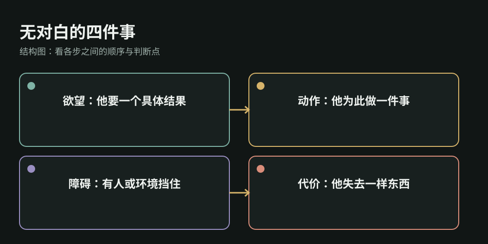

很多人一写无对白就加旁白，或者让演员用表情“演”情绪。真正的无对白不是没有声音，而是人物不说话也能让观众知道他要什么、谁挡着他、他付出了什么。声音还在，只是不由台词承担信息。

<!-- DIAGRAM_START -->
<h2 id="diagram">图解</h2>
<figure class="diagram">
  
  <figcaption>看画面里有没有“想要—动作—阻挡—代价”四件事；只靠表情和旁白的，不是无对白场景。</figcaption>
</figure>
<!-- DIAGRAM_END -->

<section><h2 id="section-1">现场</h2>
一条 2 分钟短片，主角是一个不会说当地语言的搬家工人。原稿写了 8 句旁白，解释他很孤独、想融入、想念家人。导演把旁白全删，只留三个动作：他把同事的饭盒放进冰箱、他在门口等一个不会来的电话、他把自己的名字写在纸箱上又擦掉。
</section>
<section><h2 id="section-2">判断</h2><ul><li><strong>观众能说出他要什么：</strong>不是“他很难过”，而是“他想让同事接受他/想接到家里的电话”。</li><li><strong>动作遇到阻力：</strong>饭盒被拿走、电话没响、名字被覆盖；没有阻力，动作只是流程。</li><li><strong>结尾有变化：</strong>他开始做什么，结尾不做什么；观众能看见一个决定，而不是一串动作。</li></ul></section>
<section><h2 id="section-3">怎么做</h2><ol><li>写一句“他想要什么”，必须是一个可拍的结果：进门、被留下、拿到东西、送到一封信。</li><li>把台词删到零，只保留动作句：他拿起、放下、等待、藏起、擦掉。</li><li>设一个空间障碍：门锁、柜台、语言、时间；障碍必须看得见，不能只写在人物心里。</li><li>用景别和视线替代解释：他看哪里，观众就看哪里；他不敢看的地方，就是信息。</li><li>最后拍一个“没有做成”的动作：手伸出去又收回、门开了一半又关上；变化留在动作里。</li></ol></section>
<section><h2 id="section-4">失败</h2><ul><li><strong>用字幕/旁白解释：</strong>画面已经演完，字幕再说一遍“他很孤独”，观众被重复告知，不再观察。</li><li><strong>动作重复：</strong>三次搬箱子、两次擦桌子，动作很多但没有一次改变关系。</li><li><strong>让表情代替行动：</strong>演员一直难过，但什么都不做；观众看见情绪，看不见选择。</li></ul></section>
<section><h2 id="section-5">边界</h2>
无对白不适合所有类型。信息密集的说明片、依赖语言机锋的喜剧、需要复杂前史的段落，仍然需要台词。无对白也不等于没有声音：环境音、脚步、门、呼吸都要补，否则观众会觉得“缺了一层”。
</section>
<section><h2 id="section-6">验收</h2><ul><li>一个陌生人看完能说出人物想要什么。</li><li>场景里至少有一个看得见的障碍，且人物尝试了两次。</li><li>结尾有一个动作变化，不是情绪总结。</li><li>关掉声音看一遍，信息仍然成立；打开声音，环境音补上了空间。</li></ul></section>
<!-- DEEP_DIVE_START -->
## 深读

<strong>约 8 分钟。</strong> 下面把同一套判断放进两个不同条件，再看一个反例和一个可复用模型；不是重复前文，而是决定什么时候该换做法。

### 条件 A：喜剧型无对白

喜剧型无对白靠“预期—落空”的节拍。人物很认真地做一件小事，观众先形成预期，再让环境或另一个人把预期打偏。动作要具体、可重复，第三次才变；前两次是建立规则，第三次是打破规则。不要靠摔跤和夸张表情，靠物件和空间。

喜剧的代价要小：丢面子、拿错袋子、坐错椅子；代价太大，观众会替人物紧张，不再笑。结尾通常回到开场动作，但关系已经反过来：一开始他推门，最后门推他。

### 条件 B：悲剧型无对白

悲剧型无对白靠“重复—失败—放弃”的节拍。人物一次次做同一个动作，每次只差一点；观众看见他越来越接近，也看见代价越来越大。关键不是让他哭，而是让他停下来：手停在门上，不再敲；电话拿起来，又放回去。

悲剧的结尾不要给解释，给一个“仍然在”的物件：没送出去的信、凉掉的饭、没关的灯。观众自己会把前面的动作接上。镜头可以停留，但不要推近脸；让空间承担情绪，比让演员哭更可靠。

### 反例：动作很忙，但没有变化

一个无对白段落拍了 40 秒：人物洗杯子、擦桌子、整理鞋、开窗、关窗。每个动作都清楚，但观众看完不知道他要什么。问题不是动作不够多，是动作之间没有同一个欲望；他在做家务，不在追求一个结果。

修法不是再加一个动作，而是先写一句“他想让谁留下”。然后删掉所有和这句话无关的动作，只留三个：把对方的鞋摆好、把门打开、把灯关掉。三个动作都指向同一个人，观众才会把它们连成一个故事。

### 可复用模型

<strong>欲望 → 动作 → 障碍 → 代价。</strong> 四件事都必须在画面里发生过，不能只写在导演阐述里。写完后做一次“关声音测试”：如果观众只看画面说不出这四件事，就回去改动作，不要加旁白。

无对白不是“没有台词”，是“台词的功能被动作接走”。动作接不走的信息，才留给声音：脚步告诉观众谁来了，门铃告诉观众谁在外面，呼吸告诉观众谁在忍着。

<!-- DEEP_DIVE_END -->
<!-- SOURCES_START -->
## 参考与延伸阅读

- [S42] [Khan Academy：Pixar in a Box](https://www.khanacademy.org/partner-content/pixar) — 2026-11-26 访问。用于核对“判断”一节的术语、方法或规则；不核对本页由经验得出的数字、型号与现场结论，也不替代测试或合同。
- [S16] [BBC 编辑准则：BBC 编辑准则](https://www.bbc.co.uk/editorialguidelines/) — 2026-11-26 访问。用于核对“边界”一节的术语、方法或规则；不核对本页由经验得出的数字、型号与现场结论，也不替代测试或合同。
<!-- SOURCES_END -->
