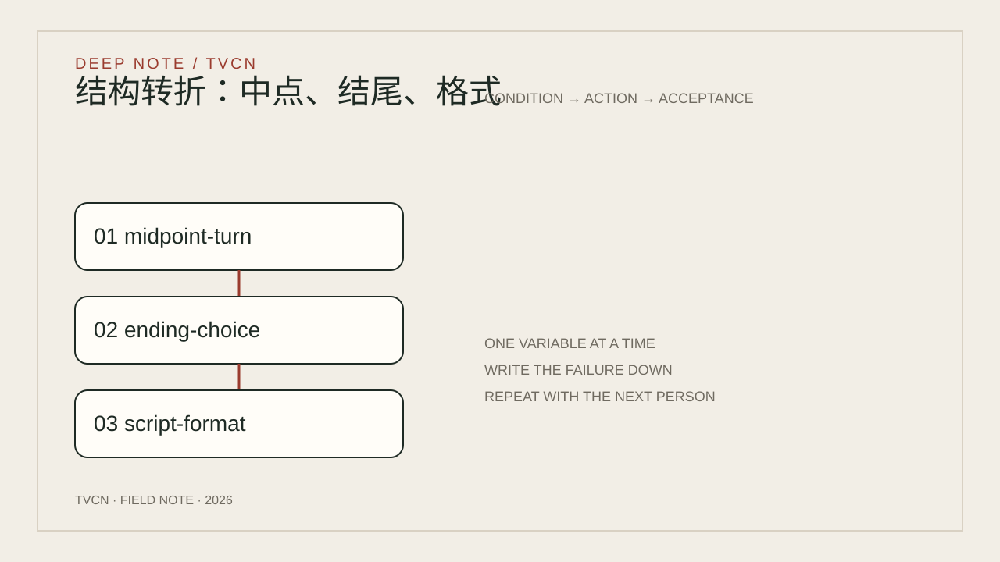

结构不是三幕模板，而是中点把方向翻一次、结尾把选择付一次代价。 单看《中点转向：换方法，不换目标》只能解决一个局部；把《中点转向：换方法，不换目标》《结尾：停在选择之后》《剧本格式：让全组读得懂》接成一条链，才会暴露“条件没写、变量太多、结果无法复现”的真问题。

<!-- DEEP_DIVE_START -->
<!-- DIAGRAM_START -->
<h2>图解</h2>
<figure>
  
  <figcaption>看“中点转向：换方法，不换目标”和“结尾：停在选择之后”两处，先定条件，再看失败能不能被记录下来。</figcaption>
</figure>
<!-- DIAGRAM_END -->

<section><h2 id="section-1">问题</h2>
这一页的问题不是“方法不够多”，而是三个环节各自成立、合起来却不成立：条件没写、变量太多、结果不能复现。

本页按“先定条件—再做判断—只改一个变量—留下证据”的顺序；每一步都能被下一个人复述，才算完成。
</section>
<section><h2 id="section-2">判断</h2><ul><li>《中点转向：换方法，不换目标》的第一道门槛：中点前后目标那一行完全一样，没有偷偷换目标</li><li>《结尾：停在选择之后》的第二道门槛：左右两栏各有三个可拍动作，方法差异看得见</li><li>《剧本格式：让全组读得懂》的第三道门槛：观众不看台词也能说出他换了什么办法</li></ul>
三条里有一条不成立，就先回到对应单页；不要用整条链掩盖一个没解决的单点。
</section>
<section><h2 id="section-3">做法</h2><ol><li>先写条件：把《中点转向：换方法，不换目标》里“写一张 A4：左栏旧办法，右栏新办法，目标那一行不变”落到一张三行表：素材、环境、验收。</li><li>再做一次最小动作：只按《中点转向：换方法，不换目标》的步骤做 30 秒，不加入第二页的方法。</li><li>把《结尾：停在选择之后》的步骤接上：两栏各写三个具体动作，能在画面上看出区别。</li><li>用《剧本格式：让全组读得懂》做对照：拍出来让观众看到方法换了，而不是只听他说“我变了”。</li><li>每改一次只动一个变量；其他条件写进记录，不靠记忆。</li><li>把失败也拍下来：失败版本和成功版本并排，才知道哪一步不能省。</li><li>让下一个人按记录复现一次；他做不出来，说明记录还不够。</li></ol></section>
<section><h2 id="section-4">现场案例</h2>
可复现实验（不是客户案例）：拿 30 秒素材，先按《中点转向：换方法，不换目标》的“中点前后目标那一行完全一样，没有偷偷换目标”做 A 版；再按《结尾：停在选择之后》的“左右两栏各有三个可拍动作，方法差异看得见”做 B 版；两版只允许一个变量不同。把两版并排看，记录《剧本格式：让全组读得懂》里最先崩的是哪一项：条件、动作还是验收。如果一次就成功，说明变量还不够多，再加一个现实限制重做。
</section>
<section><h2 id="section-5">失败表</h2>
<table class="data-table"><thead><tr><th>现象</th><th>原因</th><th>替换动作</th></tr></thead><tbody><tr><td>别把中点写成反转；目标没变，方法变了，才叫转向</td><td>条件没写清</td><td>回到第一页重写三行表</td></tr><tr><td>别在结尾加解释；解释一多，选择就没有余味</td><td>条件没写清</td><td>回到第一页重写三行表</td></tr><tr><td>别把剧本写成小说；全组找不到场号和声音提示，现场就会漏</td><td>条件没写清</td><td>回到第一页重写三行表</td></tr></tbody></table>
</section>
<section><h2 id="section-6">验收</h2><ul><li>中点前后目标那一行完全一样，没有偷偷换目标。</li><li>左右两栏各有三个可拍动作，方法差异看得见。</li><li>观众不看台词也能说出他换了什么办法。</li><li>中点换的是方法不是目标</li><li>前半段的方法先有效</li><li>中点证明旧方法失效</li><li>新方法有学习成本</li><li>代价能拍出来</li><li>最后一个镜头是选择后的动作，没有解释性旁白。</li><li>观众能说出人物选了什么、放弃了什么。</li></ul></section>
<section><h2 id="section-7">替代方案</h2><ul><li>只处理《中点转向：换方法，不换目标》里的单点问题：回到<a href="https://story.tvcn.org/article/midpoint-turn/">《中点转向：换方法，不换目标》</a>，不要用整条链。</li><li>只比较两个动作：看<a href="https://story.tvcn.org/article/ending-choice/">《结尾：停在选择之后》</a>，先不改第三页。</li><li>只做验收：看<a href="https://story.tvcn.org/article/script-format/">《剧本格式：让全组读得懂》</a>，把判断表拿去做自测。</li></ul></section>

<!-- SOURCES_START -->
## 参考与延伸阅读

- [S42] [Pixar in a Box：叙事课程](https://www.khanacademy.org/partner-content/pixar) — 2026-11-26 访问。用于核对「问题」一节的术语/方法/规则（Pixar 叙事课程，不是项目报价）；不核对其中由本页经验得出的数字、型号与现场结论，也不替代测试。
- [S43] [BFI：国家档案馆](https://www.bfi.org.uk/bfi-national-archive) — 2026-11-26 访问。用于核对「判断」一节的术语/方法/规则（BFI 档案资料，不是发行规则）；不核对其中由本页经验得出的数字、型号与现场结论，也不替代测试。
<!-- SOURCES_END -->

