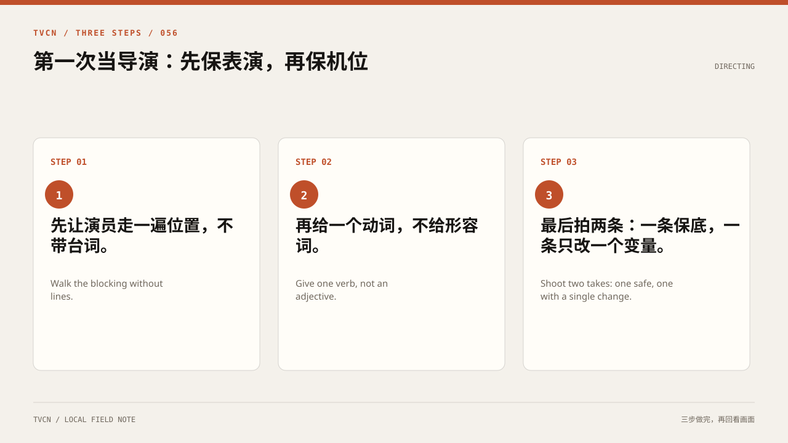

第一次当导演，先保住演员和一场戏，再想着多拍几个机位。

<!-- DIAGRAM_START -->
<h2>图解</h2>
<figure>
  
  <figcaption>把三步按顺序做完，再回看画面或文件。</figcaption>
</figure>
<!-- DIAGRAM_END -->
<h2>现场</h2>

开机第一天只排一场戏，先拍全景和两条近景；把灯光和机位简化，确保演员有完整的表演时间。

<h2>怎么做</h2>

第一次当导演，先保住演员和一场戏，再想着多拍几个机位。
<ol><li>开机第一天只排一场戏。</li><li>先拍全景和两条近景，保证有完整表演。</li><li>简化灯光和机位，给演员留出排练和重来的时间。</li></ol>
<h2>别踩</h2>

别第一天排十场；机位一多，演员就没有完整表演。

<h2>验收</h2>
<ul><li>第一天只有一场戏，演员有完整排练时间。</li><li>全景和两条近景都拍到，可用表演不止一条。</li><li>灯光和机位数量被压到能按时收工。</li></ul>
