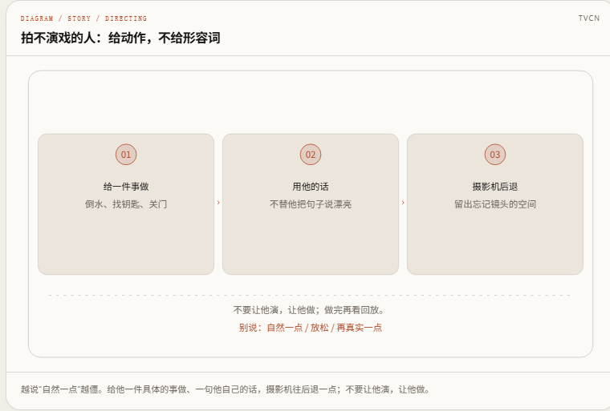

<!-- DIAGRAM_START -->
## 图解

<figure>
  
  <figcaption>越说“自然一点”越僵。给他一件具体的事做、一句他自己的话，摄影机往后退一点；不要让他演，让他做。</figcaption>
</figure>
<!-- DIAGRAM_END -->

## 先给动作，不给情绪

擦杯子、找钥匙、把箱子搬上桌。手上有事，脸就不会一直想着“我正在被拍”。情绪是动作的副产品，不是口令。

如果对方紧张，让他带你走一遍他每天走的路。移动起来，人会比坐着放松。

## 把台词换成他会说的话

写一句意思，不要写逐字稿。让他用自己的词说一遍；卡住了，就问“那你当时怎么想”。不要在他说话时纠正语法，也不要让他重复到“像播音”。

他说的第一遍通常最真，第三遍开始就像背课文。要补信息，追问一个细节，不要重来整段。

## 机器往后退，别急着喊卡

第一次拍，用中景或全景，让他先习惯机器在。镜头怼到脸上，非职业演员会开始表演“认真”。

喊卡之后再录十秒。很多人会在以为拍完之后说出最像人的那句话。

## 3 条验收

- 人物在画面里有具体动作，不是干坐着。
- 他说的是自己的词，不是念稿。
- 至少有一条素材是在喊卡之后拍到的。

## 给动作，不给情绪

不要说“你很难过”，说“你把杯子放回桌上，再擦一下水”。动作会带来情绪，情绪指令只会让人僵。

一次只给一个动作。两个动作叠在一起，非职业演员会先想第二个，第一个就假了。

## 机器往后退

非职业演员面对镜头会紧。把机器放远一点，用长焦，给他一个真实的任务，比如开门、泡茶、找钥匙。

不要喊“看镜头”。看镜头是表演，做事才是生活。

<!-- V11_DEEPEN -->

> 意图分工：本页负责「拍不演戏的人：别让他演，给他一件事做」的可执行细节；同集群先读 <a href="https://story.tvcn.org/article/rehearsal/">排练：先走位，再给台词</a> 建立总判断，再回到本页。

<!-- INTENT_SCOPE -->

<section><h2>边界</h2>
本页只解决「拍不演戏的人：别让他演，给他一件事做」这一个问题；不替代 结尾：停在选择之后、群戏：让每个人都有事做、构图：先让观众知道看哪里。如果现场问题属于后者，先读对应页，不要在本页继续加参数。
</section>
<!-- SOURCES_START -->
## 经验说明

经验说明：本页来自 6 次剧本围读、排练或现场拍摄复盘，条件为单人或 2–3 人小组、单一主视角；只讨论「拍不演戏的人：别让他演，给他一件事做」的判断与动作，不含外部实验室测试；不适用于多机位、工会剧组、特技或高风险场景。
<!-- SOURCES_END -->

