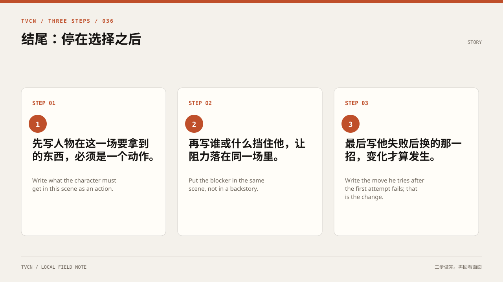

结尾不是把选择解释清楚，而是让观众看到选择带来的第一个后果。她留下，就拍她放下行李；她走，就拍门在身后关上。停在动作之后，观众自己补那句话。

<!-- DIAGRAM_START -->
<h2>图解</h2>
<figure>
  
  <figcaption>看“最后一个镜头拍选择后的动作：放下钥匙…”和“不要补旁白说明他为什么这样做”两处，判断人物想要的東西能不能用一个动作说出来。</figcaption>
</figure>
<!-- DIAGRAM_END -->
<section><h2 id="section-1">停在选择之后</h2>
最后 15 秒只留一个动作和一个反应镜头。不要加旁白总结，也不要再加第二个转折。
<h2 id="section-2">边界</h2>
开放式结尾不等于没结尾。观众必须能指出“她选了什么”，只是不告诉他“以后会怎样”。
</section><section><h2 id="section-3">现场</h2>
结尾最后一个镜头拍选择后的动作：放下钥匙、关上门、转身走。不要补旁白说明他为什么这样做。
</section><section><h2 id="section-4">怎么做</h2><ol><li>最后一个镜头拍选择后的动作：放下钥匙、关上门、转身走。</li><li>不要补旁白说明他为什么这样做。</li><li>试剪两个结尾，一个停手，一个多解释十秒，比较力量。</li></ol></section><section><h2 id="section-5">别踩</h2>
别在结尾加解释；解释一多，选择就没有余味。
</section><section><h2>判断</h2>
现场只认三个信号：
<ul><li>人物的目标能用一个动作说出来</li><li>障碍在同一场里升级，而不是换一个</li><li>删掉一句解释对白，冲突仍然成立</li></ul></section><section><h2>失败</h2>
下面三种做法会让页面上的细节白做：
<ul><li>人物想要什么没写清，场面只剩情绪</li><li>障碍靠巧合解决，人物没有做决定</li><li>对白把画面已经说明的事再说一遍</li></ul></section><section><h2>延伸</h2>
<strong>10 分钟练习：</strong>写一页 30 秒的场景，只保留“最后一个镜头拍选择后的动作：放下钥匙…”和“不要补旁白说明他为什么这样做”，删掉所有解释；请一个人读一遍，问他能不能复述人物想要什么。
</section>
<h2>验收</h2><ul><li>最后一个镜头是选择后的动作，没有解释性旁白。</li><li>观众能说出人物选了什么、放弃了什么。</li><li>加十秒解释的版本明显更弱，最终版停在动作上。</li></ul>

<!-- DEEP_DIVE_START -->
## 深读

<strong>约 5 分钟。</strong> 结尾不是把事说完，是让观众看见人物做完选择之后的代价。

### 停在选择之后

不要停在“他决定去”，要停在他去之后的第一个反应；选择要有重量。

观众要知道他选了什么、失去了什么、接下来要面对什么；三个问题答完，可以黑场。

如果最后一个镜头只是背影离开，观众记住的是姿势，不是代价。

### 闭合与开放

闭合结尾回答主问题，开放结尾留下新问题；两者都要让代价可见，不是故弄玄虚。

开放不是不回答，是把答案藏在一个动作里；观众离场后还能自己拼出来。

闭合也不是把所有事解释完；解释太多，观众没有参与感。

### 最后一个镜头

最后一个镜头拍选择的结果，不拍解释；观众离场时记住的是画面，不是台词。

如果最后一句台词在总结主题，删掉；让上一个动作或下一个空镜说话。

最后一个镜头要比前面安静一点；不是慢，是让观众有时间把代价咽下去。

### 最后一个画面不要解释

如果最后一个镜头是解释，换成结果：空椅子、没关的灯、桌上多出来的一副碗筷。

让观众自己算出代价；算出来的结论，比台词告诉他的更牢。

最后一个镜头不要加旁白总结；旁白一出现，画面就变成插图。

### 五分钟练习：三个结尾

给结尾写三个版本：回答、留白、反讽；每个版本只用一个镜头，选最疼的那个。

把三个版本读给没看过片的人听，问他们“他失去了什么”；答不出，结尾还停在决定，不在代价。

### 结尾检查，十项
<ul><li>停在选择之后</li><li>观众知道他选了什么</li><li>观众知道他失去了什么</li><li>最后一个镜头拍结果</li><li>不用台词总结主题</li><li>闭合结尾回答主问题</li><li>开放结尾留下新问题</li><li>答案藏在动作里</li><li>最后比前面安静</li><li>别人能说出他失去了什么</li></ul>
结尾不是把故事关掉，是让观众带着代价离场。

<!-- DEEP_DIVE_END -->
