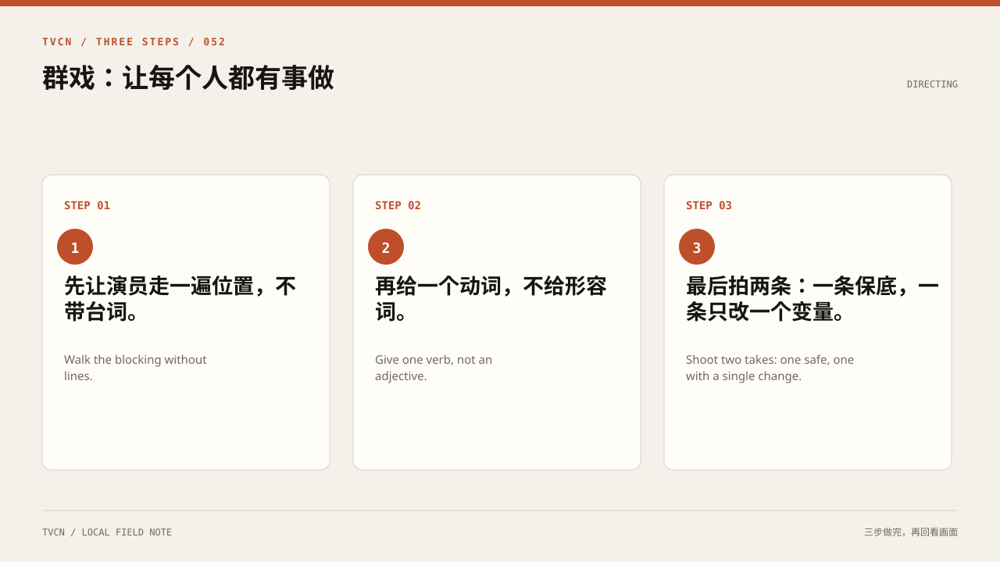

多人场景乱，通常不是因为人太多，而是因为权力关系不清。先画一张视线图：谁想说话、谁在阻止、谁在看戏。每个人的位置和视线都要能回答这三问。

<!-- DIAGRAM_START -->
<h2>图解</h2>
<figure>
  
  <figcaption>看“给每个人一个动作和一个目标：找钥匙、…”和“写满一页再开机，确保没有人在背景里空…”两处，判断人物想要的東西能不能用一个动作说出来。</figcaption>
</figure>
<!-- DIAGRAM_END -->
<section><h2 id="section-1">群戏先定“谁在看谁”</h2>
给每个人一个持续动作：倒水、收杯子、玩打火机。动作让群戏有层次，不需要每个人都发言。
<h2 id="section-2">边界</h2>
群戏不是平均分配台词。有人可以整场不说，但他的反应必须改变场上的压力。
</section><section><h2 id="section-3">现场</h2>
群戏给每个人一个动作和一个目标：有人在找钥匙，有人在躲电话，有人在等一个人。写满一页再开机。
</section><section><h2 id="section-4">怎么做</h2><ol><li>给每个人一个动作和一个目标：找钥匙、躲电话、等一个人。</li><li>写满一页再开机，确保没有人在背景里空站。</li><li>让动作互相干扰，关系才会出现。</li></ol></section><section><h2 id="section-5">别踩</h2>
别让群演站成一排等台词；背景一空，空间就假。
</section><section><h2>判断</h2>
现场只认三个信号：
<ul><li>人物的目标能用一个动作说出来</li><li>障碍在同一场里升级，而不是换一个</li><li>删掉一句解释对白，冲突仍然成立</li></ul></section><section><h2>失败</h2>
下面三种做法会让页面上的细节白做：
<ul><li>人物想要什么没写清，场面只剩情绪</li><li>障碍靠巧合解决，人物没有做决定</li><li>对白把画面已经说明的事再说一遍</li></ul></section><section><h2>延伸</h2>
<strong>10 分钟练习：</strong>写一页 30 秒的场景，只保留“给每个人一个动作和一个目标：找钥匙、…”和“写满一页再开机，确保没有人在背景里空…”，删掉所有解释；请一个人读一遍，问他能不能复述人物想要什么。
</section>
<h2>验收</h2><ul><li>画面里每个人都有动作和目标，没有空站的人。</li><li>至少两组动作互相干扰，关系在画面里出现。</li><li>删掉任意一个人的动作，空间会明显变空。</li></ul>
