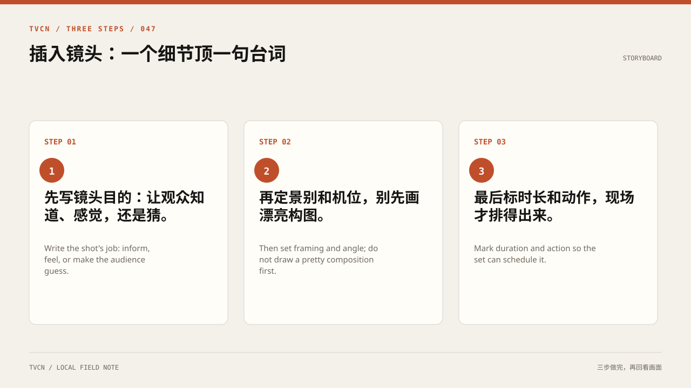

一个插入镜头能顶掉一句台词：手抖、杯沿、没关的门，都比解释有用。

<!-- DIAGRAM_START -->
<h2>图解</h2>
<figure>
  
  <figcaption>把三步按顺序做完，再回看画面或文件。</figcaption>
</figure>
<!-- DIAGRAM_END -->
<h2>现场</h2>

给每场戏列三个可拍细节：手指、杯沿、门缝。选一个在关键台词前切进去，时长 1 到 2 秒，别配解释。

<h2>怎么做</h2>

一个插入镜头能顶掉一句台词：手抖、杯沿、没关的门，都比解释有用。
<ol><li>给每场列三个可拍细节：手指、杯沿、门缝。</li><li>选一个在关键台词前切进去，时长 1 到 2 秒。</li><li>不要配解释，让细节自己说。</li></ol>
<h2>别踩</h2>

别把插入镜头当装饰；它不交代信息，就该删。

<h2>验收</h2>
<ul><li>插入镜头交代了一个具体信息，不只是好看。</li><li>时长在 1 到 2 秒，切在关键台词之前。</li><li>删掉插入后信息缺失，说明它真的顶掉了一句台词。</li></ul>
