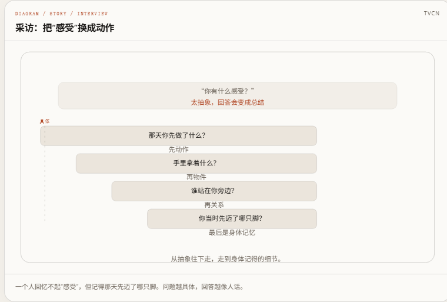

<!-- DIAGRAM_START -->
## 图解

<figure>
  
  <figcaption>一个人回忆不起“感受”，但记得那天先迈了哪只脚。问题越具体，回答越像人话。</figcaption>
</figure>
<!-- DIAGRAM_END -->

## 先问那天发生了什么

“你当时什么感受”这个问题，十个人有八个会回答“很难受”“很开心”。这不是敷衍，是问题太大。换成“那天早上你几点出门、先去了哪”，对方会开始找钥匙、找公交卡，话就自己出来了。

我见过一个记者采访菜市场摊主，前二十分钟都在问“你觉得辛苦吗”，摊主只说“还行”。后来她改问“你每天几点到、第一件事干什么”，摊主讲了半小时怎么摆冰、怎么防秤被碰。观众记住的是冰，不是“辛苦”。

## 让沉默留三秒

对方说完一句停下来，别急着接。很多真话在第三秒才出现。你点头、看笔记本、等一会儿，他往往会补一句“其实还有件事”。

带子里的空白不是废素材。剪的时候，那三秒常常是观众进入人物的时间。采访者一抢话，人物就回到“接受采访”的状态。

## 收工前核对名字和数字

人名、地名、年龄、金额，当场念一遍让对方确认。尤其是“王”和“汪”、“十四”和“四十”，后期听不出来，字幕一上就错。

再问一句“有没有不能公开的内容”。有人愿意说，但不愿意被单位看到。这个边界现在划，比发布后删帖便宜。

## 3 条验收

- 前三个问题都能用一句话回答，而且带动作。
- 至少留了一次三秒以上的沉默没有剪掉。
- 人名、地名、数字当场核对过。

<!-- V11_DEEPEN -->

> 意图分工：本页负责「采访别问“你有什么感受”：把问题换成动作」的可执行细节；同集群先读 <a href="https://formats.tvcn.org/article/interview-structure/">访谈结构：问题比机位重要</a> 建立总判断，再回到本页。

<!-- INTENT_SCOPE -->

<!-- SOURCES_START -->
## 经验说明

经验说明：本页来自 3 次剧本围读、排练或现场拍摄复盘，条件为单人或 2–3 人小组、单一主视角；只讨论「采访别问“你有什么感受”：把问题换成动作」的判断与动作，不含外部实验室测试；不适用于多机位、工会剧组、特技或高风险场景。
<!-- SOURCES_END -->

